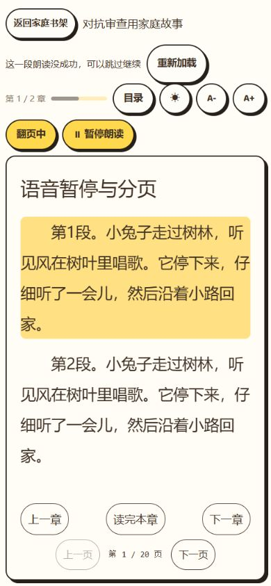
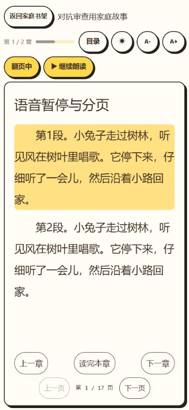
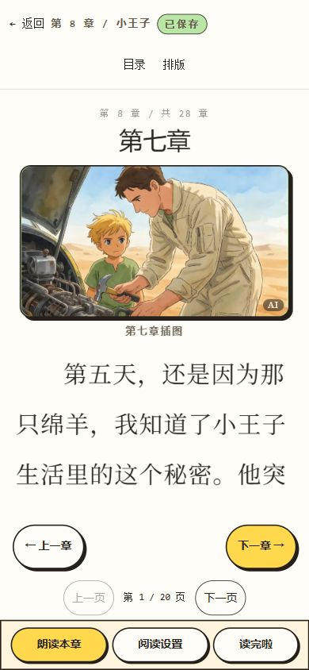

# 产品对抗式审查与修复（2026-10-11）

九部经典童书完成收录后，本轮针对儿童端实际阅读旅程、进度并发、语音生命周期、分页布局及搜索空态开展对抗审查，并修复下述八类问题。九部经典已有 243 个阅读单元、252 张配图、3648 个默认语音段；这些数量和媒体全量校验来自上一轮发布验收，本轮不重新导入正文、不重新生成媒体。

## 方法和证据边界

- 源码与自动测试：当前代码、实际失败再通过的回归、完整仓库验证；不把历史审计报告视为当前通过证据。
- 隔离浏览器：克隆数据库和媒体，在 9881/9882 本地服务体验儿童登录、换儿童、今天、找故事、详情和目录、公共阅读、家庭书架、我的分类、生词空态、阅读记忆。语音边界用可控 SSE 和假 Audio 注入，不消耗供应商额度、不写真实家庭。
- 布局：320×568、390×844、844×390、768×1024、1440×900；最大字号 30、宽松行距 2.1。公共和家庭分页均做双向鼠标拖动，文字 Range 的纵向边界、图片解码及页面横向溢出检查。
- 断网：浏览器网络层真实置离线，点击公共目录另一章，原章保留且出现网络错误提示；随后恢复网络。初次未命中的接口 mock 不计入通过证据。
- 权限负例等通过本轮 444 项服务端测试验证，不能据此声称所有家长功能均已逐个在浏览器点完。
- 浏览器不支持触摸事件注入，未做 Android/iOS/Safari 真机、读屏、复杂扫描 PDF 的导入及全文专业译审/全量人工听审。

## 八类问题与修复

| 问题 | 复现和影响 | 修复与验收 |
| --- | --- | --- |
| 公共进度短间隔覆盖 | 两台设备在 1.5 秒内基于同版本写不同位置，旧写可以覆盖新位置；原测试实际失败 | 版本严格相等、按版本原子条件更新、毫秒内版本递增。两个并发同版本写只有一笔成功，响应返回真实落库位置；首次建行冲突不会误报 500 |
| 公共阅读多入口竞态 | 进章、翻页、滚动、完成和 pagehide 分别写；退出请求缺版本，冲突仍冒充已保存/进入结算 | 单阅读器串行保存队列合并最新位置；所有请求带认证、版本和 keepalive；失败保留待保存位置。冲突停止补写，显示同步入口，完成必须保存成功 |
| 冲突同步回旧章 | 仅刷新旧 URL 会读到最新版本后再次写旧章，二次复验发现 | 同步读取服务器章号并导航服务器章；实际模拟服务器先写第 8 章，旧阅读器显示同步，点击后进入第 8 章且进度仍正确 |
| 家庭朗读暂停失效 | 首段结束、下一段未到时点暂停，新段到达/轮询会自行播放；修前截图及播放次数复现 | 保存等待段并冻结暂停状态；继续才播等待段，不重播已结束段。暂停后新段到达仍 plays=1，点击继续才增加；普通暂停继续仍能接下一段 |
| 旧语音流和结束边界 | 换章旧流的迟到 segment/error/done 可影响新会话；网络 reject 未捕获；缺失末段可能一直等待 | 按 controller 身份和 aborted 隔离回调，按播放尝试版本隔离旧结束/拒绝；连接错误可见。等待缺段时 onDone 立即顺延/收尾，最后专项回归确认恢复“朗读本章”且只播一次 |
| 家庭短章与回到开头不保存 | 不滚动的一页短章未保存新章号；offset=0 被忽略；换章旧排队写仍可能发出 | 进入章节保存一次且保留本章已有偏移；允许保存 0，旧 generation 任务在发出前取消。第二章无滚动后书架显示“读至第 2 章” |
| 分页插图挤占整页 | PC 第一页只剩标题和大空白，图注另占下一页；大图占满视口高度 | 公共/家庭图片按分页高度限制，标题/图注留空间，完整包含图片。最新 PC 和移动截图中标题、图片、图注及正文同页；小屏、横屏文字纵向未溢出，页面无横向溢出 |
| 搜索零结果无效按钮 | 不存在的关键词搜索后“帮我挑一本”仍可点但没反应 | 零结果禁用随机按钮，增加“看看全部故事”重置查询/筛选；实际点击恢复完整 275 本列表，空书单文案不再暗示年龄限制 |

## 验证结果

- `npm run verify`：触控审计、所有 workspace 类型检查、Lint、服务端 47 个文件/444 项、前端 15 个文件/115 项通过（共 559 项）。
- 最后搜索空态修改后重新运行 Lint、前端 115 项测试和 `npm run build -w @taoread/web`，均成功。最终入口为 `index-fZzHVzco.js`，V8 模块为 `V8App-D6_ufDIn.js`。
- 最后专项浏览器回归：短章书架位置、缺失末段流结束收尾、最新 PC 插图分页截图通过。
- 原有测试 fixture 的家庭归属残留导致重复执行 404，已改为 upsert 更新本次 familyId；并未改生产数据。
- 本轮原始日志和故障注入脚本在忽略的 `output/adversarial-20261011/`，不含在发布代码中。

## 视觉证据

修前家庭段间暂停：

修后家庭暂停不自行续播：

公共阅读器最终移动布局：

公共阅读器最终 PC 布局：

## 发布和回滚

本轮仅发布代码和前端静态资源，无 schema 迁移、不重跑经典 publisher。生产 `D:/taoread-prod`，服务 `taoread-api`，本机 8091，经现有 Tunnel 对外服务。

发布前在一致备份互斥锁内停服务并运行 quiescent 备份；代码仅 fast-forward 到指定提交。旧 hash 静态资源保留，新入口最后切换；重启服务在 finally 中执行。若失败，用本轮生产静态备份及发布前代码版本恢复，不能覆盖其他 agent 或用户后续改动。正文、配图、语音无需恢复或重生成。

发布后核对源站及公网健康、静态 SHA-256、九部目录/章节和缓存语音，记录实际发布版本。未刷新旧客户端仍保留向后兼容的无版本写入口，最新版阅读器具备本轮新保护；用户应刷新页面使用最新版。

## 实际发布证据

- 修复提交：`ee71cd1fbd5caa0fb2a1a19ab0f31887c7d6a408`，已推送 GitHub main；生产已 fast-forward 到该版本，服务重新启动为 Running，生产 tracked 文件无修改。
- 一致备份：`db/backup-2026-10-11T09-59-10-686Z.db`，17,096,704 字节；252 个新原图归档上传，0 失败，清单共 5255 文件；3818 项数据库原图引用核验通过。备份包含原图，音频/视频/变体明确排除；513 项历史原图台账字节差异沿用归档真实 SHA-256/字节，不声称台账已修复。
- 新入口 SHA-256：`24624cb2ade2e02b35db3d4c30f80b93b420240130690004da7f7c8c54ca0786`。源站和公网返回的 index 及 `index-fZzHVzco.js` 均与安装构建字节一致，API 健康检查通过。
- 源站、公网分别检查九部书目录与全部 243 单元的标题/正文/插图信息，均一致；每部首末单元分别做缓存语音请求，两端合计 36 次，段数完整、无 error、全部 cached 且使用媒体 CDN。未重新做上一轮 4404 媒体对象全量哈希核验；本轮代码发布前后语音索引 SHA-256 相同。
- 验收详情：`output/adversarial-20261011/production-verification.json`；日志：`deploy.log`、`production-verify.log`。临时隔离服务已关闭，无修改其他开发实例。
- 发布后的生产浏览器补验因 CUA 连接超时未完成，不计入视觉通过证据；本文截图为发布前隔离浏览器的同一最终源码，线上确认来自实际源站/公网响应与静态资源哈希。
- 此后仅补充本报告的文档提交，生产同步文档，无新业务代码、无需再次重启或构建。
