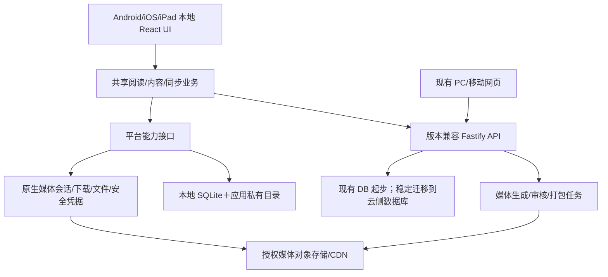

# 桃阅读独立应用：产品、技术、上线与执行方案

编制日期：2026-10-11。方案基线：`d3fd246f596e6ee8355d7d20c838bb0d9e5756a1`。

用户已确认：**Android＋iPhone／iPad 首发，主要服务中国大陆家庭；PC 网页继续提供。** 本文件是开发前方案，本次没有修改业务代码、数据库、域名、服务或部署。预算、周期和性能数值为规划估算/验收目标，不能当作已经达到的结果。

## 1. 建议决策

推荐先实施 **现有 React＋Capacitor 原生容器＋原生音频／文件／安全存储能力＋现有 Fastify 服务端**。Web UI 作为安装包内的本地资源运行，读书和家庭业务继续共享服务端。应用打开不依赖先加载线上首页，公共下载书在断网时也能读图、听音和保存位置。

在开始全面迁移前，安排 **7—10 个工作日技术验证**。用 Android 真机、iPhone 真机、iPad 分别验证阅读分页、长章内存、离线下载和原生后台播放。若核心目标无法达到，停止扩展 Capacitor 阅读器，转为 React Native 原生界面方案；复用内容协议、服务端和独立业务逻辑，不承诺 React DOM/CSS 可以直接变为原生组件。

正式版必须具有以下独立应用价值：

1. 正文、配图、默认朗读可选择下载；下载完整性可验证，过程可暂停、恢复和取消。
2. 原生后台听书、锁屏控制、耳机控制、定时停止；后台队列不依赖 WebView 的 JavaScript 继续运行。
3. 阅读位置本地事务保存、离线可靠记录、联网冲突可解释，不让较旧设备覆盖新位置。
4. 原生文件选择、系统分享、安全区与返回手势、进程重启恢复和安全凭据存储。
5. 明确的儿童/家长身份边界、监护人同意、设备撤销和注销清理。

先完成可安装的受控测试版，再进入商店发行。**测试包能运行不等于具备公开发行条件，技术工期不等于审核/备案时间。**

### 1.1 首发定位

产品定位：面向家庭的儿童阅读与共读应用，兼顾孩子自主读、家长陪伴读、睡前听。核心价值是完整故事、稳定阅读和留下家庭阅读记忆。

延续当前选择：公共书不按儿童档案年龄隐藏；年龄/阅读难度用于建议，家长屏蔽、地域权利、发布状态仍生效。全年龄可见不意味着任意内容都可加入儿童产品。

首发维持免费基础产品；不在儿童端加入广告、积分商城、排行榜、购买引导和营销推送。付费会员、商业授权和购买恢复在业务模式另行确定后规划，不把支付接入塞入本期关键路径。

### 1.2 发布路线

| 阶段 | 用户拿到什么 | 发布出口 |
| --- | --- | --- |
| 技术验证包 | 三端核心技术演示，不替代线上产品 | Android 调试包；受控 iOS/iPad 测试设备 |
| 家庭测试版 | 完整读/听/下载/续读/家庭流程 | Android 签名测试包；TestFlight 等合适测试渠道 |
| 中国大陆正式版 | 通过内容、隐私、性能和运营门槛 | App Store 中国大陆；分批选择国内 Android 商店 |
| 后续版本 | 大规模内容运营、可选高级能力 | 通过相同质量门发布更新 |

首批 Android 商店建议选择 1—2 个渠道完成闭环，再适配其余渠道；具体根据主体资格、可覆盖设备和提交要求确定。Google Play 是未来海外渠道，不能代替大陆主要分发渠道。HarmonyOS NEXT 原生应用不属于 Android APK 的自动覆盖范围，另立适配项目。

## 2. 当前产品事实和迁移差距

### 2.1 证据分类

- **本次源码确认**：直接读取当前实现，下表列出入口。
- **已有发布验收**：docs/45、docs/46 及其运行产物，代表对应发布时点，不替代本次新 App 真机验收。
- **待验证**：原生兼容、国内移动网络、商店资格、备案材料和未完成的内容人工审校。

| 领域 | 当前事实与证据入口 | 对 App 的影响 |
| --- | --- | --- |
| 技术栈 | `apps/web/package.json`、`apps/server/package.json`：React 18、Vite 5、TypeScript、Zustand；Fastify、Prisma 5、SQLite | 可以复用大量页面/业务；当前没有 Android/iOS 原生工程，不能直接产生正式安装包 |
| PWA | `public/manifest.webmanifest`、`main.tsx:58`、`public/sw.js`：standalone manifest、静态资源缓存 | 可以安装到主屏，但不是商店 App 的全部能力；原生版应使用安装包资源、独立启动/更新流程 |
| 离线 | `lib/offline.ts`：IndexedDB，最多 5 本/单本 5 MB/100 章以内/7 天，只保存公共文字，不含图片、音频、家庭书或进度 | 完整图文有声下载与可靠离线同步需要新设计；原生首次启动断网不能依赖网络首页 |
| 路由 | `App.tsx:60`：离线首页跳独立文字离线页；`main.tsx` 用 BrowserRouter | 原生路由必须处理本地壳、深链接、恢复和原生返回；不能直接沿用网页离线分支作为最终方案 |
| 公共阅读 | `ReaderPage.tsx`、`pagedReading.ts`：多列分页、手势、块定位、插图、排版、TTS 和进度 | 复用渲染，但需验证 WKWebView/Android WebView 字体、布局和手势；页码不是跨设备稳定位置 |
| 家庭阅读 | `FamilyTrialPages.tsx`：独立正文坐标与分段音频，版本进度 | 与公共阅读共享平台能力/播放器，但保留内容类型差异，避免一次大改两套阅读器造成回归 |
| 音频 | `lib/audioPlayer.ts`：HTML Audio＋MediaSession；家庭阅读器也直接使用 Audio/SSE | 有网页播放基础，仍不足以证明锁屏后台可靠；需要原生持久队列与系统媒体会话 |
| 凭据 | `stores/session.ts`：令牌等持久化到 localStorage；`lib/auth.ts:27` 默认令牌 30 天 | 原生应用需 Keychain/Keystore、短期令牌和刷新/撤销策略；浏览器存储不能直接视为安全存储 |
| 家长角色 | `modules/family/routes.ts` 和 `service.ts:147`：家庭码加入，角色由请求选择；parentCode 不再校验 | 这是现有产品选择，但公开儿童应用不能把“点家长按钮”当监护人验证；需要独立身份与迁移 |
| 家庭媒体 | `modules/media/access.ts`：家庭/会话/路径绑定票据，分桶有效 30—60 分钟 | 正确使用现行源码，不能沿用旧报告的 5 分钟说法；缓存票据不是永久下载权，原生需续签/下载授权 |
| 数据模型 | `schema.prisma`：Book/Chapter/Block、公共与家庭进度、DeviceSession、收藏、划线、生词、权利台账 | 可以兼容演进；尚无 App 离线事件幂等账本、稳定音频清单和刷新令牌模型 |
| 媒体地址 | `api.ts:5` 可配置 API 基址；`publicMedia.ts` 未配置 CDN 时返回 `/api/media/…` | 原生本地 origin 下相对路径可能失效；API、媒体、字体、导入图、分享文件需统一解析和域名白名单 |
| 安全头/跨域 | `app.ts:107,124`：CSP 为 report-only，CORS 由配置提供 | 需专门验证原生 origin；CORS 不是鉴权，也不能通过任意放开或禁用证书来解决兼容 |
| 内容范围 | docs/45：九部经典、243 单元、252 图、3648 默认语音段完成发布；docs/46：本轮进度/朗读等八类修复 | 这些内容可做技术验证代表样本；全量媒体完备不等于专业人工译审/听审完成 |
| 生产 | 本次读到生产 HEAD 与基线一致、`taoread-api` Running；现有 Windows 常开主机/SQLite/Tunnel/CDN 体系 | 可供受控验证；公开发行应评估大陆网络、机房/运维和备案条件，不把桌面电脑当最终容量保障 |

本次 PATH 探测找到 Node 和 JDK 17，未找到 adb/gradle；不代表 Android Studio/SDK 一定未安装，但原生构建工具链尚未验收。Windows 可承担 Android 开发；iOS 构建与实机调试需要合适的 macOS/Xcode 环境，不能以“云构建能出包”替代 iPhone/iPad 调试。

README 和 schema 中部分历史注释与现有实现不完全一致，例如家庭码权限、旧测试数量、“不分发正文”的历史文案。App 开发前更新产品文档，使公开承诺与实际行为一致；本次不顺带修改这些文件。

### 2.2 现有媒体体积：下载设计依据

读取九部经典上次发布的 `release-media-manifest.json` 得到：

| 资源 | 数量 | 字节数 | 约占用 |
| --- | --- | --- | --- |
| 默认朗读 MP3 | 3648 | 2,469,788,482 | 2.30 GiB |
| reader 图 | 252 | 18,193,874 | 17.35 MiB |
| 缩略图 | 252 | 4,281,396 | 4.08 MiB |
| 原图 | 252 | 85,622,704 | 81.66 MiB |

这是上次发布清单数据，本次没有重新下载全部媒体。结论：**App 不随包携带全部书库，默认不下载原图，也不预下载所有音色**。图片可较轻，长篇音频才是容量/网络成本重点。九部平均值不能用于判断某一本实际大小，下载前必须展示该书清单精确字节数。

## 3. 首发产品范围与优先级

### 3.1 V1.0 必须交付

| 模块 | 儿童/家长得到的结果 | 首发边界 |
| --- | --- | --- |
| 首次使用 | 家长了解隐私，建立家庭与孩子昵称，选择角色后进入阅读 | 不要求儿童手机号/实名/精确生日；预置少量权利明确、人工核验的体验书可不登录试读 |
| 今天 | 一键继续上次故事，少量适合的推荐 | 保留孩子选择权，不无限自动播放/无限流推荐 |
| 找故事 | 搜索中文/英文、分类/主题、目录与完整性信息 | 全年龄可见策略保持；不可用、下架、媒体未准备好状态清楚 |
| 阅读器 | 公共及家庭书统一基础体验，滑动/按钮翻页、滚动、拼音/字号/主题、目录/书签 | 两类内容都纳入验收；横竖屏、iPad 分屏重排不能掉位置 |
| 听书 | 默认语音、段/章导航、锁屏继续、耳机、速度、睡眠定时 | 先保障默认已审音色；其他音色在线可选，下载需显式选择 |
| 下载 | 正文＋reader 图；可加默认音频；按书/章选择 | 显示大小、完整度和预计范围；不声称未下载语音可离线听 |
| 我的 | 正在读、喜欢、读完、生词、阅读记忆；本机下载入口 | 归属按家庭/孩子；共享设备换人不混记录 |
| 共读 | 纸书记录、共读收尾、金句/回忆、家长讨论提示 | “听完/翻到末章”和“已读完”分开；不冒充能力测评 |
| 家庭书架 | 家长通过系统文件选择导入，家庭内阅读 | TXT/可提取文字 EPUB/PDF；复杂/扫描 PDF 明确不保证，首发不做 OCR/DRM 绕过 |
| 家长管理 | 孩子/设备、屏蔽内容、时间提醒、导入、反馈、导出/注销 | 高敏感操作需要家长验证，离线只能执行事先允许的管理功能 |
| 稳定性 | 弱网、断网、锁屏、杀进程、升级后能恢复 | 安全失败与离线不可用有可理解提示，不空白、不静默丢进度 |

**内容发行门**：凡列入 App 正式发行范围的图书，必须有完整正文、准确精选/全译标识、封面/章节配图和默认语音，并有对应地域权利与内容审查记录。现有全书库先做清单式核验；九部经典的已验媒体可以复用，其余不能未经逐书核验就标记齐全。应用不能用年龄隐藏未迁移书，也不能让“媒体待补”伪装成“已完整可下载”。

测试阶段可先选择 20—40 本代表内容降低验证成本；这不是正式书库数量上限，也不等于其他已开放书被取消。全量内容核验/补齐是独立排期，可能长于客户端开发。

### 3.2 V1.1 适合后续交付

- 家长选择开启的本地共读提醒、词汇搜索增强、下载管理更精细、完整导入预览和批量纠错。
- 系统级朗读作为明确标注的可选兜底；音色、语言、是否需要联网须实际探测，不冒充审核过的服务端音频。
- 自然拼读完成教师/音素语音审校后再作为正式学习模块。当前保留为默认关闭草稿，不因有 App 就宣称完整课程。
- Passkey、更多登录恢复方式、家庭邀请流程优化；不新增儿童身份采集。

### 3.3 暂不纳入首发关键路径

实时儿童 AI 聊天、自动生成给孩子看的内容、儿童声音克隆、视频批量生成、社交/公开评论、广告/成长排行榜、商业支付、OCR 扫描书、完整专业 EPUB 排版、桌面独立客户端和 HarmonyOS NEXT。它们分别增加内容治理、费用、原生或审核成本，需独立需求与验收。

微信读书作为家长可选外部连接保留评估，不应成为 App 阅读公共书/家庭书的必要依赖。第三方网关合法授权和商店适用性需核对，不能把已有连接认作获取第三方全文再分发的权限。

## 4. 信息架构与关键旅程

### 4.1 单一安装包，两种受控模式

儿童底部主导航维持三个入口：**今天、找故事、我的**。“我的”内设置明显的“下载的书”，家庭书架在今天/我的均可达。避免用五六个入口分散孩子注意力。阅读器进入沉浸模式，底部提供读/听主动作及二级排版/目录入口。

家长区域独立入口并验证，主要包括：孩子与设备、家庭书架/导入、共读与周报、内容/屏蔽、下载空间、设置/隐私/反馈。外链、分享、导出、账号删除和后续支付放在家长区域。


### 4.2 必须设计的完整旅程

| 旅程 | 正常过程 | 异常/恢复验收 |
| --- | --- | --- |
| 新家庭第一次使用 | 家长查看政策/同意→建立监护人账号→昵称/年龄段→选择孩子→读体验书 | 拒绝非必要权限仍可读；取消注册不产生半个家庭；验证码超时可恢复 |
| 已有家庭迁入 | 家长账户关联既有家庭→核对孩子和数据→旧设备更新 | 不能凭家庭码直接抢占家庭；无法证明归属时进入人工核验，原数据不被覆盖 |
| 出门离线阅读 | 联网选书→图文/音频下载→显示完成→飞行模式→继续读/听 | 未下载章明确提示；进程被杀后仍可读；回网只补必要数据，不重新下整本 |
| 连续听书 | 用户点击播放→后台/锁屏→下一段/章→定时停 | 来电/耳机断开/其他音频打断按系统规则暂停；结束后不擅自抢音频焦点 |
| 多设备续读 | A 离线记录→B 在线已读新位置→A 回网 | 自动合并可证明无冲突的事件；位置冲突提示继续哪次阅读，不取最大章号/手机时间 |
| 家庭导入 | 家长文件选择→类型/大小检查→解析预览→确认→家庭书架 | 扫描 PDF/损坏 EPUB/无正文给解释；重复文件不重复建书；取消不残留临时文件 |
| 换孩子/换家庭 | 当前阅读先事务保存→停止原音频→切 scope→加载目标书架 | 不播放前一孩子音频，不显示前一家庭私有下载、不发送旧家庭待同步事件 |
| 删除孩子/注销家庭 | 家长再次验证→确认范围→服务器撤销/删除→本机清理 | 无网不能假装完成云删除；在线设备收到 tombstone；离线设备下次联网清理，备份按既定保留策略处理 |
| 应用升级 | 保存队列→安装新版本→执行本地迁移→恢复阅读 | 下载文件不随 schema 升级丢失；迁移失败进入可恢复状态；不强迫读到一半时更新 |

### 4.3 视觉、交互与无障碍

- 延续纸张/贴纸/桃子品牌，先统一阅读和控件规范；不照搬旧夜空设计系统，也不为“像 App”重做整套品牌。
- 儿童主要触达区域建议 48—56 dp/pt；关键控件最低 44 pt（iOS）/48 dp（Android），实际布局按平台校准，不能将 CSS px 当物理单位。
- 系统安全区、Android edge-to-edge、iPhone 刘海/底部手势区、键盘避让均以原生真实设备验证。上一个弹层关闭后恢复焦点，返回优先关闭弹层。
- 大字号、宽松行距、中英混排、长英文词、拼音、长图、图注、空章均有明确布局策略；iPad 默认可单页，双页是可选样式且需专项验收。
- 分页页码是“当前排版下本章第几页”；不宣称固定纸书页数。改变字号/旋转后保持内容锚点，不保持不可靠的页号。
- 支持系统减弱动态效果/字体缩放、VoiceOver/TalkBack、可达目录/听书按钮、对比度和可理解状态。夜间主题只描述显示效果，不宣称医学护眼功效。
- “已保存”区分本机和云同步；“已下载”区分图文与音频；“读完”需要明确用户动作。低空间/弱网提示由家长可处理，儿童端不展示技术错误码。

## 5. 技术路线比较与决策门

| 路线 | 可复用程度 | 原生能力/维护 | 主要风险 | 结论 |
| --- | --- | --- | --- | --- |
| 继续 PWA | 现有页面与服务几乎直接沿用 | 最省资源，浏览器后台/分发受限制 | 完整有声离线、后台可靠性与商店发行目标仍未解决 | 保留网页入口；不作为这次独立 App 唯一路线 |
| React＋Capacitor | 可复用现有 DOM 阅读器、页面和 TS 业务 | 原生插件补音频/下载/安全存储；仍需双平台实机维护 | WebView 分页、JS 挂起、插件成熟度、平台默认行为 | **优先技术验证，通过后作为 V1.0** |
| React Native | 服务端/协议/纯 TS 逻辑可复用；页面和 CSS 重写 | 原生界面与生态，后台播放器仍要专项集成 | 新阅读器开发、跨平台文本测量、双端回归；不能视为零迁移 | Capacitor 核心门失败时首选替代 |
| Flutter | 服务端/内容协议复用，主要前端用 Dart 重写 | 统一渲染，仍需平台通道 | 团队栈改变、阅读组件/排版全部重建 | 团队具备 Flutter 经验且愿意重建时考虑 |
| Swift/SwiftUI＋Kotlin/Compose | 复用服务端和数据协议 | 平台控制最强，两个客户端长期维护 | 人力、版本一致和测试成本最高 | 有稳定双原生团队和长期预算后考虑 |

本地包中的 WebView 并非技术上不合格；商店审查关注实际功能、体验和政策符合程度。完整离线、后台音频等有助于形成独立应用价值，但**不保证一定过审**。

### 5.1 7—10 个工作日技术验证的输出

样本必须包含：中文短绘本、九部中的中文长章/长书、中英混排/拼音、家庭导入书、图文/语音缺失负例。设备必须包括至少两种 Android（含国产 ROM）、iPhone、iPad；模拟器用于辅助。

| 关口 | 必须得到的证据 | 不通过时怎么办 |
| --- | --- | --- |
| 真触摸分页 | 每种设备连续正反 200 次、章界/目录/旋转/字号变更，文字和图片无裁切、额外空页和位置跳变 | 定位 CSS/手势问题；同一原因两轮修复仍不能满足，评估替换阅读渲染层/RN |
| 后台播放 | 缓存语音锁屏连续 30 分钟，跨段/章、耳机/来电、定时停止；Android 厂商电池策略记录 | 必须原生播放器/媒体会话；不能以 WebView MediaSession 截图当可靠播放通过 |
| 离线启动 | 真机下载图文/语音→飞行模式→退出/重启→读听和本地保存 | 修本地壳/文件/数据库；不把离线跳登录视为可接受 |
| 下载恢复 | 断网/进程死亡/低空间/资源过期/哈希不符，能恢复或明确失败 | 引入原生下载持久任务；不能依赖长生命周期 JS Promise |
| 性能 | 代表长章、大图、全目录；内存、加载、帧耗时按目标测量 | 优化目录/分页；如有结构性问题再决定重建，不事先承诺节省比例 |
| 工具链 | 签名 Android 测试包＋可安装 iOS/iPad 包、构建步骤和版本锁 | 环境/账号问题单独记录，不能误判成技术路线失败 |

这一步是完整有证据的小型验证项目，不是全面 App 开发。产物包括设备录屏/日志、问题单、资源/性能数据、路线决策和回归用例。

## 6. 推荐架构与代码组织



### 6.1 拆分原则

先提取与环境无关的协议、定位、播放器事件和同步逻辑，随后接入平台适配层；不把 `ReaderPage.tsx` 整体搬进 shared，也不强迫 web 引入原生依赖。公共书与家庭书转换成标准阅读数据后共用核心能力，权限、坐标映射和来源提示保持可追踪。

建议仓库结构（待实施，不是现在已存在）：

```text
apps/
  web/                    # 现有网页，保留发布路径
  mobile/                 # 原生容器配置、启动/路由、android/、ios/
  server/                 # 现有 API，兼容升级
packages/
  shared/                 # 已有枚举与契约
  reader-core/            # 内容块、定位、阅读/音频状态；不依赖 DOM
  reader-web/             # 可共享 DOM 渲染和受控分页
  platform/               # 平台接口及 web/native adapter
  sync-core/              # 离线事件、幂等、冲突与重试
```

是否建立所有包以实际边界为准：最先只创建 mobile 和必要接口，避免空包/抽象泛滥。Vite 的 mobile 构建产物独立于线上 web dist；原生构建不覆盖当前网页产物。

### 6.2 必须有平台接口的能力

`AuthStorage`、`LocalRepository`、`DownloadManager`、`AudioEngine`、`FilePicker`、`Share`、`Lifecycle`、`Connectivity`、`Haptics`。Web adapter 延续网页行为；native adapter 调用原生插件或小型自有桥接。共享业务只看能力/状态，不检查到处散落的平台字符串。

音频/下载/SQLite/安全存储插件先评估：实际平台支持、目标 SDK 兼容、许可证、维护记录、增量体积、隐私清单、后台能力和升级路径。Capacitor 官方插件覆盖部分平台能力，**并不自动提供完整后台有声书引擎、安全令牌库或可靠 SQLite**。第三方库不经评估不能默认满足要求；关键能力准备小型 Swift/Kotlin 适配的后备方案。

### 6.3 API/网络与原生 origin

- 测试阶段使用现有 HTTPS API；正式版域名/机房按备案与部署方案确定，API 和媒体地址由发行环境配置，不写开发地址/密钥。
- 不将线上 `server.url` 作为正式包唯一 UI 来源；若用于开发调试，仅限开发配置。原生版启动不注册现有网页 SW，PWA 继续使用现有策略。
- API 响应中的媒体字段统一经过受控 URL 解析：绝对 HTTPS CDN、允许的 API 相对路径、本地文件引用；禁止任意 `file:`、javascript URL 或未授权外域。系统文件访问仅通过受控转换，不交给外部页面。
- 构建针对 `capacitor://localhost`/本地 HTTPS origin 等实际平台配置验证 CORS/证书/SSE/上传。不能把 CORS 当授权或关闭 TLS 检验。
- 清晰处理 401/403/409/410/413/429/5xx：会话刷新/家长屏蔽/版本冲突/内容撤回/文件超限/额度不足分别可理解，不能统一吞成“网络睡着了”。
- Connectivity 是提示，不是能否读本地书的前置条件。请求成功/超时反映真实连通性，不完全依赖 `navigator.onLine`。
- 外部网页打开到系统浏览器并经过家长门；不把任意外部 HTML 放进具有原生桥权限的 WebView。

### 6.4 拟新增契约

| 契约/端点（草案） | 用途 | 关键约束 |
| --- | --- | --- |
| App bootstrap/capabilities | 最小支持版本、政策版本、功能能力 | 不能以远程配置添加未审查代码；可关闭在线功能，不破坏本地阅读 |
| Content manifest/metadata | 版本、正文、图/音频清单、地域/下载许可 | 不把临时 signed URL 当资源稳定 ID；清单按内容版本生成 |
| Download authorization | 批量短期资源 URL、续签、配额 | 家庭内容验证家庭/会话；下载权和分享权分开 |
| Narration manifest | 章节所有段、稳定段 ID、字数、时长、校验 | 缓存完整才 ready；离线不能调用生成服务 |
| Sync batch | 事件去重、按书聚合、位置冲突 | 服务端角色与归属校验、事务/idempotency，拒绝凭客户端时间覆盖 |
| Delta/tombstones | 家庭/孩子/书目删除、屏蔽、版本撤回 | 本机 purge 和待同步过滤；未联网不能声称即时撤回 |
| Session refresh/revoke | 设备会话、短令牌、刷新轮换 | 刷新令牌哈希存储；父角色提升需要监护人验证 |

URL 命名在实施中结合现有 `/api/content`、`/api/family` 确定，不必为所有新端点另建大版本路由。使用契约版本/能力协商保证旧网页和旧 App 在兼容窗口仍能工作。

## 7. 阅读器和音频专门设计

### 7.1 阅读位置不是页码

统一定位建议：`bookId＋contentVersion＋chapterId/稳定单元 ID＋blockId＋块内 UTF-16 offset＋定位上下文`。把现有 chapterOrder/blockOrder 和家庭 cleanStart 映射到该格式，同时保留旧协议兼容。文字按码点高亮与 UTF-16 定位换算仍应明确测试。

内容版本变化时不能直接沿用行号/块号；优先通过发布时映射定位到相同段落，失败时打开对应章节开头并说明变更。朗读位置另记 `narrationVersion＋segmentId＋positionMs`，不因听书 seek 修改已完成阅读记录。

章节内容包括正文、图片、图注、拼音与注释。图片原有留白、人物可见性、文字图内文字必须检查；任何必要图片未下载时不能标记完整图文包。当前 CSS 多列仍是优先方案，真机问题达到退出门时再更换，不为了统一抽象丢掉刚修好的稳定行为。

### 7.2 原生音频状态机

状态：idle→preparing→buffering→playing↔paused→ended；错误、网络等待与用户暂停分开。必须有明确会话 ID，每次停止/切书/切孩子撤销旧回调。自然结束、缺段错误和人为停止不同，缺段不可静默跳过并显示完整播放成功。

- Android：Media3/ExoPlayer＋MediaSession/合法 `mediaPlayback` 前台服务；按平台规定处理权限与媒体通知。
- iOS：AVFoundation 播放、合适的 AVAudioSession、后台音频模式、Now Playing/Remote Command；这些是平台实现方向，具体类/插件在验证中锁定。
- 用户按播放才开始会话；锁屏和前后台切换不中断已准备好的音频。关闭应用/系统强行停止后不承诺偷偷恢复播放，下次打开提供继续。
- 来电/其他播放器打断、耳机拔出暂停；是否允许系统中断结束后恢复按系统条件与用户意图执行，禁止无条件自动恢复。
- 5/10/20/30 分钟或“本章结束”定时停止由原生时钟实现，不依赖后台 JS timer；睡眠定时和家长阅读提醒分开。
- Web UI 订阅原生当前段/播放位置事件后做高亮；后台只维护媒体会话，返回前台再还原高亮，不后台不断 React 重渲染。

### 7.3 语音清单与队列

已有 SSE 是在线生成和流式阅读入口，不等于适合后台播放的永久清单。优先将已生成内容输出不可变 narration manifest：段 ID、顺序、文本 hash、语言、音色、模型/版本、时长、字级时间轴、字节/哈希和受控 URL。

下载态/完整缓存态可以将后续整章队列交给原生引擎。未生成内容先在在线前台完成准备，或走服务器异步任务后取得清单；不能把“后台持续调用 JS fetch/SSE 生成下一段”作为锁屏方案。

受控在线播放预缓冲 2—3 段/按可配字节预算；原生在需要时续签资源 URL并下载下一队列，JS 挂起时不形成章界断链。长书不把数千段全部常驻内存；按章节读清单、回收已播缓冲。音频可做按章容器/拼接验证，但不能先假定现有 MP3 可无缝拼成稳定时间轴。

固定 default voice 为完整媒体验收基准；内容、读音或标点修订后重新生成受影响段并升级 narrationVersion。字级时间轴若按时长估算，界面/文档不宣传为语音精确对齐。

## 8. 离线书库与下载协议

### 8.1 三种下载选择

| 选择 | 包含 | 默认行为 |
| --- | --- | --- |
| 图文 | 全正文、封面缩图、reader 图、必要注释/字体资源 | 推荐给阅读，显示实际大小 |
| 图文＋默认语音 | 上述全部＋对应默认音色清单/时间轴/音频 | 家长确认流量/大小；可按章选 |
| 仅后续章节/自定义 | 明确所选章节与资源类型 | 显示“已下载 X/Y 章”，绝不写“整本完整” |

安装包只包含页面、字体授权允许的必要字形/字体、图标及少量经审体验内容。建议内置体验资源预算≤10—20 MB（待样本测量）；不随包携带现有 2.30 GiB 默认音频。在线读优先取已下载资源，内容版本变更按增量更新。

### 8.2 清单示意

```text
BookPackageManifest
  schemaVersion, bookId, editionId, contentVersion
  chapterIds, selectedChapterIds, rightsRegion, offlinePolicy
  textHash, assets[{assetId, kind, bytes, sha256, version}]
  narration[{voiceId, narrationVersion, chapterId, segmentIds}]
  issuedAt, expiresAt（仅在该书权利/策略确需时）
```

资源稳定 ID 与临时 URL 分离。manifest 使用服务端签名校验、防路径穿越、文件类型/尺寸验证；签名验证公钥可以在客户端，签名私钥永不下发。下载完成应在 SQLite 事务中原子提交完整状态，未完整资源用临时文件而非可读完成目录。

### 8.3 下载状态和持久恢复

`queued→downloading→verifying→ready`，分支包括 paused/failed/canceled/expired/withdrawn/needsRepair。采用原生下载任务与本地持久账本，记录已完成资产/临时分块/重试时间；Android/iOS 后台传输符合系统调度规则，不承诺任意时段无限下载。

- URL过期可续签；CDN 支持 Range 才对大文件续传，否则按稳定小段重新获取，不声称必然所有资源都支持断点。
- 文件下载后核对字节数和 SHA-256；损坏只重下对应资产，直到清单要求的资源全部验证才显示 ready。
- 并发初始建议 2—4，可根据网络/ROM实测调整；移动网络下载较大音频需确认，可选“仅 Wi-Fi”。
- 低空间前检查并保留安全余量；复制/解密/解包的临时占用也计入。首期建议下载软预算 1 GiB，可由家长调节；超预算不擅自删除家长明确下载书。
- 临时文件、最近播放缓存可 LRU 清理；手动下载资源需要确认/可解释策略；删除一份缓存不删除云端书/进度。
- 相同公共资产可按 hash 去重；私有内容必须有家庭 scope 和受控密钥，不能跨家庭去重变成访问能力泄露。

### 8.4 本地数据安全和生命周期

应用私有目录储存媒体，SQLite 存结构/定位/事件；token 和家庭私有内容密钥存 Keychain/Keystore。SQLite 隔离不等于自动加密，私有正文/备份需选择加密实现并测量性能。公共可共享媒体缓存不包含孩子身份，阅读记录必须按 familyId/childId 隔离。

当前版本网页书签/IndexedDB/localStorage不会自动跨 origin 进入 App。服务器已存记录直接按家庭关联恢复；网页本机书签/离线书只有主动导出/迁移流程，未实现前明确说明需要重新下载，不声称一键无损自动转移。

原生系统备份排除可重下媒体、私有缓存/密钥等不应备份项；是否备份用户原创记录需与隐私声明一致。卸载 App 会丢本机未同步内容，要提前在导出/退出中提醒；不能承诺卸载后凭据一定删除（iOS Keychain 可能保留），以安装实例绑定和服务端撤销控制。

### 8.5 离线访问与撤回的现实边界

离线时保留最近监护人授权的孩子/书目状态，拒绝高敏感管理。私有书的离线许可建议短周期续验（初始 7 天，产品/法务确认后定）；自有/公版书不机械照搬现有所有文字 7 天删除策略，按权利与产品承诺决定。

屏蔽/删除/权利撤回在线立即生效，离线设备不能实时知道。下次启动/联网读取 tombstone，停止播放并清除私有资源/待同步旧事件；达到许可期限需联网续验，不能假装实时远程擦除。设备被 root/jailbreak、用户修改时间或拷贝已解密文件时无法保证绝对防复制；离线加密和签名是降低风险，不是法域限制的完全替代。

## 9. 账号、家长门与跨设备同步

### 9.1 家长身份与孩子身份分离

建议大陆正式版采用**监护人手机号验证码账号**作为可恢复的账户身份；仅监护人提供，手机号单独保密存储、用途限登录/安全通知。短信服务、资质、费用和频控进入开发前准备。孩子沿用昵称/头像/年龄段，加入用短时/一次性邀请或家长扫码授权，不要求儿童手机号。

新父角色必须由服务端授予：创建家庭的已验证监护人或已有监护人邀请。不接受 `role:'parent'`＋家庭码自行升级。家长 PIN/生物识别只保护本机切模式/操作，不能替代账号身份、首次监护人同意或服务器角色判断。儿童不能从系统深链接或请求体绕过家长门。

新登录使用短期 access token（建议 15—30 分钟）＋轮换 refresh token（建议最长 30 天，按风险调整）绑定 DeviceSession；刷新只保存哈希并检测重用。App 安全存储令牌，access token尽量内存；web逐步改安全会话方案，保持必要兼容。设备撤销后在线刷新/请求立即拒绝；离线权限按上节期限收敛。

### 9.2 旧家庭迁移不能假设“知道家庭码就是家长”

现有系统没有可信监护人账号，家庭码能请求父角色。**单凭家庭码/现有 parent token，不能可靠证明真实监护人归属。** 必须先制定旧家庭认领协议，再关闭旧父角色入口。

建议过程：

1. 对既有家长设备提示建立监护人账号，建立争议可处理的核验流程；旧会话/历史操作只提供连续性线索，不作为唯一身份凭证。
2. 小范围真实家庭由运营核验并锁定 owner；无证据/多方冲突标记待核验，禁止凭码先到先得绑定。保留旧数据，必要时暂限制高敏感写，不强制合并他人账号。
3. 原有 familyId/childId/bookId保持，父角色会话重新认证；已存阅读/共读记录按同一家庭恢复。旧孩子凭据转为低权限邀请/已授权设备。
4. 正式发行前关闭旧“家庭码可申请父角色”的服务端入口；同步更新网页。不能为了旧端兼容长期留着同一越权路径。
5. 历史家庭无法自动核验归属的情况要诚实说明并人工解决，而不是新增手机号字段后宣称安全迁移完成。

账号注销与家庭删除语义分别定义：移除监护人账户不能自动删除其他监护人的家庭；唯一监护人离开时需要转移或确认删除家庭。现有单家庭删除能力不能直接当完整多监护人账号生命周期。

### 9.3 本地保存与离线事件

位置变更先事务落本地，再形成 outbox。事件包含 `eventId、installationId、localSeq、familyId、childId、bookId、contentVersion、baseRevision、type、payload`。安装实例随机 ID 用于排序/幂等，不采集硬件永久标识；时间用于展示，不用手机时钟判胜。

服务器保存去重记录/事务更新进度 revision；批量响应分别报告 accepted/duplicate/conflict/rejected。部分失败不重放已成功项；指数退避和明确停止条件，退出登录/注销不向另一账号重新发送旧事件。

| 数据 | 合并规则 |
| --- | --- |
| 同设备连续位置 | 未发事件按书合并最新位置；确认后使用新服务器版本 |
| 跨设备阅读位置 | 基于同一版本出现分歧则冲突；可保留两次阅读记录，用户选择续读位置；不取最大章号 |
| 主动回读 | 明确 reread/position intent 可回退；完成历史保留，不当作 stale 自动拒绝 |
| 收藏/取消收藏 | 带事件 ID/版本，以服务器确认意图处理；取消不能被旧离线收藏复活 |
| 划线/笔记/生词 | 稳定 ID＋编辑 revision；删除 tombstone防旧设备复活；正文版本变化要重定位 |
| 读完/共读记录 | 明确 finish 事件幂等落库；页面停留/听完不自动等价于专注或理解 |
| 家庭/孩子/私有书删除 | 服务器 tombstone 优先，旧待写拒绝且本地清理；不自动重建被删实体 |

原有毫秒 updatedAt CAS 是网页当前已修基础；离线 sync新增整数 revision/幂等账本，不把任意客户端新版本用于自动覆写旧位置。迁移要同时处理公共与家庭进度。

### 9.4 状态文案

儿童端显示“已保存在这台设备”“联网后会同步”；冲突使用“另一台设备也读过这本书，想从哪次继续？”并提供可理解的章名。家长端显示待同步数量、失败原因和重试入口。云端不可达不阻断本地阅读；注销操作必须诚实区分本机退出与服务器删除已完成。

## 10. 服务端、媒体和生产运维

### 10.1 中国大陆发行的推荐部署方向

受控测试可用现有生产API，原生客户端独立签名并保持线上站点。大陆正式版先完成主体/备案/出版业务适用性确认，再选择境内合规机房、稳定 API 域名及符合许可要求的对象存储/CDN。现有 R2/Cloudflare 是当前事实，不自动视为最佳大陆正式方案；是否继续用、迁移或双区域运行以资格与运营商实测为依据。

保留 Fastify/Prisma，先迁移到受维护云主机/部署环境。SQLite 可用于小规模单实例验证；若正式用户规模、并发写和容灾需要多实例，再在正式数据复制演练通过后迁移 PostgreSQL。建议将 PostgreSQL作为正式增长阶段目标，不将“换数据库”当安装包制作的前置；数据库迁移与新客户端首发可以拆成两个独立门。

### 10.2 建议分层

- API/业务：身份、家庭、内容授权、同步、反馈/导出，不直接在请求内承担长时间批量生成。
- 媒体/内容任务：离线生成、复核、manifest、CDN分发；worker有重试/限额/断点和审计，成功才发布内容版本。
- 数据：关系数据库、对象存储、同步幂等账本；私有媒体不能使用公共可猜 URL。
- Web/运维：原网页及内容运营界面，权限隔离；运营审核/导入不打包进儿童 App。

### 10.3 媒体生成和供应商策略

优先“生成→检查→审核→缓存发布→客户端使用”，尽量不让孩子等待现场生图/生成默认语音。供应商活动免费/有限额度不构成长期 SLA：服务可用性、费用、版权/数据使用条款、音色授权和替代路线必须按供应商实际配置确认。

默认语音/配图发布后不因供应商中断突然不可读；已有 CDN/本地资源仍可用。缺段记录为任务失败，运营处理后才标记完整。现有混合来源的 Windows/Edge等少数音频逐段登记、审核音质/读音和服务条款，正式 App前不把来源不同掩盖成全部同一模型。

### 10.4 数据迁移和恢复门

演练副本：统一 UTC/日期、JSON/String字段、SQLite约束、外键、索引、事务/唯一冲突语义；逐表行数和关键数据哈希对照。特别保留 family/child IDs、完成记录、阅读位置、内容版本、素材归属、同意记录和撤销状态。

发布采用 expand→兼容部署→迁移/校验→切流→观察→contract；不同时切数据库、身份、CDN和阅读引擎。首次云迁移停写/一致快照有计划窗口，旧副本只读。明确唯一写入源，不能旧新数据库同时写后用覆盖同步解决冲突。

建议运维目标：小规模正式版月可用性≥99.5%，业务数据 RPO≤1小时、RTO≤4小时，发布前快照；这些是初期目标，后续按用户规模提高。备份必须做独立环境恢复演练，包含私有原文/不可再生资源、权限、媒体清单及密钥恢复路径；复制 DB成功不等于恢复成功。

### 10.5 更新与回退

- 原生代码/插件/权限随商店版本更新；V1不引入绕过商店功能审查的热更新平台。内容更新通过数据/媒体版本完成，不下发任意可执行代码。
- 服务端支持至少当前和上一个正式客户端版本，兼容窗口建议≥90天，危险权限漏洞例外必须有迁移提示。
- 静态/原生包/内容/本地DB各有版本；内容原子切换，先下载新版本再替换，失败保留旧可用内容。
- 商店 App不能像服务器一样强制降级已安装包：紧急措施是停相关在线功能、暂停分发、服务端回滚兼容行为并提交修复版；本地损坏需修复/恢复入口。
- Android签名密钥、iOS证书/账号、bundle ID由产品主体掌握；签名备份/轮换依渠道规则；密钥不入Git/日志/共享提示。

## 11. 内容权利、儿童隐私与发行准备

### 11.1 内容必须按地域和媒介审查

“原作公版”“现行中文译文可用”“插图可用”“TTS可播”“允许离线分发”是不同判断。App会新增离线复制/分发和可能的跨境可达路径，台账应补：版本来源、译者/插画/音频来源、地域、在线/离线使用、TTS/改编、许可期限、证据和撤回策略。

现有《小王子》明确限中国法域判断、法国特殊保护期说明，不能直接全球上架/全球CDN开放后宣称全球公版。首发商店区域限定中国大陆，服务端权利策略与下载清单一致，海外发行逐书重审。商店区域/地理限制只能降低风险，不能保证资源在境外绝对不可访问。

《夏洛的网》《没头脑和不高兴》沿用用户取消决定，不纳入这次 App。读书派仅作为书目线索，不能将其文件当授权底本；家庭私人导入不转成公共推荐资源。

内容验收分三层：结构完整性、图/音匹配与人工审核。人工审核包括暴力/死亡/宗教/刻板印象等情节说明、译文质量、图中文字段、人物一致、中文多音字/专名、段漏读/重复/明显噪音；诗歌/动物叫声/混合语言列专项。九部先完成重要片段和已知异常复核，再扩展全部章节听审。机器抽样/哈希通过不能替代人工责任。

### 11.2 中国大陆业务准备

根据工信部 APP 备案通知，在境内从事互联网信息服务的 APP须履行备案；新闻/出版/教育/影视等业务可能需要提交对应主管部门审核同意文件。网站已有备案不代表 App 自动完成备案，境外域名/服务器也不能直接推导豁免。

桃阅读直接向用户提供图书正文、插图和音频，**需要在公开发行前请所在地通信管理局/出版主管部门或合资格顾问确认网络出版等业务分类及许可路径**。若适用网络出版规则，还涉及许可和境内服务器/存储等条件。免费/公版/亲子定位不当然免除运营资质。

可选合法路径：由具备资格的主体按许可范围运营，或采用经过核验的出版合作模式，明确出版责任、内容审核、分发和数据处理。不能以挂靠、租借许可证或改叫“教育工具”绕开实际业务性质。APP备案不是出版许可，也不是软件著作权登记。

开发/受控验证可先推进；正式公开分发依合法运营和渠道条件完成。资质不清晰时不能简单改成海外上架却继续面向大陆运营。此项列为项目外部关键路径，不在本次代办/签约。

AI 内容也有发行准备项：2025年9月1日起施行的[《人工智能生成合成内容标识办法》](https://www.cac.gov.cn/2025-03/14/c_1743654684782215.htm)涉及显式/隐式标识和上架材料。需核定本产品生成与传播角色的适用要求，并在 A3/A14/A15 中落实配图、合成朗读、AI译文的来源标识、文件元数据及下载/导出保留；不以一条总免责声明代替具体要求。转码/缩图后检查标识，修改文件后更新 hash/manifest，原生离线播放与锁屏场景也纳入验证。算法备案/安全评估是否适用，按实际服务范围另行确认，不认定调用第三方模型就自动完成。

### 11.3 隐私与儿童数据

- 儿童专门保护规则与用户协议、监护人同意、拒绝路径、负责人、删除/更正/投诉渠道；国家规定的“不满14周岁”与产品年龄段是不同概念。
- 非必要权限按操作时申请：麦克风只在跟读录音、文件访问只用系统选择；不申请定位、通讯录、广告 ID、后台定位/无关读取。
- 跟读录音首发仅本机短时回放、默认不上传/不评分；如以后上传分析，另做单独同意、保留期限/删除及供应商评估，不借旧同意自动扩展。
- 第三方 SDK清单、数据流/存储地/保留期限、服务端供应商调用真实披露；默认不接广告/第三方行为追踪SDK。自有运维指标也最小化，不上传儿童全文笔记/录音/令牌/签名URL。
- 儿童私人导入内容若送第三方TTS/生图，要先明确服务与同意/授权；不能以“后台接口”掩盖第三方处理。
- 生物识别仅使用系统成功/失败结果，应用不采集指纹/面部原始数据。家长 PIN哈希与频控、防猜/恢复策略设计。
- 注销云端记录/私有媒体/衍生缓存/设备会话/任务；备份有明确有限保留与恢复后再删策略，不能声称全世界所有离线副本即时删除。

### 11.4 商店资料与审核

| 项目 | 中国大陆 iOS/iPad | 国内 Android |
| --- | --- | --- |
| 开发主体/签名 | Apple账号、主体/身份核验、bundle ID、证书/TestFlight | 各渠道开发主体、同一包名、签名/密钥保管 |
| 备案/资质 | 按当前中国大陆分发要求准备备案与业务许可资料 | 按渠道/业务要求准备备案、许可、软件著作权等可能材料 |
| 儿童适用 | 诚实选择 Kids Category/年龄评级；家长外链/购买门，按儿童标准设计 | 内容年龄与儿童隐私真实声明；各厂商隐私检测 |
| 数据声明 | App Privacy、Privacy Manifest/required-reason API、SDK披露 | 隐私政策、权限/SDK清单、收集行为与声明一致 |
| 账号 | 创建账号则应用内注销；有可用审核账号/体验路径 | 注册/注销/权限拒绝可走通，审核账号/测试数据 |
| 最小功能 | 应用有完整独立体验；不是只显示远端网站 | 同样按渠道标准验证，不能只交一个图标/网页入口 |
| 资料 | 隐私/帮助/客服网址、截图、版本说明、后台音频说明 | 截图、说明、隐私/帮助/客服、包扫描、更新说明 |

备案展示、隐私/儿童规则/AI内容说明页面必须同时在App内和可访问网站可达；离线可查看随包政策，版本变化需重新读取并在必要时重新同意。年龄分级按真实内容提交，不能把“全部图书都能看”填写成无风险全龄内容。

App Store拒审时按具体条款解决产品问题；不通过隐藏功能/审核后远程开启策略规避审查。渠道审核时间和规则可能变化，提交前复核官方文档。

## 12. 实施任务包、依赖和交付物

下表开发估算以熟悉当前仓库的工程师计算，单位人日；不含许可办理、全文译审/听审、供应商等待和大规模补库。具体估算需技术验证后更新。

| ID | 工作包 | 依赖 | 工程人日 | 交付与验收 |
| --- | --- | --- | --- | --- |
| A0 | 原生工具链/签名/三端技术验证 | 设备/Mac环境 | 7—10 | 签名可安装包；第5节证据；路线决策 |
| A1 | 产品UX/阅读规范/关键异常状态 | 确认范围，与A0并行 | 4—6 | 页面与流程清单、无障碍/横竖屏规范，不只静态首页 |
| A2 | mobile工程/环境/本地壳/平台接口 | A0 | 5—7 | 三端安装、本地离线冷启动、app scheme/返回处理 |
| A3 | 内容/音频manifest与版本协议 | A0，内容资源 | 5—8 | 默认图音清单、校验、地域/下载政策、旧API兼容 |
| A4 | 原生音频/媒体会话/定时停止 | A2、A3 | 8—12 | 三端后台/中断/锁屏/章界专项通过 |
| A5 | SQLite/持久下载/完整性/空间 | A2、A3 | 8—12 | 恢复/损坏/低空间/私有资源隔离 |
| A6 | 公共/家庭阅读器适配与稳定定位 | A1、A2，结合A3 | 8—12 | 真触摸、iPad重排、字体/图/高亮、两类书完成路径 |
| A7 | 监护人账号/家长门/会话刷新 | 身份与短信方案 | 7—10 | 服务器角色授权、安全存储、拒绝/撤销/恢复 |
| A8 | 离线事件/幂等/冲突/tombstones | A3、A5、A7 | 8—12 | 多设备/钟偏差/删除复活/重复事件负例通过 |
| A9 | 家庭导入/系统分享/本机录音权限 | A2、A5、A7 | 4—6 | 原生文件选择、异常文件、数据归属与分享门 |
| A10 | 今天/找故事/我的/家长页面整合 | A1、A6—A9 | 4—6 | 第4节完整旅程、孩子换人隔离、空态恢复 |
| A11 | 正式环境/监控/备份/迁移演练 | 资质/托管确认 | 5—8 | 大陆网络、唯一写源、独立恢复、告警和配置审计 |
| A12 | CI/版本/签名构建/渠道准备 | A2、A7，可并行 | 3—5 | 可重复APK/AAB/IPA构建，秘密仅安全存储，版本一致 |
| A13 | 真机对抗回归/性能/试用问题修复 | A4—A12 | 8—12 | 第13节门、回归问题关闭、剩余风险明确 |
| A14 | 内容全库发行核验/补齐/人工审校 | 全程并行 | 另估 | 每书完整正文/图音/权利清单；不能以九部验收覆盖全库 |
| A15 | 备案/许可/隐私/商店申报材料 | 主体与地域确认 | 另估 | 实际材料与状态记录；不是代码上线自动完成 |

工程 A0—A13合计 **约84—126人日**；建议增加20%风险余量并向上取整，即约101—152人日。内容/设计深度、原生插件自研、账号复杂性和全文审核可能继续增加工作量，不能按最低值承诺交付。

### 12.1 每个工作包必须带的执行卡

实际执行前将上述包拆为可审任务，每张卡包含：目标/证据、负责路径、输入/依赖、需改契约、负例、设备/日志、验收条件、迁移/回滚、外部负责人。跨包接口在 A3 定稿，不能靠各端自行猜字段。每张卡完成需“实现＋适当自动验证＋真机关键路径＋剩余限制”，不能只有代码提交。

### 12.2 建议排期

假设 2 名熟悉React/后端且有原生能力的工程师、0.5—1名QA、产品/设计支持、内容审核和发行负责人：

| 时间段 | 重点 | 阶段门 |
| --- | --- | --- |
| 第1—2周 | A0/A1，主体/版权/备案咨询并行 | 技术路线能否成立；法律/环境关键约束明确 |
| 第3—4周 | 原生壳、manifest、身份基础、本地数据 | 本地启动/授权/内容版本能走通 |
| 第5—7周 | 后台音频、下载、阅读器、事件同步并行 | 完整飞行模式读/听/续读＋跨设备冲突 |
| 第8—9周 | 家庭导入/家长管理、云部署演练、隐私/渠道构建 | 受控家庭测试版具备核心闭环 |
| 第10—12周 | 真机对抗、性能、10—20家庭试用、缺陷修复/提交 | 无P0/P1阻塞，实际发行资料到位 |
| 第13—15周（余量） | 原生/ROM问题、渠道反馈、迁移修复 | 按真实问题消耗；不拿余量填已知未做功能 |

这是 **约10—15周工程日历区间**，不包含无法预计的资质办理/商店等待，任务并行取决于团队技能。单工程师同时承担前后端与原生，建议按约20—30周估算并缩小首发范围；AI工具可辅助实现/资料/测试，不能替代真机、专业内容审校和主体审核。

如急需尽早体验，先交 A0＋有限书目的核心测试包，约2—3周；它不包含完整同步/公开商店资质，不应宣传为正式版已开发完成。

## 13. 验收体系与产品对抗审查

### 13.1 验收目标（尚未测得）

| 指标 | 初期目标 | 测量条件 |
| --- | --- | --- |
| 本地冷启动 | P95≤2.5秒到可操作首页 | 定义的中档真机、已安装资源，不把联网目录加载计作离线壳 |
| 已下载章节可读 | P95≤500ms | 本地正文/图片、指定长章和字号；分别报各平台 |
| 翻页动画 | 目标接近60fps，P95帧耗时≤20ms，200次无错误页 | 普通/最大字号、真实触摸、慢机，记录超预算帧 |
| 默认缓存音频启动 | 在线P95≤2秒，本地≤1秒 | 指定运营商/文件和队列状态；与需生成语音分开 |
| 后台听书 | 每平台30分钟压力、跨章无意外停止；再做2小时耐久 | 无网已下载、联网缓存各一轮，包含中断 |
| 本地位置恢复 | 最后已确认位置不丢，重排恢复同内容锚点 | 500次位置操作/100次强制重启；跨章不回旧章 |
| 下载完整性 | 标记ready资源字节/哈希全匹配 | 所有正式可下载书manifest验证，不仅抽首章 |
| 离线事件 | 重放无重复业务记录，冲突不自动覆盖，删除不复活 | 双设备、乱序、重试、时间偏差、家庭切换 |
| 稳定性 | 试用崩溃自由会话≥99.5%，P0/P1=0 | 样本数量同时披露，小样本不能宣称规模稳定 |
| App体积/内存 | 基础下载体积暂目标≤80MB（不含可选书），增长无持续泄漏 | 逐平台可分发包，候选插件/字体后测量锁定；内存按基准机记录上限 |

P95要至少有明确样本和设备说明；离线可靠性与身份/隐私是硬门，帧性能目标失败可调整动画但不得接受裁切/错页。体积目标不通过时先分析来源，不能通过删除必要图音降低完整性。

### 13.2 自动验证与真机矩阵

沿用仓库 `npm run verify`、web构建及隔离E2E。新增协议/manifest哈希、定位映射、同步幂等/冲突和角色授权测试；原生构建增加可重复构建/基本测试。上轮559项是当前网页发布基线，App新增后以实际运行数量和日志为准。

真机覆盖：

- Android目标最低/当前系统、至少两个国产ROM、中低档/中档手机、Android平板；最低支持版本依Capacitor/插件锁定，不把SDK target与min混同。
- iPhone小屏/普通屏/带安全区机型、目标最低和当前iOS；iPad至少两种尺寸，旋转和分屏；支持范围在技术验证后正式冻结。
- 中国移动/联通/电信至少主要覆盖网络、Wi-Fi、4G/5G、弱网/丢包/高延迟、完全断网、校园/家庭受限网络。
- VoiceOver/TalkBack、字体缩放、减少动态效果、夜间、单手触达、键盘/系统返回。

不需要每个测试组合全笛卡尔执行，但所有高风险原生功能必须在真实设备，核心闭环在所有目标平台都完成。浏览器390px截图只代表网页布局，不能替代真机触摸/后台测试。

### 13.3 必须开展的对抗用例

| 类型 | 必测负例 | 通过条件 |
| --- | --- | --- |
| 身份/家庭 | 伪造parent角色、猜家庭码、跨家庭childId、深链接进家长管理、refresh重用 | 服务端拒绝；无泄露；家长恢复可用 |
| 阅读 | 快速翻页/换章、字号变化、字体延迟、横屏、超长段/大图、图坏、空章 | 无裁切/错页/额外空白页；位置可解释 |
| 音频 | 首段未到/缺末段、段间暂停、旧SSE回调、锁屏跨章、来电/耳机拔出、URL过期 | 用户暂停保持；旧回调无效；错误不冒充读完 |
| 下载 | 断网/杀进程/部分资源成功/磁盘满/坏hash/路径穿越/错版本/取消 | 可恢复或清晰失败；不出现虚假完整包 |
| 同步 | A离线B在线、乱序/重放/时间错误、主动回读、删除后旧设备上线 | 不越权、不复活、不重复；冲突明示 |
| 权利/隐私 | 下架/屏蔽/离线过期、签名URL泄露、导出越权、拒绝麦克风、注销重启 | 权限受控，隐私承诺与实际行为一致 |
| 发布 | 旧App连新API、新App连旧API、本地迁移失败、服务端回滚 | 兼容策略可行；不损坏本机书和用户数据 |

发布门：P0（数据/身份/隐私/不可启动）和P1（核心读听下载/位置丢失）未关闭则不正式上架；P2有影响评估与下一版本责任人。每个问题必须“复现→根因→修复→同样场景复验”，不能把只改代码当关闭。

### 13.4 真实家庭试用

建议10—20家庭、覆盖3—5/6—8/9—12年龄段与孩子自主/家长共读，两周左右观察：能否无需成人解释找到书、成功翻页、暂停/继续、识别下载完整、断网续读和自然收尾。监护人同意，记录最小化，不拍摄儿童身份/声音作为默认分析资料。

核心指标建议：首次阅读成功率、图文/语音完整可用率、下载失败/修复率、续读正确率、朗读意外停止率、每千会话故障；留存/时长作为辅助，不以增加屏幕时间为优化目标。家长周报区分阅读跨度、活跃操作和共读记录，不做未验证能力标签。

## 14. 成本模型与资源准备

### 14.1 一次性投入

工程101—152人日（含20%余量）×实际人日成本。示例仅用于量级：按1000—2000元/人日约10.1万—30.4万元；**不是报价，不包含新增设备、专项设计/QA、全库人工审校、版权/出版合作、资质/短信/商店和后期维护**。自有团队现金支出可能不同，但工时成本不会为零。

准备：可用Mac或合适macOS构建/调试环境、iPhone/iPad/国产Android真机、开发主体、签名密钥保管、隐私/客服负责人、内容审核人员、适合大陆的服务托管和备案路径。现有Windows与JDK17需和锁定的Capacitor/Android插件工具链对齐，不直接假定符合最新环境。

本次官方页面核对：Apple Developer Program为99美元/年；Google Play为25美元一次注册（海外渠道参考）。税费/地区价、身份核验和国内渠道费用按实际页面核实。不要为内部测试误用Apple Enterprise分发给公众。

### 14.2 月度运行成本

采用可计算模型，避免泛泛承诺“全部免费”：

```text
月成本 = API/数据库计算 + 媒体与备份存储 + CDN出网/请求
       + 短信条数×单价 + 新TTS字符/时长×单价
       + 新图片/视频数量×单价 + 监控/客服/内容审核
```

音频带宽示例（假设平均码率128kbps，实际应由文件/时长测量）：每分钟约0.96MB；1000日活×每天20分钟×30天，约576GB/月音频传输，另计初次下载/重下/图片/API。相同缓存命中能省生成成本，不能使终端传输流量变零；整书下载与在线播放不能重复计费预测时忽略。

每阶段测量：DAU/并发、平均下载大小、重复下载率、每书缓存完整率、音频实际码率、CDN命中率、私人生成量、各地区失败率。先以日活100/1000两档做容量/费用模型，再按供应商报价填写，不在未确认服务/地区前给虚假固定月费。

设置80%预算提示/100%非必要生成停止策略：只停新增生成或高成本可选任务，已有完整书仍读听；已授权必要能力不能因后台供应商不足无提示消失。免费模型作为成本优化，不作为服务承诺。

### 14.3 发布前责任清单

| 事项 | 责任 | 完成证据 |
| --- | --- | --- |
| 法律主体/国内发行路径 | 产品负责人＋专业顾问/主管部门 | 主体资料、备案/许可适用结论与实际状态 |
| 内容地域与媒介授权 | 内容负责人 | 每书权利清单、许可/原作证据、审查记录 |
| Apple/Android账号与签名 | 产品主体＋发布负责人 | 可安装构建、凭据保管/恢复流程 |
| 原生开发与设备 | 技术负责人 | 环境版本锁、真机清单、验证日志 |
| 监护人迁移/短信 | 后端＋产品/隐私负责人 | 身份协议、争议流程、短信合规配置/费用 |
| 内容人工审校 | 编辑/朗读审核人员 | 各章节签核/问题修复记录 |
| 备份/安全事件/客服 | 运维＋运营 | 恢复演练、联系渠道、告警/处置流程 |

## 15. 风险、应对和落地顺序

| 风险 | 触发/证据 | 应对 |
| --- | --- | --- |
| WebView阅读真机不稳定 | 第5节触摸/字体/重排门不通过 | 优先局部修；达到退出条件转原生阅读渲染，不继续堆无验证补丁 |
| 后台队列断链 | 锁屏跨段/章停止 | 原生队列＋稳定manifest，不依赖SSE/JS常驻 |
| 旧家庭身份不能可靠认领 | 家庭码可授父角色且没有监护人身份资料 | 安全迁移/人工争议处理；不得先到先得抢绑 |
| 大陆网络/备案条件不满足 | 运营商实測、服务/资格判断 | 在公开发行前确定可运营环境/合作模式；不擅自切DNS或迁生产 |
| 法域权利和离线分发不足 | 《小王子》等台账限地域，现成译/图/音许可不清 | 发行范围限制、逐书补授权或更换材料，保留现有已取消书决定 |
| 全书库审校/媒体补齐超工期 | 现有275本基线不能证明全部人工/媒体完备 | 内容工作流并行，单独报数量/质量完成率；不要用客户端完成掩盖内容未完 |
| 限免供应商中断/变价 | 额度/政策变化 | 预生成缓存、可替代provider、成本限额与默认媒体完整验收 |
| 原生插件长期维护风险 | 新SDK不兼容/维护停止/许可不符 | 控制插件数、版本锁/扫描、小型原生后备实现 |
| 商店退审/外部时间 | 审核意见/材料/主体核验 | 提前准备，真解决条款问题，工程排期不含无限制外部承诺 |

建议实际启动顺序：

1. 明确运营主体/国内发行资格和Mac/真机条件；整理全文书库权利/媒体完成台账。
2. 开始 A0三端技术验证与A1关键旅程设计；获得可安装的原型和决定路线的证据。
3. 定稿manifest、位置/音频协议和旧家庭迁移规则，再建设本地壳/数据和身份。
4. 开发核心读、听、下载与同步；每项增加对应真机负例，保持网页可回归。
5. 受控家庭试用与内容审校并行；必要时先独立迁移服务托管，不叠加多个危险切换。
6. 产品对抗审查关门、资料/资质到位后分渠道提交，灰度观察，再扩渠道和内容。

**此时可启动的是方案中的技术验证，不是宣称正式应用已完成。** 下一阶段最重要的具体交付，是一套 Android＋iPhone＋iPad 可安装的核心验证包及其真实设备证据。

## 16. 来源与查阅边界

源码入口使用第2节路径；历史产品/内容/发布依据：docs/36、docs/44、docs/45、docs/46。旧报告未完成项以现有实现和后续验收重新判断，不直接复制为仍存在缺陷。

2026-10-11查阅的官方来源：

1. [Capacitor开发流程](https://capacitorjs.com/docs/basics/workflow)：本地Web构建、sync进入原生工程及签名输出。
2. [Capacitor环境要求](https://capacitorjs.com/docs/getting-started/environment-setup)：当前页说明Node22+、Capacitor8对应Xcode26+/Android Studio2025.2.1+；实际使用版本/最低运行系统在验证阶段冻结，不能只看本机Node/JDK。
3. [React Native核心组件](https://reactnative.dev/docs/intro-react-native-components)：原生组件与Web DOM的区别，支持路线成本判断。
4. [Android Media3后台播放](https://developer.android.com/media/media3/session/background-playback)：媒体服务、媒体会话与前台服务声明。
5. [Apple App Review Guidelines](https://developer.apple.com/app-store/review/guidelines/)：1.3儿童类别、4.2最小功能等；不是对本产品预审批。
6. [Apple应用内账号删除](https://developer.apple.com/support/offering-account-deletion-in-your-app/)：支持建号的应用须提供应用内启动删除路径。
7. [Google Play Families政策](https://support.google.com/googleplay/android-developer/answer/9893335?hl=en)：儿童适用/数据实践/不能仅提供网站WebView；未来海外分发参考。
8. [工信部APP备案通知](https://www.gov.cn/zhengce/zhengceku/202308/content_6897341.htm)：备案、网络资源/主体核验及相关业务主管审核文件要求。
9. [儿童个人信息网络保护规定](https://www.gov.cn/zhengce/zhengceku/2019-08/22/content_5458118.htm)：不满14周岁、专门保护规则、监护人告知/同意和第三方处理。
10. [国家新闻出版署：网络出版服务管理规定PDF](https://www.nppa.gov.cn/xxgk/fdzdgknr/zcfg_210/bmgz_213/202112/P020221115748304315015.pdf)：许可及境内服务器/存储等条件；本方案只列需确认的适用性，不代主管部门作结论。
11. [Apple Developer Program](https://developer.apple.com/programs/)、[Google Play注册流程](https://support.google.com/googleplay/android-developer/answer/6112435?hl=en)：开发者费用与身份/测试条件。
12. [国家网信办：人工智能生成合成内容标识办法](https://www.cac.gov.cn/2025-03/14/c_1743654684782215.htm)：生成/传播标识、下载/导出、上架相关材料与适用范围。

费用/SDK/商店/法规存在变化，正式实施和提交前再次核验。此轮是基于源码、现有发布记录和官方资料的方案评估，没有新增原生代码，也未声称完成原生真机、商店申请或国内资质办理。
