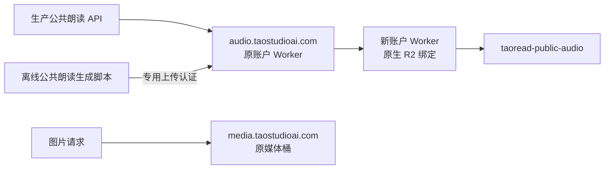

# 桃阅读公共音频跨账户 R2 迁移

## 最新状态（2026-10-12 22:10）

迁移与旧副本清理均已完成。旧音频地址已配置精确兼容转发并验收，9,681 个冻结源副本已按白名单删除，旧桶图片完整保留。旧账户全桶实测 6.197 GB，新账户音频桶 3.319 GB；上传门禁和每日一诗已部署。最新执行证据与恢复顺序见文档 53 的最新状态和文档 54。下文迁移时的“保留旧副本/七天”说明为历史建议，不能再直接按旧回滚脚本切回已清空的旧音频前缀。

## 目标与边界

将已压缩的 9,681 个公共朗读文件迁入新 Cloudflare 账户的专用 R2 桶，跑通上传、完整下载校验、公开播放与后续生成上传流程。家庭音频、数据库、图片及原域名所在账户保持原有路径。迁移不提交或推送 Git。

冻结清单：`output/b2-audio-migration-20261012/frozen-audio.json`。共 3,319,223,631 字节；文件 SHA-256 为 `4cc7d05272d79b148d9f7e8ca85bb567f730e652e446525e80337ef7b490db89`。清单取自已压缩的生产媒体，不能使用经典童书旧导出文件替代。

## 账户与访问路径

| 用途 | 账户 ID | 资源 |
| --- | --- | --- |
| 原媒体、图片与域名 | `c9bfec733c53297d509a3f1ddc740e7e` | `taoread-media` / `media.taostudioai.com` |
| 新公共音频 | `b39a61b902f00682c734676cbe147934` | `taoread-public-audio`，Standard，APAC |
| 音频域名入口 | 原账户 | Worker `taoread-public-audio` / `audio.taostudioai.com` |
| R2 原生绑定 | 新账户 | Worker `taoread-audio-origin` / `taoread-audio-origin.taoread-audio-r2.workers.dev` |

新桶创建于 `2026-10-12T08:38:41.428Z`。新账户创建前后清单均已核实，初始仅此一个桶。MCP 的桶管理权限可用，账户 token 管理接口返回 9109 无权限，故未创建或提取账户级 S3/API 密钥。

本机 `workers.dev` 被 DNS 解析到非 Cloudflare 地址，直接连接失败；自定义音频域名的跨账户代理路径已实际验证。保持主站与完整 DNS 区域在原账户。

## 上传与容量约束

新账户 Worker 只接受 `tts-public/<64位十六进制键>.mp3`，公开 GET/HEAD/OPTIONS；PUT 和桶清单 POST 需要独立上传凭据。不存在 DELETE、覆盖已有对象、家庭媒体或数据库访问接口。R2 `onlyIf.etagDoesNotMatch=*` 防止并发覆盖；R2 原生校验上传 SHA-256，内容类型固定为 `audio/mpeg`，单文件最多 16 MiB。

上传凭据只保存在生产目录下受限 ACL 文件中。Worker 保存其 SHA-256 验证值；源码、配置与回执没有原始凭据。代理只向固定新账户地址转发上传认证，公开读取会剥离客户端认证和 Cookie。配置 `r2-worker` 不完整或账户、桶、网关不匹配时直接失败，不能回落到原图片桶。

新增音频上传前会列出目标桶，超过 5,400,000,000 字节就停止新增上传。全量迁移也有容量预检。此阈值约束本项目上传流程，并非 Cloudflare 的账户全局硬配额；账户管理员额外创建桶或其他系统上传需单独计入账户预算。

原账户最终完整清单时间为 `2026-10-12T09:40:30.213Z`：

| 桶 | 对象数 | 字节数 |
| --- | ---: | ---: |
| taoread-media | 20,004 | 4,830,940,783 |
| taostudio-cases-assets | 68,898 | 3,464,389,899 |
| taostudio-lab | 1,390 | 1,218,543,022 |
| taoread-backup | 0 | 0 |
| 合计 | | **9,513,873,704（9.514 GB）** |

`taostudio-lab` 在此前快照后增加 51 个对象、50,889,972 字节。不得将历史 9.463 GB 当成当前值。若保留期后删除经过完整验证的原公共音频副本，按此清单计算原账户将降至 **6,194,650,073 字节（6.195 GB）**。新音频桶预计为 **3.319 GB**。源 R2 音频至少保留切换后七天，暂不删除；本地生产音频也保留。

R2 Standard 官方免费量为每月 10 GB-month、100 万次 Class A、1,000 万次 Class B，互联网出口免费。10 GB-month 是计费单位，不能理解为服务自动停止上传的硬配额。使用 Standard，不启用 Infrequent Access。两账户容量分别核算；本文只记录经验证的资源与本次操作，不承诺将来任意其他上传仍免费。

官方依据：[R2 定价](https://developers.cloudflare.com/r2/pricing/)、[Workers R2 API](https://developers.cloudflare.com/r2/api/workers/workers-api-reference/)、[R2 认证](https://developers.cloudflare.com/r2/api/tokens/)。

## 验证方法与回执

迁移脚本 `apps/server/scripts/migrate-public-audio-r2.mjs` 固定冻结清单哈希。写入前复核全部本地文件和生产索引；已有目标文件必须满足字节数和 ETag/MD5。每个迁移文件上传后，通过公开音频域名强制穿透缓存，从新账户 R2 原生绑定完整读回，验证 SHA-256、字节数、MIME 与 immutable 元数据。最终再次核对全桶清单。

断点回执仅能用于同一冻结清单和账户/桶/网关，并要求目标 ETag 与冻结源一致。800 条完整读取证明已在提高并发时安全复用；未获得完整读取证明的已上传文件仍重新下载验证。

相关证据位于 `output/r2-audio-migration-20261012/`：

- `account-inventory.json`：新账户桶清单证据。
- `old-account-inventory.json`：原账户完整字节清单。
- `old-account-final/summary.json`：切换前最终完整清单，容量仍为 9.514 GB。
- `pilot-receipt.json`：3 个真实文件、743,552 字节，上传与完整 SHA-256 校验通过。
- `cdn-pilot-receipt.json`：3 文件全内容、HEAD、首尾/开放 Range、416、304、If-Range、私有路径隔离通过。
- `browser-audio-receipt.json`：Chrome 154，在 390×844 视口正常解码、播放和跳转中间进度；206 响应的来源标识为新 R2，播放器无错误。
- `full-receipt.json` / `.partial`：全量完整验证与断点证据；只在 `completed:true` 时允许切换。
- `production-preflight.json`：生产业务文件与原先基线一致。
- `production-deployment.json`：切换文件校验和及源副本保留截止时间。
- `api-acceptance.json`：本机和公网生产朗读 API 的切换验收。
- `production-upload-check.json`：生产启用的上传配置与共享上传辅助模块真实验证。
- `final-status.json`：最终切换、验证、容量和源副本保留状态。

校验通过：新 R2 Worker 和跨账户代理的真实 Workers/Miniflare 测试；4 个上传目标隔离测试；58 个服务端相关测试；TypeScript 检查与相关 ESLint。Playwright CLI 在 Node 24 下退出时崩溃，改用已安装的 Playwright 运行时与真实 Chrome 完成播放验收。

## 生产切换与回滚

生产切换门禁要求全量 9,681 个文件通过，以及 CDN 和浏览器验收通过。只复制独立音频基址、相关朗读路由、配置校验、两条离线上传脚本和它们的存储辅助模块；启用 `.env.audio` 的新 R2 上传目标，并在主配置新增 `TAO_TTS_PUBLIC_BASE=https://audio.taostudioai.com`。不修改生产朗读索引、数据库或家庭数据。

执行准备好的 `output/r2-audio-migration-20261012/deploy-production.cjs` 后，需要短暂重启 `taoread-api`。业务文件复制前再核对生产哈希，原文件与配置备份位于生产目录下受限 ACL 的 `.audio-migration-secrets/production-before-r2/`。禁止把备份配置复制到仓库或文档。

验收脚本仅请求预先确认全段命中公共音频索引的章节，不触发新合成、不记录认证值。生产没有可复用的演示会话，因此正式验收时创建独立临时家庭和会话、签发短期验证凭据，结束后删除该临时家庭并确认会话级联清理；不使用真实家庭的登录。要求本机和公网生产 API 均返回新音频域名，且真实音频完整 SHA-256 正确。

若切换失败，执行同目录 `rollback-production.cjs`，再重启服务。该脚本先确认文件没有其他漂移，然后恢复业务文件和原配置、撤下新上传配置；远端新桶与本地音频都保留，音频读取恢复原媒体域名。B2 历史迁移记录保留在文档 50，不能将本次 R2 完成状态写成 B2 已可用于线上冷读取。

## 当前状态

**迁移和生产切换已完成。** 全量回执于 `2026-10-12T09:41:09.683Z` 完成，9,681 个对象、3,319,223,631 字节，全部获得完整读取 SHA-256 证明，最终清单与冻结源一致。新账户在全量上传后再次核实只有此专用桶。

生产复制了 8 个相关文件，启用独立音频配置并重启 `taoread-api`。本机及公网 `https://read.taostudioai.com` 朗读 API 均 HTTP 200；验收章节 17 段全部命中公共缓存、返回 `audio.taostudioai.com`，真实音频来源为新 R2，完整下载哈希正确。临时验收家庭和会话已清理，未触发新合成。

生产共享上传模块已使用实际 `.env.audio` 配置验证，目标明确为新账户的 `r2-worker`；已有文件不可覆盖。服务健康 HTTP 200，图片外发基址保持不变，生产朗读索引 SHA-256 与冻结时相同。

新账户当前 **3.319 GB**，原账户最终完整盘点 **9.514 GB**，两者分别低于 10 GB。源 R2 音频尚未删除，保留截止为 **2026-10-19 17:41:54（北京时间）**。届时若清理，仍应重核新桶完整回执、当前源清单及回滚状态，仅删除冻结清单覆盖的公共音频；本文没有安排自动删除。B2 不承担线上音频冷读取。未提交或推送 Git。

维护新账户 Worker 使用已授权的新账户 Cloudflare MCP；本机 Wrangler OAuth 仍属于原账户。新账户原生绑定配置为 `wrangler-r2-origin.jsonc`，原账户域名代理采用默认 `wrangler.jsonc`，日常默认部署也将继续指向新 R2。旧 B2 配置已存入本次输出目录的 `wrangler-b2-before-switch.jsonc` 作为非敏感历史快照，不能再用于线上音频域名。

## 后续独立复核

用户随后要求严格验证并判断旧副本是否可删。新的独立复核于 `2026-10-12T10:08:55.978Z` 完成：不上传、不复用先前证明，重新完整下载全部 9,681 个对象，SHA-256、字节数及清单完全一致。公网和本机生产朗读、实际浏览器播放与跳转、上传目标以及远端新账户桶绑定均重新验证通过。

本次原账户完整盘点仍为 9,513,873,704 字节；冻结清单中的原公共音频副本已具备清理条件，删除后预计原账户为 6,194,650,073 字节。七天保留是此前回滚建议，数据清理需结合新的证据与旧 URL 兼容要求判断。此次只进行了核验和范围评估，没有删除任何源对象。完整证据、精确清理范围和删除后的恢复顺序见 [文档 53](53-R2迁移独立复核与旧副本清理范围-2026-10-12.md) 与 `output/r2-audio-reverification-20261012/`。
