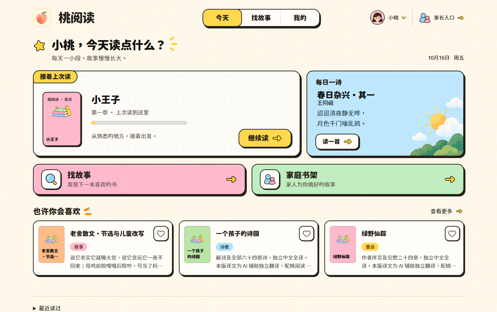
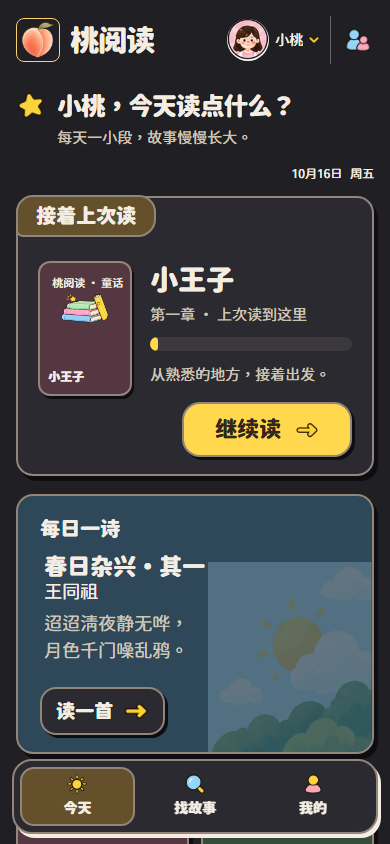
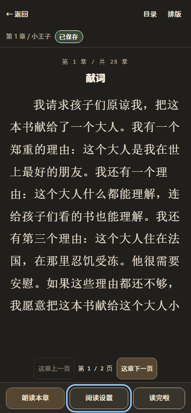
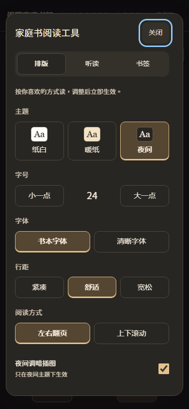

# 桃阅读视觉对抗审查与夜间适配

本轮依据用户实测反馈修复桌面字号、内容密度和手机夜间显示。保留已认可的主体风格、原桃 Logo 与既有图标资产。上一轮亮色审查不能代替本轮深色、异常态和多屏宽验收。

## 发现与修复

| 编号 | 实测问题 / 原因 | 修复与复验 |
| --- | --- | --- |
| V01 | 1448 CSS px 首页标题 52px、主卡书名 43px；卡片与留白按大幅原型尺寸硬编码，推荐被挤到折叠下 | 桌面标题 34px、主卡书名 28px；导航 19px、说明 16–17px；主卡约 250px。1448×910 推荐行完整可见；1024/1920 与手机另验 |
| V02 | 系统深色下首页、登录、书库、家长端仍是奶油白，固定颜色压过变量 | 新增统一深色表面、文字、分隔线、行动色与原生控件方案；移除深色下的亮纸纹。页面、portal 弹层、加载及恢复页一起覆盖 |
| V03 | 阅读器只按时钟选择初始主题；加载和首次失败分支缺少主题 class，夜间失败回白底 | 默认同时尊重系统深色；显式设置仍优先并保留。加载、失败、重试、目录、排版与结算按阅读器主题显示 |
| V04 | 桌面首页宽度规则影响阅读器，夜间两侧露出亮色背景 | 阅读布局明确占满视口；增加 1448px 下 x=0、width=1448 的浏览器回归断言 |
| V05 | 家庭阅读器章号在纸白下对比度约 4.07；暖纸保存状态约 4.40；普通阅读器章号 opacity 导致偏淡 | 三套阅读器主题隔离变量、原生控件色板；分别提高辅助文字对比度，移除章号低透明度；保留深色系统下主动选择纸白或暖纸的能力 |
| V06 | 深色下收藏心形的深描边消失在深卡底 | 给收藏控件浅色小底板，选中状态保留粉色，图标资产不改 |
| V07 | 小封面沿用 22px、大标题起点和三行限制，最后一行被封面边界截断 | 封面标题按容器宽度缩放、两行省略、底部留白；小推荐封面去掉重复眉题。为不支持容器单位的浏览器提供 16px 回退 |
| V08 | AI 说明尾部使用固定墨色并叠加 70% 透明度，深色下几乎不可读 | 使用可随主题变化的辅助文字颜色，复验登录说明弹层及滚动 |
| V09 | 独立离线 HTML 与阅读控件缺少深色适配，旧 precache 仍可能提供旧界面 | 增补离线书架及全文控件的系统深色样式；SW 缓存 v9→v10，实际旧 worker 升级、离线导航、正文与翻页均复验 |

## 真实浏览器验收

Chromium 隔离演示环境，公开测试家庭与本地夹具；生产凭据未用于视觉夹具。基础矩阵为 320/390/768/1024/1448/1920 CSS px × light/dark；长书名另加 1536，阅读工具与状态页按有关屏宽补测。125% 观察采用等效缩小 CSS 视口，未据用户截图推断其浏览器缩放值。

最终按同一场景、宽度、系统主题的最后一次结果归并：**68 个场景、738 个组合，无页面横向溢出、可见损坏图片或当前受检文字对比度失败**。本轮发现与复验分开保存，未将第一轮失败删除或记成通过。

| 步骤 | 范围 | 结论 |
| --- | --- | --- |
| 1 | 登录、创建/加入家庭、选小读者、AI 说明、隐私 | 明暗主题与输入/说明弹层通过 |
| 2 | 今天、找故事、主题书单、详情、连续听读 | 六屏宽、长书名、自动下滑加载通过；桌面信息密度通过 |
| 3 | 我的各分类、阅读记忆、月份筛选、识字练习 | 空态、已有内容与弹层通过 |
| 4 | 公共阅读器正文、排版、听读/更多、目录、结算 | 夜间正文、加载失败/重试、主题持久化、纸白选择、桌面整屏通过 |
| 5 | 家庭书空态、正文、排版、听读、书签、目录 | 纸白/暖纸/夜间、长标题与工具通过 |
| 6 | 家长今天、内容各来源、足迹、设置及数据区、运营摘要 | 明暗主题、窄屏、输入/select 与失败状态通过 |
| 7 | 英语练习未开通、课程列表、教学；编辑工作台未加载/已加载 | 明暗与六屏宽通过；课程和编辑数据为隔离夹具 |
| 8 | 试读、试读失败、全局恢复、联网/静态离线书架及离线正文 | 明暗主题、断网导航、缓存升级与可操作控件通过 |

实际触摸事件：夜间公共书从 1/2 页翻到 2/2，家庭书从 1/18 页翻到 2/18。离线真实正文从 1/7 页到 2/7。没有把鼠标点击“下一页”替代公共/家庭阅读器触摸验证。

对比度巡检基于当前可见文字的计算颜色、透明度与平面背景合成；不将图像内文字、整个屏幕的背景遮罩、禁用控件或自动结果等同完整 WCAG 认证。已人工查看分组截图和关键原尺寸截图。未使用物理 iPhone/Android，也未覆盖每一种浏览器厂商的强制反色算法。

桌面首页（1448×910）：

手机系统深色（390×844）：

夜间正文与家庭阅读工具：

## 代码与功能门禁

- `npm run verify`：触达 0 违规；typecheck、lint 通过；本地 server 57 文件 / 511 项、web 15 文件 / 131 项通过。server 数量包含工作区既有未提交诗词测试，不能等同远端提交内的测试数量。
- 独立端口 8902/5192 的全套 E2E：43 项通过，含本轮新增的 3 项主题/密度/失败重试回归。
- 最后桌面整屏修复后追加 8 项主题、阅读/触摸、离线回归全部通过，相关测试 lint 通过。首次追加复验中，一项测试在会话请求完成前检查冲突弹窗，弹窗稍后出现而阻挡测试；修正测试为等待会话响应后处理 409，保留失败日志并重新验证。旧 worker v9→v10 另有独立回归。
- 前端生产构建通过；发布包采用最后一次构建。原桃 Logo SHA-256 仍为 `843eb51efff8220aaa3c594d4870e05b120117a2af6cc3c38f6e3e41833d2436`。
- 本轮证据：本地 `output/ui-adversarial-20261016/`，包括原始/最终矩阵、逐页截图、触摸结果、离线升级、门禁日志与发布验收。归并场景清单随报告存于 `assets/ui-dark-20261017/visual-verdict.json`。

## 发布约束

本次仅发布本报告、前端样式/主题及有关回归测试。工作区既有诗词、未选用原始图片及生产 untracked 运维目录不提交、不覆盖。生产数据模型和 PIN 无改动。

生产发布使用本次提交，CI 通过后先做协调备份和本地快照，再替换静态包、启动服务，逐项验证源站与公网实际 HTML/静态资源及浏览器明暗主题。保留上一版 dist 和哈希块供回退。

## 实际发布记录

- 实现提交：`5feb4d4a36fd36f7e528dcff8174cab47802490e`，已推送 main。[CI 38930306361](https://github.com/wanghao137/taoread/actions/runs/38930306361) 全绿：远端 server 56 文件 / 508 项、web 15 文件 / 131 项，构建和 43 项 E2E 通过。
- 2026-10-17 00:19（北京时间）完成生产部署，服务健康 200。发布包 109 个文件，仅含已跟踪公共资产与最后生产构建；未发布工作区未选用的原始图片。
- 发布前完成协调离机备份：媒体清单 5295 项、上传失败 0；本地数据库快照完整性 `ok`、外键问题 0。旧 dist 与快照保留于生产 `.release-state/ui-density-dark-20261017/`。
- 2026-10-17 00:30 完成公网验收：源站和 `https://read.taostudioai.com` 各有 109 个文件哈希一致；各 20 项浏览器检查通过（390/1448 × 明/暗 × 登录、试读、联网离线入口、独立离线 HTML、隐私页），无页面横向溢出、可见损坏图片和脚本错误。`publicVerified: true`。
- 前两轮命令行公网探针存在间歇性连接失败/超时，失败证据保留。已匹配的 94 个资源与不可变发布包一致，其余 15 个资源使用禁用 Service Worker 的公网浏览器完成哈希比对；随后完成全部 20 项公网浏览器检查。该结果不代表公网延迟或所有网络环境均通过性能验收。
- 私有家庭页面使用隔离环境完成本报告的 738 组合视觉审查，公网未使用真实家庭凭据执行写入。物理手机和厂商强制反色的覆盖边界见前文。

可核对的发布摘要：[`release-verification.json`](assets/ui-dark-20261017/release-verification.json)。完整日志和 40 张源站/公网验收截图保存在本轮本地证据目录。
