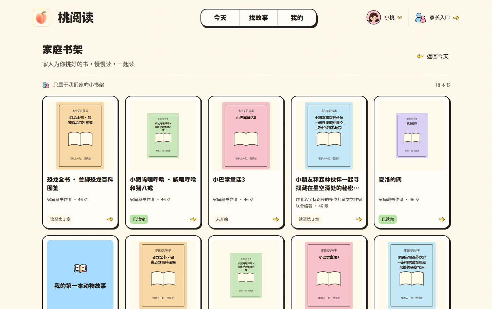
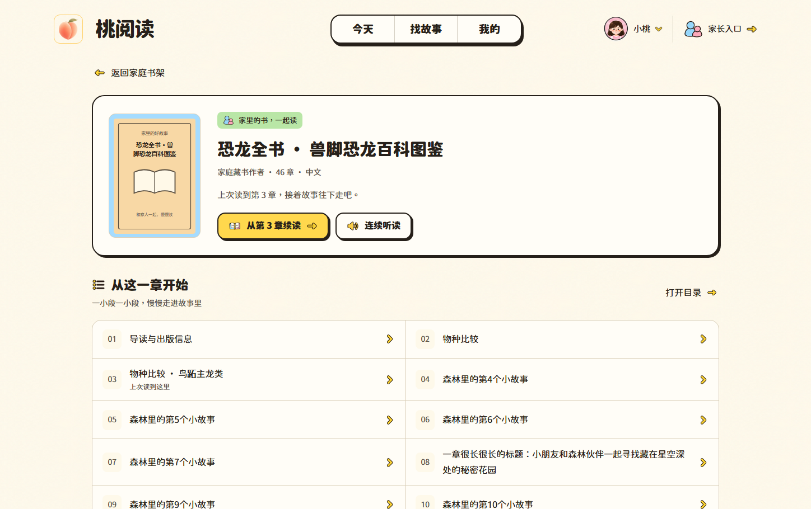
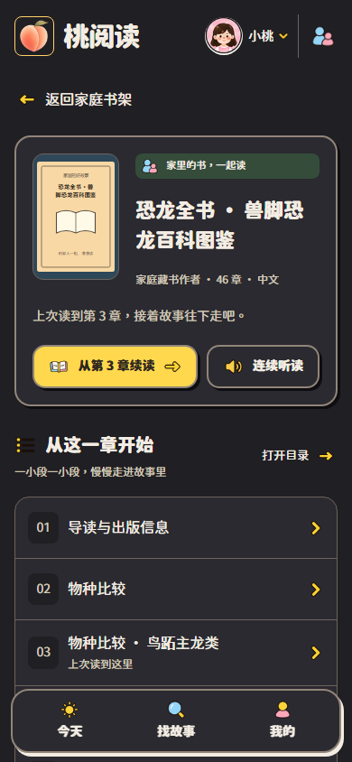
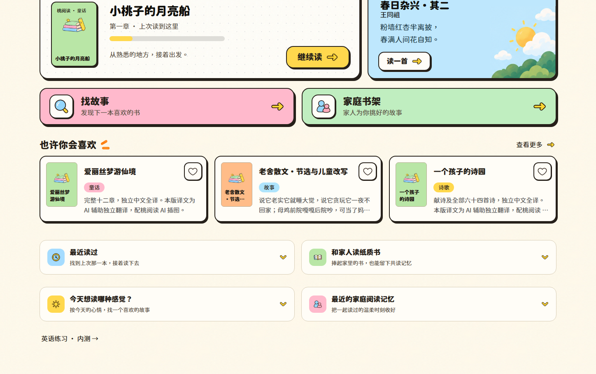
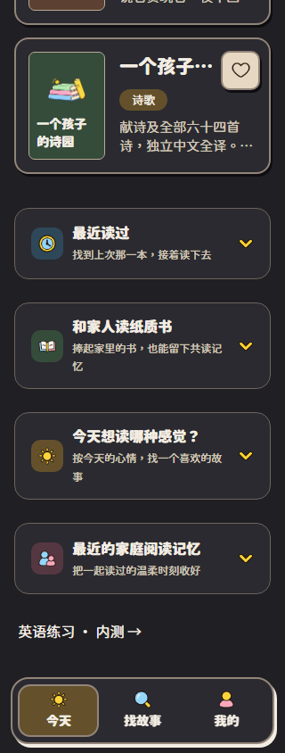
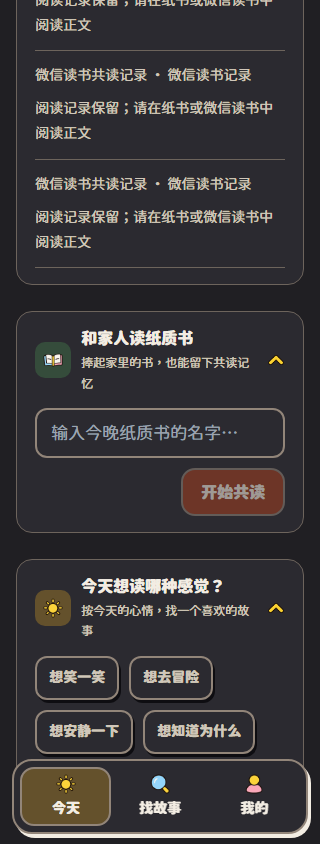
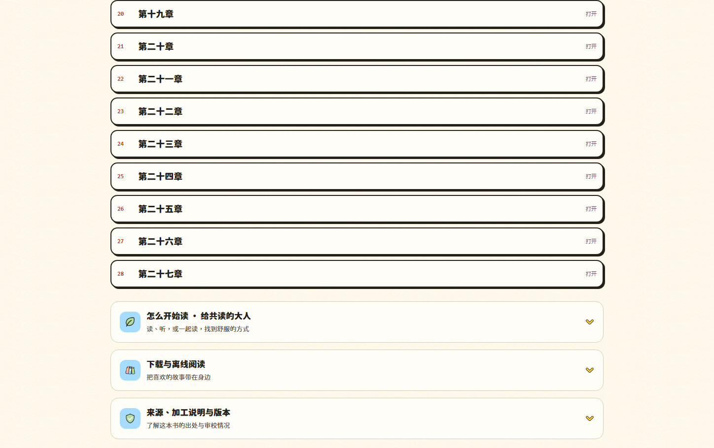
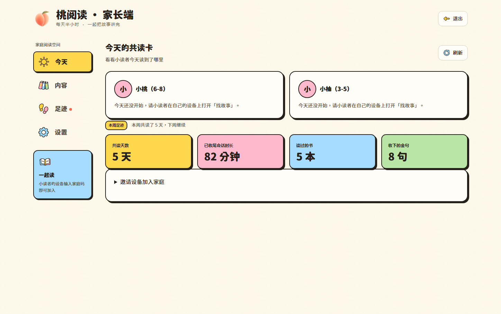
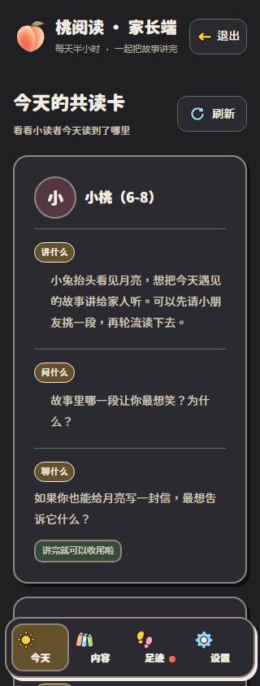
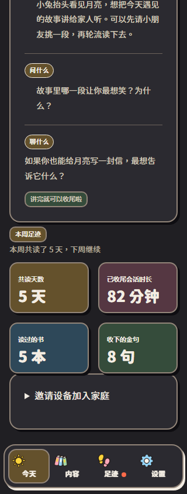

# 二级页面视觉重构与对抗复验（2026-10-17）

本轮针对用户的五组截图，补齐家庭书架、家庭书详情、首页辅助区域、公共书说明区域和家长端工具栏的设计。延续已经确认的奶油纸、圆角字和彩色图标，桃 Logo 文件保持原字节。

## 问题与修复

| 区域 | 实际问题 | 本轮结果 |
|---|---|---|
| 家庭书架 | 封面随容器放大，桌面信息密度低；无封面只显示一个字 | 桌面封面高度 208px、手机 145–168px；封面完整展示；书名、作者、进度分层，缺图时显示书图标和书名 |
| 家庭书详情 | 详情被路由规则当成沉浸阅读器；缺少封面介绍区；目录是一串大按钮 | 详情恢复浏览导航；封面、简介信息、续读和听读组成介绍卡；桌面双列、手机单列紧凑章节列表，保留原目录弹层 |
| 首页四个辅助区 | 原生折叠标题缺乏信息层级，间距松散 | 桌面 2×2、手机单列卡片；彩色图标、标题、辅助文字、展开箭头统一；保留原生 details/summary 键盘行为 |
| 公共书详情下方 | 导读、离线、来源说明像未设计的附加文字 | 使用同一折叠卡组件；正文、元信息、下载动作各自排列 |
| 家长端 | 退出、刷新是孤立的大按钮；手机嵌套气泡挤压正文 | 退出归入品牌工具栏，刷新与区块标题对齐；共读内容改为讲、问、聊的分段；窄屏统计数值收紧字号 |

## 审查过程中追加修复

- “最近读过”的旧选择器盖过新卡片背景和边框：提高限定区域的样式优先级。
- 旧封面 img 规则误把无封面图标撑满容器：限定占位图标位置和 44px 尺寸；回归测试检查该实际尺寸。
- 深色卡片阴影误依赖浅色文字变量：改用既有阴影变量。
- 家长端统计小字因透明度叠加偏淡：恢复实色。
- 新按钮显式标注孩子端最小点击高度，触达门禁可识别。

## 验证证据

- Chromium 视口：320、390、768、1024、1448、1920；系统亮色与深色。
- 222 个最终场景/宽度/配色组合：未检出页面横向溢出、当前可见文字的对比度不足或已加载图片损坏。矩阵保存每种组合的最后一次结果；正文阅读、空态、失败页只覆盖 320/390/1448，其余主要区域覆盖六种宽度。
- 家庭书浏览器夹具：18 本、46 章、长书名/作者、不同封面比例、无封面、续读第三章、目录弹层、空态、503 和重试。截图中的模拟封面仅用于布局测试，不发布、不替换家庭真实书籍。
- 家长端浏览器夹具：无活跃共读、已有共读卡、加载失败和刷新恢复；16 次接口调用验证刷新确实重新获取。夹具不写生产数据。
- 10 项相关浏览器回归通过：系统深色/动态切换、桌面字号、显式阅读主题、离线升级与阅读、触摸往返、家庭详情导航/续读、辅助卡 Enter/Space。修正无封面图标后新增的实际尺寸断言和相关 2 项用例再次通过。
- `npm run verify` 通过：触达、全仓类型、lint，以及本地工作区 server 511 / web 131 项单测全部通过；本地 server 数量包含用户尚未提交的诗词测试。新增用例的最终定向 lint 通过。生产构建通过。
- 对代表截图进行了人工复核，包含桌面密度、深色窄屏、长目录和逐个展开的辅助内容；自动几何和对比度检查不等同于审美评分。设备范围是桌面 Chromium 的响应式视口，未宣称完成真实 iOS/Android 设备验收。

[完整视觉矩阵](assets/ui-secondary-20261017/visual-matrix.json)

### 家庭书架与详情

### 首页与说明区域

### 家长端

## 发布边界与回滚

仅提交本轮前端、回归用例与验收证据；不提交工作区既有诗词内容或未选用的插图。构建发布目录只包含受 Git 管理的公共资源和本次编译产物。

桃 Logo SHA-256：`843eb51efff8220aaa3c594d4870e05b120117a2af6cc3c38f6e3e41833d2436`，与原文件相同。待本次提交的独立 CI 通过后上线，部署和公网结果将在发布后补录。

上线前复用协调备份互斥锁，暂停 API 后执行异地备份和本地完整性快照，保留旧静态文件；以 ff-only 更新生产源码并发布已审查 dist。本轮无后端/数据库结构/家长 PIN 变更。

回滚以独立发布目录 dist-before 恢复原静态入口和旧资源；本次前端变更不需要数据回滚。公网验收必须独立核对实际返回资源 SHA-256 和页面，不以本地成功代替。
