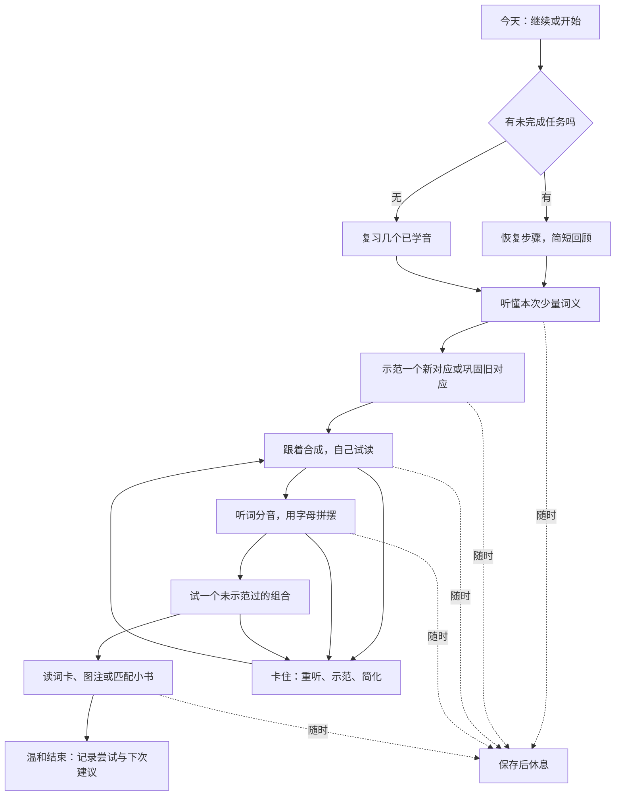

# 桃阅读英语自然拼读：产品研究与课程开发方案

研究日期：2026-10-19。面向用户已确认的 **5–7 岁、英语启蒙不多的孩子**；以中文母语家庭、家长可以短时陪伴作为设计假设。

性质：研究与建议方案，未实施产品变更，未形成已审定教材。本轮核对当前源码、旧方案、相关测试和公开原始资料；不把开发完成、练习完成和学习有效混为一谈。

## 1. 产品结论

建议将这个板块定义为：**帮助孩子在声音、文字和意思之间建立联系，逐渐读出自己的第一批英文词和小句子的亲子学习空间。** 对外可以叫“英语声音小屋”或“英语小练习”，家长说明中明确包含自然拼读。

它应当同时有两条相互配合的线：

- 听说与理解：知道本次几个词说的是什么，听懂极短的口头指令，愿意模仿和表达。
- 拼读与拼写：认识字母或字母组合代表的声音，合成读词，把口头词分成音并用字母表示，最后在句子中使用。

最先要解决的是：**每次学什么、怎样带孩子学、卡住时怎么帮、下次为什么复习这几个内容。** 做完这些，再扩充课程。单独增加词卡、动画和关卡数量，无法填上这条学习链。

推荐开发次序：**一课完整样板 → 八课亲子试点 → 约二十四课基础阶段 → 再扩展常见字母组合与更多拼写规律。** 这些课数是制作范围建议，不是孩子必须按天完成的进度。

## 2. 本次确认了什么

### 2.1 当前实现规模

工作区基线 HEAD 为 `0c4f650`，另有用户已有未提交改动。本报告只把本次读到的源码作为现状依据，不假定线上与本地完全一致。

| 项目 | 当前事实 | 产品含义 |
|---|---|---|
| 课程 | 八课，全部 `draft`，顺序为 s/a、t、p、复习、i、n、m、复习 | 有可复用的第一组教学顺序，尚未覆盖基础短元音体系 |
| 新授对应关系 | 七个：s、a、t、p、i、n、m；课程元数据为 GB | 现有英式草稿可作为工作起点，正式口音仍需确认 |
| 词表 | 二十个去重词条 | 词义在服务端内容中存在，但没有通过 `publicLesson` 下发成词义学习步骤 |
| 题目 | 三十二道，每课四道；字形、合成、分音三种标记 | 界面实际均为文字选择题，题型名称不能代表已测到对应能力 |
| 短文 | 六份，另两课无短文 | 已有解码素材草稿，但需要语言、情境与适龄重编 |
| 音频 | 目录和课详情均明确 `audioAvailable: false` | 当前课堂接口没有教学音频，不能独立完成听音与发音示范 |
| 儿童流程 | 选课 → 有新音则看示范 → 四题 → 短文或结束页 → 完成记录 | 有基本页面链路，缺少复习推荐、语音带领、纠错再教学 |
| 家长侧 | 按孩子开启/关闭，显示最近最多三十次尝试形成的记录 | 可复用授权和记录基础，不能当成全量学习统计或技能报告 |
| 保存 | attempt、作答、暂停/恢复、幂等提交、家庭归属校验 | 可继续发展，不必重写账号和家庭体系 |

机器清点见 [source-inventory.json](../output/phonics-research-20261019/source-inventory.json)。清点脚本只描述源码，不判断教学质量。

### 2.2 当前流程逐步判断

以下是**源码流程研究**，不是已完成截图取证的浏览器审计。

| 步骤 | 当前行为 | 判断 |
|---|---|---|
| 1. 家长开启 | 家长“内容”内为孩子勾选允许查看内测试题 | 授权基础可保留；需要补充简短使用说明和起点选择 |
| 2. 孩子进入 | “今天”底部文字入口进入练习，关闭时提示去找家长 | 入口已存在；对尚不识字的孩子，缺少语音和直观说明 |
| 3. 选课 | 同时列出八课，可直接进入任一课 | 浏览自由；缺少“今天从这里继续”的明确引导 |
| 4. 示范 | 显示大字母、IPA、中文口型说明，请大人读 | 依赖家长的英语和中文阅读能力，是当前核心缺口 |
| 5. 作答 | 选一个文字选项；答错后直接下一题 | 操作简单；难以区分字形匹配、听音理解和真正合成 |
| 6. 读短文 | 整段文字显示，孩子点击“我读完啦” | 可作为阅读尝试记录；没有独立读出与理解的证据 |
| 7. 完成与续练 | 显示题数和答对数；主动暂停可恢复未答部分 | 暂停不惩罚值得保留；仍缺精确步骤保存与复习安排 |

### 2.3 最优先处理的七个问题

**第一，声音教学目前缺少声音。** 孩子需要听到经审校的字母音、连续合成和自然词音。家长口型提示可以辅助，但不应成为唯一教学方式。`/æ/` 提示写成中文“啊”、`/ɪ/` 提示写成“衣”，有被照中文读出的风险，正式内容要重写并由语音人员确认；本轮没有音频可据此判断实际发音。

**第二，部分“合成/分音题”可通过文字比对完成。** 例如看到 `s—a—t` 后选 `sat`，或看到 `sat` 后选 `s-a-t`，不必真的听音或读词。保留为示范练习可以，但不能作为独立拼读证据。

**第三，词义学习没有进入孩子实际流程。** 当前词表中的中文含义不在公开 lesson DTO 中，教学页也没有逐词的图片/动作/语音解释。对英语启蒙不多的孩子，拼出声音后仍可能不知道意思。

**第四，答错后没有帮助孩子学会。** 当前“没关系，看看下一个”很温和，但没有指出目标音、播放正确合成或安排更简单的再试。需要温和反馈和具体再教学同时存在。

**第五，“可解码”与“好读的内容”仍有距离。** L02 的 `sat. at.` 更适合标为词语练习；L06 的 `Pin in tin. Sit in it.` 需要重新处理语境和指代。`sap`、`nip` 等词应评估是否值得在最初几课占用孩子的词义学习精力。原始词表不必删除，但核心教学词要重新挑选。

**第六，现有检查会遗漏教学前置条件。** L04/L05 已出现作为人名的 `Pat`，明确的大写教学说明到 L07 才出现；L06 的 n 字形题出现尚未新授的 m 选项。这些是需要编辑决定的审查项，不能仅靠转成小写后的字母集合校验放行。未授字母作为干扰项不必一概禁止，但必须有设计理由，不能声称测到了孩子对它的掌握。

**第七，记录粒度不足以支持正式复习。** 当前没有课程/题目版本、提示使用、独立/帮助完成、教学步骤或技能证据。`finish` 接口本身也不要求答齐全部题；现有测试可在仅答一题后标记 completed。这里的 completed 应解释为一次练习结束，不能拿来推断整课学会。

## 3. 研究依据及适用范围

美国 IES/WWC 的 K–3 基础阅读指南将声音意识与文字对应、解码与拼写、连贯文本阅读列为相互配合的教学内容，并分别标明证据等级。对桃阅读的启发是：不能只做字母认识，也要让孩子有读词和使用文本的机会。[IES/WWC 原文](https://ies.ed.gov/ncee/wwc/PracticeGuide/21)

英国教育部 SSP 标准强调明确、递进的字素—音素顺序，以及从左到右的合成、口头分音和匹配进度的阅读材料。本方案采用这一条一致的主线；不拼接多个商业课程的顺序。[DfE 核心标准](https://www.gov.uk/government/publications/phonics-teaching-materials-core-criteria-and-self-assessment/validation-of-systematic-synthetic-phonics-programmes-supporting-documentation)

英国文化教育协会针对英语作为第二/附加语言的讨论指出：能拼出词音不代表理解，词汇教学需要配合。对本次目标儿童，增加听说和词义支持具有直接的产品意义。[British Council 专家文章](https://www.britishcouncil.org/voices-magazine/how-phonics-can-give-children-head-start-reading-english)

阅读准确性、流利度、理解和阅读兴趣需要相互支持，不能把播放故事和自主解码记成同一种学习结果。[DfE 阅读框架](https://www.gov.uk/government/publications/the-reading-framework-teaching-the-foundations-of-literacy)

这些材料主要来自英语教育体系，**不构成桃阅读在中国家庭中有效的直接证明**。具体时长、课数、复习间隔、题量和界面安排均是本报告提出的试点参数，需要观察孩子后调整。British Council 文章还讨论了首音与韵尾等活动；本方案只借鉴其词汇与第二语言提醒，不把不同教学路线混为一套。

两个产品参考仅用于结构借鉴，本轮没有完成其完整游戏实测，也不采用厂商自述作为效果证据：

| 公开产品资料 | 值得借鉴 | 桃阅读的适配 |
|---|---|---|
| [Teach Your Monster to Read](https://www.teachyourmonster.org/teach-your-monster-to-read-overview/) | 从字音对应逐渐走到合成、分音、句子与阅读 | 保留清晰学习进阶；首期只做少量稳定交互，无需先制作大世界冒险 |
| [Starfall Learn to Read](https://www.starfall.com/h/ltr-classic/) | 在同一学习结构内连接练习和可读小书 | 每个学习单元有读词/读句的实际用途，并能回到“我能读的小书” |

## 4. 面向 5–7 岁的整体体验

### 4.1 孩子应当能够理解的四句话

“听一听。” “跟我拼。” “你来试。” “读一句。”

孩子端不要求理解自然拼读、音素、GPC、IPA、内测版本等术语。专业信息收进家长说明；课堂中用声音、字母、简单动作和短提示呈现。首次进入只演示一次点击和重听，之后保留相同位置、相同操作。

默认以点击完成；字母拼摆允许拖动，也必须允许“点字母，再点位置”。颜色辅助区分声音块，但同时用形状、位置或标记说明。建议主触点按 48–56 px 量级设计并实测，这属于儿童界面方案，不是本轮已经测量通过的指标。

### 4.2 与桃阅读主产品的关系

保留“今天 / 找故事 / 我的”的整体结构，不为自然拼读增加一套主导航。

- “今天”给出一张英语卡：继续上次、先复习，或认识一个新声音；只突出一个推荐动作。
- 课程列表作为次级入口，家长可调整起点；孩子不必从八个陌生标题中做教学选择。
- 完成后可进入“我能读的小书”，也可结束。小书允许反复读；不要求每次先答题才能看。
- 普通英文听读故事继续用于兴趣和理解，标注“听故事”；只有按课程核对过的材料才标注“适合自己拼读”。
- 英语练习由家庭选择时段，白天或共玩时间均可；不把它绑定为睡前共读必须完成的任务。

### 4.3 第一次使用

1. 家长花约一分钟了解：本阶段做什么，需要怎样陪伴，记录能说明什么。
2. 家长选择“从声音游戏开始”或“试试字母音”。认识字母名称不自动跳过字母音教学。
3. 孩子玩两三个短任务：听懂一个熟悉词、模仿/辨别声音、试着把口头声音连成词。可跳过，不称入学测试。
4. 系统给出温和建议：“先一起听和玩”“可以开始试着拼”，家长可更改。
5. 进入首个小任务。家长无需会读 IPA，也无需现场自行示范标准英语发音。

声音游戏不应变成长时间学习所有前置技能的关卡。孩子可以一边学少量字母音，一边继续做口语合成和词义活动。

### 4.4 日常一次学习



默认约 5–8 分钟，也允许只做其中一小段。可供试点的时间分配为：复习约 40 秒、词义约 40 秒、新音约 60 秒、合成约 90 秒、分音约 60 秒、阅读约 60 秒、结束约 20 秒。步骤可合并，不在孩子端显示倒计时，不以拖延判定错误。

只有一个新对应也并不意味着只练一个声音；复习和读词会不断使用旧对应。遇到明显吃力时，下一次可以整节做巩固，不增加新授。

## 5. 一课怎样做到真正“在教孩子”

以现有 L07 的 m 为例。假设孩子已接触 s/a/t/p/i/n，且本次词义预备已理解 mat 和 map。本例是可交给内容与交互开发的脚本草案，须经教学/语音编辑审校。

| 环节 | 孩子看到/听到 | 孩子动作 | 系统如何记录 |
|---|---|---|---|
| 旧音唤醒 | 听到一个已学音，看见两个已学字母 | 点相应字母，可重听 | 字音辨认练习；是否重听、是否提示 |
| 词义预备 | 垫子与地图的清晰实物图，短英文词音和必要中文说明 | 指一指、做动作或跟说 | 词义接触；不记独立解码 |
| 新音示范 | 大写/小写安排按课程前置要求；核心先显示 m，播放 /m/ | 听、模仿，观察闭唇提示 | 已示范，不推断孩子发音正确 |
| 教师示范 | m、a、p 三个音块依次点亮，再连续合成 map | 观看并跟着尝试 | 有示范的练习 |
| 分音拼摆 | 只听到 map，看到已学字母选择区 | 点三枚声音标记，再点字母 m/a/p | 分音与拼写证据；帮助程度分别记录 |
| 小迁移 | 显示未在本次示范中带读的 mat；先不播放答案词音 | 尝试自己读；需要时主动点提示 | 无麦克风时只记自述/家长观察，不自动宣布正确 |
| 使用阅读 | 一张情境图注，例如经审定的 Sam sat. | 尝试指读，再看意思 | 阅读尝试、是否求助；理解问题单独记录 |
| 结束 | “今天试着把声音拼成词了。” | 结束或再读一次 | 练习完成；下次建议复习 m 与相关组合 |

注意三件事：

1. 词义阶段可以听词、看图；独立解码时先不给直接泄露答案的图片、中文词义或整词音。孩子读出后再出现图片并确认意思。需要帮助随时可用，使用后标为有帮助的练习。
2. 如果孩子刚在同一轮听过或反复跟读 mat，就不能把紧接着的 mat 当成陌生组合迁移。示范词与迁移词要分池，并结合跨日再观察。
3. 大写字母、专名、标点、词义和句法都要纳入课程，不能假定孩子从中文或别处自动知道。上例的 Sam 与大写 S 要有明确前置教学。

### 5.1 答错或卡住的处理

建议反馈顺序：“再听一遍” → 指出目标声音位置并示范 → 换一个更简单、同目标的任务。连续两次吃力后切到一起练，不再重复测试同一道；“两次”是试点规则，可调整。

例：孩子把 map 选成 mat，系统不要只说“不对”。可以播放末尾 /p/，提示“听最后的小声音”，再示范完整 map。后续用另一个可读组合再观察，不把纠正后答对补记为首次独立正确。

错误提示不扣星、不损失生命、不公开比较。鼓励针对行为：“你又听了一遍”“你把三个声音连起来了”，避免固定给孩子贴聪明/不会的标签。

### 5.2 题型的证据边界

| 任务 | 可以支持的判断 | 不能据此判断 |
|---|---|---|
| 听音点字母 | 在这些选项中辨认字音对应 | 会自主读出单词 |
| 看字点音频选项 | 在声音选项中辨认对应 | 自己发音准确 |
| 听分开的音选词 | 有听觉合成的练习证据 | 能从印刷词自主解码 |
| 听完整词、摆字母 | 分音和编码的行为证据 | 口头朗读一定准确 |
| 看新组合、尝试读 | 有自主解码尝试；有成人观察时可补充结果 | 未观察时自动正确、口音达标 |
| 听故事、回答意思 | 听力理解或语义判断 | 已经独立读完文字 |
| 点“读完” | 孩子自述完成 | 真实阅读准确性或熟练度 |

首期不引入自动麦克风评分。应用可以承担示范、练习和记录，关键的口头独立阅读先允许家长点选“独立读出 / 提示后读出 / 未观察”。不愿意或无法陪伴时仍可练，但报告保留“不确定”，不生成虚假的掌握分数。

## 6. 应增加哪些内容

### 6.1 内容结构

不能把内容清单只写成“字母表 + 单词表”。每个学习目标都应配套：

- 一个明确的字形—声音对应，包含口音、适用位置或条件。
- 少量孩子能理解的核心词义与情境。
- 正确字母音、分音、连续合成和自然词音。
- 有带领的练习、帮助策略，以及单独保留的迁移候选。
- 匹配已学内容的词卡、图注、小句或小书。
- 一个简短理解活动和一个可在生活中做的亲子活动。
- 家长提示、前置条件、审校记录和内容版本。

口语词汇可以比当下可解码词汇丰富。例如用 apple 解释 a 的词义情境，可以由音频和图片呈现；不能因此要求孩子自己读出 apple，或把它标记成已会拼读。

### 6.2 第一批八课：保留顺序，重做教学材料

| 课次 | 目标 | 需要增加的内容 | 阅读成果与限制 |
|---|---|---|---|
| L01 | s、a 的第一次声音体验；分成两个小步骤 | 准确声音、听音点字母、发声/口型观察；不靠中文拟音 | 不强凑词或句子；形成听与字形的初步联系 |
| L02 | t；把两个/三个音连起来 | at/sat 的慢速连续合成、跟读、音块操作 | 使用清楚标注的词卡；`sat. at.` 不作为小故事发布 |
| L03 | p；注意声音顺序 | tap/pat 等动作词义、合成示范、首尾音关注 | 少量动作词卡；sap 是否保留由编辑决定 |
| L04 | s/a/t/p 的巩固 | 听词摆字、不同顺序与保留词的试读；不过度测试 | 可用动作提示语/图注；Pat 作人名需提前明确教学 |
| L05 | i；区别已学 a 和 i | sit/sip 等口语词义与音素示范，保留一两个未带读组合 | 优先简单图注；不依赖整段中文解释 |
| L06 | n；分音与拼写 | in/pin/nap/pan 等按意义筛选，听词点字母 | 重编 `Pin in tin` 材料；不把陌生词义混作拼读难度 |
| L07 | m；综合使用三个音 | mat/map/Sam 的词义与大小写前置，示范与迁移分池 | 从有意思的一句 `Sam sat.` 开始；无需强做长故事 |
| L08 | 跨任务、跨日巩固 | 新顺序、少量未示范组合、提示程度记录 | 一至两句/短图注的独立尝试；不能因点完成就升级为掌握 |

首批建议从现有二十词中筛出约十二至十六个核心词，其他词作为候选、补充或迁移池。不是要求孩子背完指定词数。优先具体动作和实物；at/in/it 等功能词通过情境理解，避免给每个抽象词硬配一张图。

现有六份短文全部重新审稿。早期两三课完全可以只读词或一行图注；随着可用对应增多再写小书。最初八课的合理目标是“敢尝试、知道怎么拼、在帮助下开始用”，不能宣传完成后能自主阅读普通英文绘本。

### 6.3 第二批：约二十四课的基础阶段草案

以下是可交给教学编辑讨论的排课草案，**不宣称是某套已认证课程的标准顺序**。八课试点有结果后再冻结。GB 是沿用当前代码的暂定工作口音；如果决定 US，需要另出版本并重新核对音频与词义情境。

| 课次 | 新授/巩固 | 候选词例 | 内容注意 |
|---|---|---|---|
| 01–08 | 上表七个对应与两次复习 | sat、tap、sit、nap、map 等 | 完成第一条教学链 |
| 09 | d | dad、sad、dip | dad 等词的语义情境与大写使用分开 |
| 10 | g，先教常见 /g/ | dig、gap、pig | 不在此阶段引入 g 的其他读音 |
| 11 | o 的本课程短元音读音 | dog、dot、top、pot | GB/US 录音和音标不可直接混用 |
| 12 | 累积复习 | 以上已学对应组成的词 | 观察听、读、拼的差异 |
| 13 | c，先教 /k/ | cat、cap、can | 词义先让孩子理解，不引入软音 c |
| 14 | k，常见 /k/ | kid、kit | 先认识相同声音可有不同拼写，不要求自行猜全部拼写规则 |
| 15 | e 的短元音读音 | pen、pet、net | 配合已有短元音，比较使用熟悉词 |
| 16 | 累积复习 | sit/sat、pen/pan 等审定组合 | 不用中文“衣/啊”代替实际声音 |
| 17 | u 的本课程短元音读音 | sun、cup、mud | 五个主要短元音至此都有入口；不讲“一个字母永远一个音” |
| 18 | r 的本课程对应 | run、rat、red | 不在此处顺便引入 ar/er 等新对应 |
| 19 | h | hat、hop、hen | 句子语义与小故事情境开始变丰富 |
| 20 | 累积复习 | hop、run、dig 等 | 在动作小句中使用，不只辨认图片 |
| 21 | b | bag、bed、bus | 后续安排 b/d 的温和形音辨别，不要求镜像速度赛 |
| 22 | f | fan、fin、fun | 不自动把 ff 视为已教 |
| 23 | l | leg、lip、log | 词尾也需清楚示范，避免吞掉尾音 |
| 24 | 阶段复习和小书迁移 | 例如 `Sam ran. Sam hid. Sam had fun.` 的审稿起点 | 逐词逐对应检查，并通过图画建立连贯情境；例句仍需英语编辑定稿 |

这二十四课覆盖十九个单字母对应，并不是全部英语字母音课程。先做广泛复用的基础，剩余字母与复杂对应继续分批扩展。

候选制作范围：约六十至八十个经过语义和对应关系标注的词条，分为核心、巩固与迁移用途；约十二至十六份词卡/短句/小书阅读材料，后期小书可采用四至六页、每页一行的形式。数量按实际可写出自然内容的程度调整，不强制每课一本。

### 6.4 后续阶段应覆盖的内容

| 阶段 | 需要逐步增加的知识 | 例子及易误教处 |
|---|---|---|
| 补齐常见基本对应 | j/v/w/y/z/x/qu 等、大小写迁移、ff/ll/ss、ck 等 | x 常对应 /k/+/s/，qu 常对应 /k/+/w/，不要强做“一块永远等于一个音” |
| 相邻辅音与更长单音节词 | 从三音走向四音、五音的合成与分音 | stop 要关注 /s/ /t/ /ɒ/ /p/，不要把 st 教成不可分的一个新音 |
| 常见辅音字母组合 | sh、ch、th、ng 等 | ship 的 sh 占两个字母；th 的清/浊两种对应分开安排 |
| 常见元音拼写 | ai/ee/oa、igh、oo 等与 a_e/i_e/o_e 等分离拼写 | 由课程定序，不能只按“字母数=音数”判断；oo 至少要区分 book/moon 的情况 |
| 其他元音与替代拼写 | ar/or/ur、oi/oy、ow/ou 等，依口音和词汇逐批安排 | 同一拼写可有不同读音，同一音也有多种拼写；不一次堆完整规则表 |
| 常见例外与功能词 | the、a、is、to、was 等，根据句子需要逐步引入 | 只标出尚不能按已教对应解释的部分，明确教过后才能进入独立阅读材料 |
| 词形与多音节 | 复数/第三人称词尾、-ing/-ed、复合词、逐步增加音节 | -s 可读 /s/、/z/、/ɪz/；不要教成所有词尾 s 都是 /s/ |
| 阅读发展 | 重复读、短句理解、简短复述和自由阅读 | 自然拼读是阅读基础的一部分；词汇、理解和兴趣继续发展 |

这些是课程覆盖地图，不能按每行一个大关直接丢给初学孩子。正式排课由教学编辑把前置技能、词汇和读物一起拆分。

## 7. 音频与图片怎样制作

### 7.1 音频分层

儿童教学音频至少区分：中文操作指令、纯音素示范、分音序列、连续合成、自然词音、短句/短文音频。按钮含义固定，例如“听声音”“一起拼”“听整词”；不能一个喇叭按钮随机改变教学用途。

可以复用现有媒体存储、缓存、播放和取消能力，但**不能把故事朗读接口输入字母字符串就当作字母音教学**。自然词音与合成素材都要审校；不把中文谐音或浏览器字母名称朗读作为缺失音频的回退。

录制/合成注意爆破音不要带多余元音，持续音可清晰延续；不要用机械时间拉伸把短音拉成长音。字母高亮与音频时间点由编辑核对，避免沿用按字符长度估算的故事时间轴冒充音素对齐。

首八课若暂以现有七个对应、二十词、六份文本估算，单计七条音素、每词三类音频、每份文本一条，英文核心槽位约为 `7 + 20×3 + 6 = 73`；还需中文指令与反馈。**这是制作量估算，不是当前已存在或已通过验收的音频数量。** 词表/文本重编后重新清点，不盲目按这个数制作。

必须逐条听审，并记录口音、说话人、用途、文本/对应关系、版本、时长、校验和、来源/授权、审校人与批准状态。没有批准的素材不能进入正式课堂。

### 7.2 图片与阅读材料

优先具体实物、可辨认动作、稳定角色和连续情境。tap/pat、mat/map 等容易混淆的图，要让图义明确，不靠大人临时猜作者意图。原始图像可由 AI 辅助，但进入教学内容前必须核对实物、动作和文本意义。

示范页可以图文并列；独立尝试页先给文字，需要帮助时再展开图或词音。读完后给图、动作或简短问题检查意思。小书不需要每页都遮图考试；只有明确用来观察独立解码的那一小段，才采用避免答案泄露的呈现。

文字使用清楚的印刷体，检查 a/g 的字体形态和大小写教学是否匹配；不让装饰字体、花纹或动态背景干扰辨认。初期每屏只突出一个字、一个词或一句话。

## 8. 记录、复习和家长报告

### 8.1 记录事实

至少分开：看过示范、完成练习、无提示选择正确、提示后完成、家长观察独立读出、孩子自述、未观察。播放结束和页面停留都不能直接转换为学习掌握。

推荐家长看到的表达：

> 今天练了 m 的声音，尝试拼 map 和 mat。一次分音任务需要提示。mat 的口头读出尚未观察；下次先复习 m，再试一个新组合。

如果有家长独立读出的观察，再明确写“家长观察到……”。不输出没有依据的掌握率、词汇量、英语等级或同龄排名。

### 8.2 先用简单可解释的复习

推荐逻辑先采用确定规则：未完成任务优先继续；最近需要帮助的目标优先巩固；再穿插已学目标；没有明显吃力时才安排下一新授。

可以试行次日、约第三天和约第七天再接触，记录跨日保持；间隔、次数和比例都可调整。缺席后从合适的复习开始，不清零进度、不要求“补完欠课”。不把一次二选一正确认定为掌握，也不把一次读不出认定为不会。

普通点击练习与独立读词证据分开。没有成人观察时，系统仍能推荐练习，但应承认对口头阅读结果未知。首期无需引入黑盒推荐模型或为孩子生成诊断标签。

### 8.3 亲子活动

每课给一个可选的一分钟活动，例如用纸字母摆出听到的词、在已认识的卡片中找相同末尾声音、把小书再读给玩偶听。活动使用已经教过的对应；家长得到明确“怎么陪”的语音/文字说明，无需自行寻找教材。

## 9. 现有工程怎样演进

### 9.1 复用部分

继续使用 Family/ChildProfile、会话鉴权、家长开启、独立 attempt/response、媒体播放和页面视觉基础。自然拼读统计保持独立，不修改普通阅读 `finished` 的含义。现有默认关闭的草稿入口在新课程验收前仍适合作为内部验证入口。

### 9.2 第一条可发布流程所需的最小增量

| 能力 | 最小实现建议 | 为什么需要 |
|---|---|---|
| 版本化课程包 | 不可变 manifest，含 GPC/词义/任务/读物/音频引用与审校状态 | 内容更新后能解释历史记录，出错能撤回 |
| 教学播放器 | 单一活动音源，重播/切换/退出取消，音频失败可重试 | 避免多个声音叠播、听不到也被推进 |
| 步骤化课堂 | 复习、词义、示范、练习、阅读、结束的显式状态 | 孩子知道当前只需做什么，暂停能精确回来 |
| 增量学习记录 | attempt 绑定课程版本，保存步骤、已答题 ID、帮助和观察来源 | 不能只按“答过几题”恢复或推断学习 |
| 下次建议 | 根据未完成和帮助记录生成一条可解释推荐 | 今天页不用把课程选择交给孩子 |
| 家长摘要 | 分开次数、帮助与独立观察，长期总数用服务端聚合 | 不把最近三十条记录长度伪装成全部学习次数 |
| 发布控制 | approved 资产门槛、家庭灰度开关、课程指针回退 | 只让完整审定内容到达孩子 |

对应关系模型需要允许同一拼写多个读音、不同拼写同一音，以及字母数与音素数不同。不能继续把 `graphemes: string[]` 的每个元素无条件当作一个音。词条应有明确的字母范围与音素映射、语境、例外部分；机器检查针对具体映射，不只查字符是否出现过。

不需要首期制作大型课程后台，也不需要改造全站架构。先以受版本控制的内容文件和校验器维护，再根据实际编辑流程决定后台是否值得做。实施时可以将自然拼读课堂逐步移到独立模块，避免继续向 `FamilyTrialPages.tsx` 堆叠；这不是本轮已经执行的重构。

### 9.3 中断与故障

教学中随时可停。完成一个有意义的小步骤后保存，返回课程列表、切换孩子、关闭页面也应保留可恢复位置。恢复时可提供十秒回顾，并允许重新听示范。

网络/音频失败显示“声音没准备好，再试一下”，不记孩子错误，不自动跳过。当前产品没有完整离线承诺，首期也不新增离线同步链路；连不上时清楚提示并保护已有记录。后续需要离线再单独设计课包版本、撤回和家庭退出清理。

默认不请求麦克风；课程素材不夹带孩子身份或家庭信息。将来若探索童声识别，要独立评估识别可靠性、家长授权和保存删除，而不是顺手接入一个通用 ASR 分数。

## 10. 开发批次与验收

| 批次 | 交付 | 完成条件 |
|---|---|---|
| A：一课样板 | 以 L07 或同等累积课做完整示范；先准备其前置内容 | 家长不会 IPA 也能带；孩子听得懂操作；音频/纠错/暂停/阅读完整；全部样例内容审校 |
| B：八课闭环 | 正式版本的八课、词义素材、音频、图注、家长记录、简单复习 | 八课逐项过内容与技术门槛；小规模亲子可用性试点；根据观察修订 |
| C：基础阶段 | 约二十四课，覆盖五个主要短元音和更多常见辅音，增加小书 | 不超出已教映射；跨日复习与未示范组合观察成立；家长看得懂报告 |
| D：持续扩展 | 常见组合、替代拼写、词形和更长阅读 | 每批独立审校、试点与版本发布；保持同一教学主线 |

建议 A 到 B 的小规模试点先覆盖约六至十个家庭，包括不同英语基础、不同年龄和不同家长陪伴条件。目的在于找到不会操作、听不懂和内容不合适的地方；这个规模不能证明教学疗效。

试点观察任务：

1. 第一次进入，孩子是否知道要做什么，家长需要解释几次。
2. 孩子听到指令后，能否通过点击完成；不会拖拽也能参与。
3. 孩子卡在词义、字音、声音合成，还是操作本身；不要把它们合成一个错误率。
4. 提示后是否理解怎样继续；同样困难是否反复出现。
5. 下次回来能否恢复；成人不在旁时能做哪些步骤。
6. 对未在本次带读的词形组合，是否出现独立尝试；由谁观察，是否使用过提示。
7. 简短句读出后是否理解；家长能否准确理解报告的证据边界。

正式发布前逐项确认：

- 内容：前置对应、词形难度、词义、大写/标点、例外部分、图片和文本一致；两位相关角色分别完成教学/英语语音审核，可由具备相应能力的人员承担。
- 音频：发布资产逐条听审；真机正常播放、首触发、重听、快速切换、暂停、后台恢复和失败重试。
- 学习证据：示范后正确与独立尝试不混；练习结束与技能判断不混；自主读出没有观察时保持未知。
- 技术：跨家庭不可访问；儿童不能改家长授权；重复提交和重试不重复计数；版本变化和撤回可解释；返回/退出/切换孩子可恢复且互不串记录。
- 界面：至少覆盖 320/390 手机、768 平板、桌面、200% 缩放、键盘和减少动态效果；无读中文能力也能按语音完成基本操作。
- 运营：素材来源/授权可追溯，灰度家庭范围明确，可关闭新课或回退版本，不丢历史记录。

验收失败应明确是内容、音频、交互、记录还是适用性失败，并回到对应批次修正；不能用单元测试通过替代儿童试用。

## 11. 本轮验证与边界

已重新执行现有相关测试：

```powershell
# 执行目录：D:\codesolo\taoread\apps\server
& 'C:\Program Files\nodejs\node.exe' '..\..\node_modules\vitest\vitest.mjs' run test/phonicsContent.test.ts test/importPhonics.test.ts
```

结果：两个文件、十四项测试通过。覆盖既有内容结构、词表字符前置检查、默认关闭/家长开启、跨家庭拒绝、作答幂等、暂停/恢复等。测试结果不包含教学音频、真实独立解码或儿童可用性验收。

源码清点确认八课、七个对应、二十词、三十二题、六份文本，并列出 Pat 大写与 m 干扰项审查候选。没有修改现有课程、产品代码或用户已有工作；没有提交、推送或部署。

尝试了当前内置浏览器：线上自然拼读深链落到家庭登录；本机隔离环境已启动，但内置浏览器未连通；公开试读按钮的交互也超时。因此**未取得课堂步骤的有效截图，没有完成浏览器课堂链路、手机/平板实测、音频听审或真实儿童试点**。本报告对界面行为的判断来自本次源码阅读；视觉布局、触点大小、真实操作表现仍待后续验证。没有使用旧截图充当本轮证据。

旧方案位于 [2026-09-22 自然拼读 PRD](audit-2026-09-22/02-英语自然拼读方案.md)。本报告补充已明确的目标儿童、当前八课实际状态、具体课堂脚本、扩展课程和开发批次；旧文中的“尚未实施”范围不能原样当成当前事实。

## 12. 下一步的建议决策

目标人群已经确认。开发前还需要确定正式口音（建议先沿用现有 GB 草稿以减少返工，尚未视为用户批准）、教学与语音审校责任人、录音/合成制作资源。上述未定项不妨碍先完善一课的交互脚本与内容样例，但会影响正式素材制作和发布。

最值得先做的具体交付是：**一课家长不需要会英语也能带、孩子不需要读中文说明也能玩、最后能尝试读出词和一句图注的完整样板。** 用它验证课堂，再决定八课细节和二十四课制作规模。
