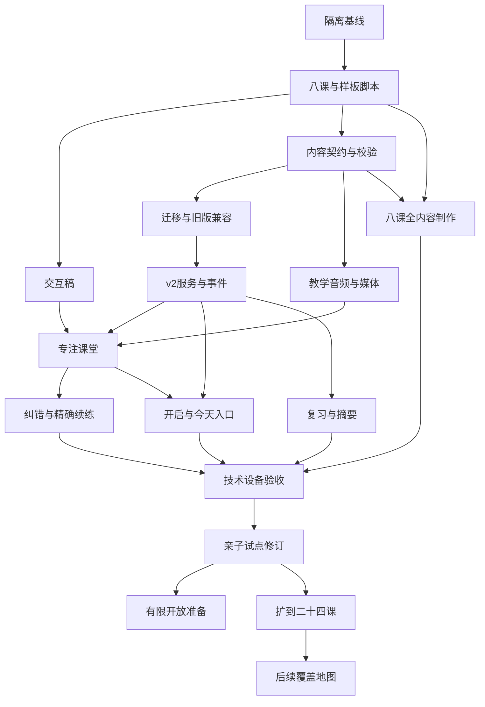

# 桃阅读英语自然拼读开发实施计划

日期：2026-10-19。依据：[69—产品研究与课程开发方案](69-英语自然拼读产品研究与课程开发方案-2026-10-19.md)。目标人群已确认：**5–7 岁、英语启蒙不多的孩子**。

本文件是可执行的开发计划，不是完成记录。产品代码、数据库迁移、正式素材与发布操作均尚未按本计划实施。任务中的新文件、接口、命令和状态是拟新增设计；现有文件另行标明。实施者必须按任务验收，不能把勾选任务、生成素材或单测通过写成教学有效性证明。

## 1. 最终要交付的产品

孩子进入桃阅读“今天”，看到一个清楚的英语入口；点击后由中文语音带领，听声音、理解少量词义、跟着拼、自己摆字母，再尝试读出词或一句图注。每次可随时暂停，下次回到正确位置。家长能够了解孩子练过什么、在哪些地方需要帮助、哪些口头读出有观察证据。

交付分三级：

| 里程碑 | 必须交付 | 此时可以怎么称呼 |
|---|---|---|
| M1：一课完整样板 | 一课教学、音频、词义、交互、纠错、续练和记录完整；有对应前置内容可用于内部验证 | 完整课堂样板；不是面向零基础孩子可直接独立使用的全部课程 |
| M2–M3：八课亲子试点 | 八课连贯内容、家长开启、初次引导、推荐、复习、阅读材料、真实家庭观察与修订 | 八课基础试点；不宣称完成后能自主阅读普通英文绘本 |
| M4–M5：有限开放与基础阶段 | 完成发布门槛后有限开放；再扩到约二十四课并重新验证 | 基础自然拼读阶段；仍不是完整覆盖英语拼写体系的课程 |

采用“声音—文字—意思”的学习主线，沿用桃阅读的家庭与孩子档案体系。**不重写全站，也不先制作大型游戏世界或课程管理后台。**

## 2. 实施基线与范围

### 2.1 已核对的现状

本轮 HEAD 为 `0c4f650`。工作区已有诗词、桌面与移动端等改动，应原样保留；实施时重新记录状态，禁止一并覆盖或提交。

| 当前资源 | 现有位置 | 保留/处理方式 |
|---|---|---|
| 八课草稿、七个对应、二十词、三十二题、六份文本 | `apps/server/src/modules/phonics/lessons.ts` | 保留为旧版本；从中筛词并重新编写正式候选版本 |
| 家长开启、attempt/response、暂停/恢复、summary | `apps/server/src/modules/phonics/routes.ts` | 保留 v1 行为，新增明确的 v2 契约；旧记录不转换成能力结论 |
| 三个既有模型 | `apps/server/prisma/schema.prisma` 中的 PhonicsEnrollment/Attempt/Response | 增量迁移；旧记录保持可读 |
| 儿童课堂 | `apps/web/src/pages/child/FamilyTrialPages.tsx` | 保留旧草稿兼容入口，新课堂进入独立目录 |
| 家长开启与次数 | `apps/web/src/pages/parent/FamilyImports.tsx` 的 ParentPhonics | 家长内容页保留入口，新设置与摘要拆成独立组件 |
| 儿童路由与预加载 | `apps/web/src/pages/child/V8App.tsx`；`apps/server/src/lib/routePreloads.ts` | 拆分自然拼读 chunk 时两处同步处理 |
| 故事播放器 | `apps/web/src/lib/audioPlayer.ts` | 参考停止、取消、手势恢复经验；新教学播放器播放已审定文件，不调用文本合成兜底 |
| 媒体权限与票据 | `apps/server/src/modules/media/routes.ts`、`access.ts` | 新增明确课程媒体分支，继续限制路径和会话；不泛化放开媒体目录 |

上一轮相关测试为十四项通过，属于 2026-10-19 的历史执行结果。本轮编写计划没有重跑产品测试；未来实施后需按新代码重新验证。

### 2.2 实施默认值

| 决策 | 本计划采用的工作基线 | 影响 |
|---|---|---|
| 首套口音 | 暂沿用现有 GB 草稿 | 可以开始接口与样板；正式批量录音前固定口音，切 US 则另出版本并重新审校 |
| 课堂时长 | 每次约 5–8 分钟，可拆成更短一段 | 没有倒计时、超时判错或欠课补课 |
| 陪伴模式 | 应用承担指令与发音示范，家长短时协助 | 家长不必会 IPA；无人观察的口头读出保留未知 |
| 评分 | 不做 ASR 自动评分、英语等级和掌握率 | 只记录明确行为和观察来源 |
| 制作方式 | 教学编辑定稿；录制或合成后逐条听审 | AI 可起草和辅助制作，不能自动批准上线 |
| 网络 | 首版在线使用，失败可恢复 | 不新增完整离线课包和离线同步系统 |
| 设备 | 先 Web 手机/平板/桌面，兼顾现有壳内 WebView | 不把浏览器模拟当成 iOS/Android 真机通过 |
| 年龄档案 | 沿用现有 3–5/6–8/9–12 档案枚举 | 5–7 岁是本课程定位，不改全站年龄枚举；起点由观察与家长选择决定 |

口音、审校人员和制作资源仍是正式内容生产的待落实项。本计划已经给出工程工作默认值，不需要因这些事项未定而停止类型、状态机、隔离测试和内部占位样板；未审定素材不得进入儿童正式课程。

## 3. 第一版功能清单

### 3.1 必须交付

1. 家长开启、暂停及选择声音游戏/字母音起点；沿用已有家长身份验证。
2. 今天页的一条推荐：继续上次、复习或认识新音，并有孩子听得懂的语音说明。
3. 少量口语词义预备；经批准的图片、动作与自然词音。
4. 字母音示范、音块合成、听词分音和点选字母拼摆。
5. 明确的独立尝试环节；求助后转为有帮助的练习，不补记为首次独立正确。
6. 每课实际可用的词卡/图注/短句，后期课程配小书；不强制每课一本故事。
7. 重听、提示、再教学、换一道简化任务；不扣分、不扣生命。
8. 任何步骤可停；刷新、返回、切换孩子和重复请求不丢失已确认记录。
9. 家长记录区分练习、自述、帮助与观察；统计全量次数，不用最近三十条长度冒充总量。
10. 版本化课程包、内容校验、素材听审台账、灰度与可执行回退。

### 3.2 后置内容

ASR 评分、自动口音诊断、学习障碍诊断、社交排行榜、积分商城、连续签到惩罚、开放式 AI 教师、任意上传教材自动生成课程、大型世界地图、完整离线同步均不进入首八课范围。

## 4. 页面与操作方案

保留“今天 / 找故事 / 我的”的现有主导航。自然拼读增加自己的学习页面，但不增加一套底部主导航。

| 页面/状态 | 主要内容 | 主要动作 | 退出/异常 |
|---|---|---|---|
| 今天英语卡 | “接着玩声音”“先复习两个声音”等一条建议 | 开始/继续 | 未开启时提供找家长的短语音说明，不展示内测技术警告给孩子读 |
| 家长设置 | 用途、短时陪伴说明、起点、开启/暂停 | 开启并选择起点 | 保存失败保留原状态，不把勾选先显示为已成功 |
| 首次操作引导 | 点击喇叭、重听、点选的三个短演示 | 跟着点一次/跳过 | 可重看；不考中文阅读能力 |
| 学习准备 | 当前版本、上一进度、当前步骤音频准备 | “开始听” | 音频没准备好时可重试，不启动题目 |
| 专注课堂 | 当前一个字母/词/句；少量进度标记 | 听、点选、拼摆、继续 | 统一暂停，避免多层抽屉或同时多个主按钮 |
| 帮助状态 | 重听、局部提示、完整示范、简化任务 | 一起练 | 保留首次结果与帮助记录 |
| 口头尝试 | 当前文字、需要帮助按钮 | 我试过了/一起读 | 孩子按钮不产生“口头正确”结论 |
| 阅读材料 | 单个词卡、图注或逐页小书；必要时展开词音 | 尝试读、再听、下一页 | 求助可以发生，但被记录为练习帮助 |
| 温和结束 | 练过的内容与可选再读 | 结束/再读一次 | 不自动跳进下一课；暂停也有正常结束体验 |
| 我的英语记录 | 练过内容、可重读材料 | 再读/继续 | 不展示同龄排名或自动英语等级 |
| 家长摘要/补记 | 全量次数、帮助目标、独立观察来源、下次建议 | 补记观察/调整起点 | 从已有家长认证入口进入，儿童不能替家长填写 |

课堂主要按钮优先采用约 56–64 CSS px 的触点，必要的紧凑控件不低于 48 CSS px，并在小屏实测间距；点击可完成全部核心交互，拖动是可选操作。中文操作音频与英文教学音频顺序播放。英文标注 `lang="en-GB"`，中文指令保留中文语言属性。状态提示用可访问名称和适当的 live 区域，避免每次音块高亮都让读屏重复打断。

### 4.1 一课的步骤模板

```text
准备 → 复习 → 词义预备 → 新音示范 → 带领合成
     → 听词分音/拼摆 → 自己尝试 → 读词/读句 → 结束
```

这是模板，**不是每课强行出现全部步骤**。L01 无读词前置时，只做声音与字形；复习课不强行新授；没有自然句子的课用词卡；需要两音合成时不强行三音。每课 manifest 明确哪些步骤存在、哪些必须完成一次尝试、哪些允许跳过。

状态机另含 `loading`、`awaiting_user_gesture`、`audio_error`、`submitting`、`save_error`、`paused` 和 `content_unavailable`。错误恢复返回当前步骤，不重新开始、不记孩子错误。

### 4.2 样板课固定为 L07：m

开发覆盖面最大，适合验证声音、词义、合成、分音与图注。内部演示必须说明已具备 s/a/t/p/i/n 前置；不能让零基础家庭直接从 L07 开始。

| 步骤 | 拟定素材与行为 | 验收重点 |
|---|---|---|
| 复习 | 两个已有字母音的听音点字 | 无需阅读中文题干 |
| 词义 | map 的实物/动作情境；mat 若尚不理解，则本次先教学，不用于独立新组合判断 | 词义困难与解码困难分开 |
| 示范 m | 显示 m，听 /m/，观察闭唇提示 | 不用字母名称、不用中文拟音替代 |
| 合成 map | m/a/p 依次点亮，再连续合成，再自然词音 | 时间点与声音一致，无叠播 |
| 分音拼摆 | 听 map，点声音标记和字母 m/a/p | 点选可完成；同一槽位可撤销重选 |
| 尝试 | 在词义已于较早活动理解的前提下，显示未在本次带读的 mat | 若刚听过答案词音或看过对应图，则标为练习；后续跨日再观察 |
| 图注 | 明确教过大写 S、人名 Sam 后尝试 `Sam sat.` | 自述、提示和家长观察分别记录 |
| 结束 | “今天练了 m，还试着拼了词。” | 无发音识别时不自动写“你读对了” |

### 4.3 “声音游戏”起点具体做什么

它是没有字母要求的短桥接，不是另一套长期前置课程。首版制作一个约两三分钟、可以分段或跳过的活动包：

1. 操作热身：中文语音示范听、重听和点选；先用熟悉的声音确认孩子知道怎样操作，不把这一步算成英语能力。
2. 词义热身：用动作或清楚情境介绍 sit、tap 等后续课程会用到的少量口语词；先听懂意思，不要求认字。
3. 声音合起来：仅对孩子已经理解的词，示范慢分音与自然词音，再做一两次口头合成游戏；可用图片帮助理解，记录为带领练习。
4. 进入 L01：卡住就重听或一起做，不把失败做成入学考试；家长可直接选择从字母音开始，后续仍可回到声音游戏。

不要求先背完二十六个字母，不把英语启蒙不足误判成分音能力差。词义预备仍分散在每课中，声音游戏不能代替后续词义教学。

## 5. 课程与内容制作任务

### 5.1 八课候选版

| 课 | 对应/目标 | 候选核心词与任务 | 内容修订要求 |
|---|---|---|---|
| L01 | s、a，两个独立小步骤 | 听音点字母、模仿、词义情境听说 | 无词语拼读；删除中文“啊/衣”式拟音教学依赖 |
| L02 | t；两音/三音合成 | at、sat | `sat. at.` 改为明确标注的词卡材料 |
| L03 | p；音序 | tap、pat | 示范词和后续尝试词分开；动作图义准确 |
| L04 | s/a/t/p 巩固 | 听词摆字、换序尝试 | 若用 Pat 作人名，先补大写与人名教学；首版优先不用该专名 |
| L05 | i；短元音对比 | it、sit、sip | 具体情境解释词义；不把相似中文音当标准 |
| L06 | n | in、pin、nap、pan | 重编原短文；m 作为未教干扰项应移除或给出明确教学理由 |
| L07 | m | mat、map、man、Sam，按课堂负担分配 | 大写 S 和专名教学明确；不要求一次记住全部词 |
| L08 | 累积复习 | 新顺序、少量保留组合、简短图注 | 记录跨任务与跨日尝试，不以四题分数决定掌握 |

核心候选共十五个：at/sat/pat/tap/it/sit/sip/in/pin/nap/pan/mat/map/man/Sam。tip/pit/tin/sap/nip 五个现有词作为待筛选的补充或保留池。**这是编辑候选清单，不是已批准词表，也不是背词指标。**

每个词指定一个准确的词义，不把多个义项堆进初学者页面。at/in/it 等通过短情境呈现，不要求抽象功能词与一张实物图一一对应。听说材料可以包含超前词，但必须标为听说，不能自动进入孩子独立拼读材料。

### 5.2 每课必须交付的内容包

1. 目标卡：新授、复习、前置、可用词形、大小写/标点与例外部分。
2. 教学脚本：逐屏中文指令、英文示范、孩子动作、卡住后的处理。
3. 词条：拼写、词义、音素/字母映射、首次可用课、示范/巩固/保留用途。
4. 音频：音素、分音、连续合成、自然词音；需要时增加句子/文本音频。
5. 图像：词义图、必要口型图与阅读情境图；图义/授权审查记录。
6. 任务：选择/拼摆/自述/观察等结构、服务端判断规则、提示序列和简化任务。
7. 阅读：词卡、图注或小书，逐词前置校验及英语编辑签认。
8. 家长说明：本课怎样陪、一分钟可选活动、记录能说明什么。
9. 审校台账：教学、英语/语音、素材权利与适龄检查结果。

### 5.3 音频与图像验收

音频按 `instruction_zh / phoneme / segment / blend / word / passage` 分类；每条资产保存 `assetId / sha256 / mime / durationMs / speakerId / accent / purpose / revision / sourceLicense / reviewStatus / reviewer / reviewedAt`。时间轴单位毫秒，业务时间戳统一说明为 Unix 秒，避免混用。

逐条检查目标声音、爆破音附加元音、持续音、音量、削波、截断、底噪、合成是否连贯、正常词音是否自然。合成慢读是单独审定素材，不用机械变速冒充教学示范。音频与音块的对齐必须核对。

首批若沿用七个对应、二十词、六份文本的规模，英文音频槽位的估算仍为 `7 + 20×3 + 6 = 73`，另有中文指令/反馈。最终以获批内容 manifest 清点，不按估算数量宣告完成，也不假设当前已经有这些文件。

图片可由 AI 辅助制作；若实施时使用本地个人图像技能，按届时技能要求执行。图片中不直接生成最终英文字形，课堂文字由界面渲染，减少拼写和字体错误。map/mat、tap/pat 必须图义明确；独立尝试前不主动显示泄露答案的图/词音。

## 6. 内容包与校验器

### 6.1 存放方式

先使用仓库内版本化内容文件；不先做可视化课程后台。建议新增：

```text
apps/server/src/modules/phonics/
  v2/contracts.ts          # 服务端输入 schema；公开类型从 shared 引入
  v2/courseRegistry.ts     # 课程版本、摘要、哈希与公开投影
  v2/service.ts            # 会话/事件/状态推进
  v2/review.ts             # 复习与推荐纯规则
  v2/routes.ts
  v2/media.ts              # 课程媒体授权辅助逻辑
  courses/taoread-phonics-gb-v1/
    manifest.json
    mappings.json
    words.json
    lessons.json
    readers.json
    assets.json
    reviews.json
apps/server/scripts/
  validate-phonics.mts
  phonics-release.mts
packages/shared/src/phonics.ts
```

所有新文件均为计划新增。`packages/shared/src/index.ts` 重新导出公开类型；现有 package 只导出根入口，不直接使用不存在的包子路径。

媒体文件放入现有媒体根的 `phonics/<versionId>/`，按批准哈希寻址；大二进制与本地原始录音不直接混入源码。课程包只引用资源 ID，运行时生成可访问 URL。

本计划中的稳定课程 ID 示例为 `taoread-phonics-gb`，首个版本 ID 为 `taoread-phonics-gb-v1`，后续扩课或改稿另出 versionId；不把 courseId 与 versionId 混用。内容哈希覆盖规范化教学正文、任务和资源哈希/用途，不含 contentHash 自身、审核签认、发布时间及运行时 URL；审核记录再绑定该内容哈希，避免循环计算。教学或素材变更导致相关批准失效；批准撤销则停止发布或撤回版本。

### 6.2 课程包最小契约

| 对象 | 关键字段与规则 |
|---|---|
| CourseManifest | schemaVersion、courseId、versionId、accent、contentHash、entryPlanKeys、lessonKeys、assetIds；发布后内容不可改写 |
| Mapping | mappingId、graphemeSpans、phonemeIds、positionCondition、accent；允许一个拼写多个对应，也允许多个字母映射多个音 |
| Word | wordId、text、sense、mappingSpans、introducedAt、requiredMappings、exceptionSpans、audioIds；字母范围完整覆盖且不重叠 |
| Lesson | lessonKey、order、prerequisites、newMappingIds、reviewMappingIds、stepPlan、requiredResolution、readerIds、parentGuide |
| TaskDefinition | taskKey、kind、skillTarget、stimulus、choices/tiles、serverJudge、hintPlan、easierTaskKey、evidencePolicy |
| Reader | readerId、kind、pages、wordMappings、requiredMappings、explicitExceptions、audioIds、imageIds |
| Asset | 哈希、用途、口音、授权与审校；被批准的具体 revision，不按同名新文件自动替换 |
| ReviewRecord | 内容哈希、审核范围、结论、审校角色与日期；内容变更使对应批准失效 |

`graphemeSpans` 支持不相邻的范围，避免将来 a_e 无法表达；x/qu 的音素数不固定为一；相邻辅音逐个对应。首八课只用到简单子集，校验器要有复杂映射的反例，不需要先开发复杂映射的全部儿童界面。

### 6.3 校验器必须拒绝的情况

- 缺前置、课程依赖成环、重复 ID、错误引用。
- 单词映射不完整、音素/字母数硬等同、例外词没有明确批准部分。
- 读物正文、标题、按钮中需要孩子独立解码的内容出现未授对应或未明确教过的例外。
- 专名/大写出现在显式教学之前；若为纯成人说明，必须标明用途并从儿童解码范围排除。
- 词形长度超出该课已安排的合成技能；不能仅因所有字母出现过就放行 CVCC/CCVC。
- 保留尝试词同时被当作本轮示范词，却仍标为独立迁移。
- 使用错误口音、错用途音频、缺失资源、哈希不符或未批准 revision。
- 答案不在可用选择中，字母拼摆题的允许答案不明确，重试任务与目标不一致。

开发模式可接受明确标注的 fixture，发布模式拒绝 fixture、未听审音频和缺失批准。报告输出每条问题的版本、课、词/任务/素材 ID 和定位，不只输出通过数量。

## 7. 数据模型与迁移方案

采用**旧表增量字段 + 两张新表**，避免一次新增完整课程关系库：课程正文在不可变内容包中；数据库保存发布索引和学习事件。

### 7.1 拟议变更

| 模型 | 新增字段/作用 | 旧数据处理 |
|---|---|---|
| PhonicsEnrollment（已有） | courseVersionId 可空、entryMode、entryLessonKey 可空、revision；保留 enabled | courseVersionId 为空时仍是旧草稿；不自动绑定正式课 |
| PhonicsAttempt（已有） | protocolVersion 默认 1、courseVersionId/lessonKey/lessonHash 可空、planKind/planJson/planHash/startRequestHash 可空、currentStepKey 可空、revision 默认 0、activeKey 可空唯一、closeReason 可空 | 旧记录一律 protocolVersion=1，保留原 lessonId、status 与 responses；v2 必填冻结计划与哈希 |
| PhonicsResponse（已有） | 首期不改语义 | 继续承载 v1 单次选择，不用于推算 v2 技能 |
| PhonicsCourseRelease（新增） | versionId、courseId、accent、contentHash、status、publishedAt、withdrawnAt、defaultForCourse 可空唯一 | 只索引已验证的内容包；不按版本名字猜测内容 |
| PhonicsLearningEvent（新增） | attemptId、clientEventId、requestHash、serverSequence、taskInstanceId/stepKey、kind、payloadJson、resultJson、actorRole、receivedAt、supersedesEventId 可空 | v2 使用追加事件，旧响应不伪造为新事件 |

新表与关联的删除策略应保证：家庭删除级联清理所属 attempt/event；公共课程版本与审核资料不随家庭删除。`supersedesEventId` 采用不会阻挡家庭整批删除的关系/校验方式，必须测试；不能引入自引用 RESTRICT 导致注销失败。

事件表唯一约束：`attemptId + clientEventId`、`attemptId + serverSequence`。新增索引覆盖按孩子查最近 attempt、按 attempt 顺序读事件、按课程版本查状态。原始事件不保存儿童录音、自由文本或客户端自报 familyId。

`activeKey` 仅 v2 设置为 `v2:<childId>`；started/paused 时保留，completed/cancelled 后清空。SQLite 的可空唯一键用于保证同一孩子最多一个活跃的 v2 计划，防止两个设备分别启动新授与复习。旧草稿均为空，不强行合并历史重复尝试。

沿用现有 `childId + clientAttemptId` 唯一约束，v2 另存规范化开始请求的哈希。相同开始 ID、相同内容返回原 attempt，即使其已结束；同 ID 换内容冲突，若撞到 v1 记录也返回冲突而不重新解释。不能因 completed 后 activeKey 已清空，就把网络重试变成一次新课。`planJson` 为服务端冻结的任务快照/不可变引用，不直接回传其判断答案。

### 7.2 迁移与兼容顺序

1. 在任务专用测试库应用增量迁移，验证旧记录、暂停记录和空库三类样本；不修改生产库做试验。
2. 先发布兼容基线：所有 v1 attempt 查询与变更限定 protocolVersion=1，v1 API 回包保持原结构。
3. 兼容基线验证后，才允许 v2 写入 protocolVersion=2 的 attempt。v2 的 lessonId 可存兼容标识，但判断内容以固定版本与 lessonHash 为准。
4. 旧 completed 只展示为旧草稿练习记录；不回填“已掌握”，不直接用于 v2 推荐。
5. 切换正式课程的孩子需完成版本绑定和起点选择；仅在旧页面开启 enabled 不等于已加入正式课程。
6. 应用回退目标必须至少包含 protocolVersion 过滤的兼容代码；不能回退到会把 v2 attempt 当成 v1 的旧服务。

生产迁移前获取一致性备份并核对恢复入口；初次部署只增表/增列，不删旧表。回退关闭功能与切换兼容应用，通常不需要破坏性回滚数据库。

## 8. API 契约与状态推进

新 API 使用独立前缀 `/api/phonics/v2`，旧 `/api/phonics/*` 与 `/api/children/:id/phonics/*` 保留兼容。请求/返回结构通过 shared 类型与服务端 schema 明确；表中接口均为计划新增。

| 接口 | 权限与用途 | 必须处理 |
|---|---|---|
| GET /api/phonics/v2/catalog | 已登录，返回本家庭可用的已发布版本摘要 | 不下发全课答案或草稿；灰度外返回可解释的不可用状态 |
| GET /api/phonics/v2/children/:childId/enrollment | 本家庭身份 | 返回 enabled、绑定版本、起点和 revision |
| PUT /api/phonics/v2/children/:childId/enrollment | 已验证家长 | expectedRevision；绑定可用版本；不能默默覆盖其他设备设置 |
| GET /api/phonics/v2/children/:childId/next | 本家庭身份 | 继续/复习/新授之一、理由、可用读物；返回原因码和短文案 |
| GET /api/phonics/v2/lessons/:versionId/:lessonKey | 有该版本访问权的家庭 | 公开教学投影，不含 serverJudge；媒体 URL 在授权后生成 |
| POST /api/phonics/v2/children/:childId/attempts | 本家庭且已开启 | clientAttemptId、versionId、planKind 与对应资源键；服务端生成并冻结计划；已有不同活跃计划时提示继续，不静默替换 |
| GET /api/phonics/v2/attempts/:attemptId | 所属家庭 | 当前步骤、revision、已确认事件摘要、可恢复状态 |
| POST /api/phonics/v2/attempts/:attemptId/events | 所属家庭 | clientEventId、expectedRevision、taskInstanceId、kind、payload；服务端判定与推进 |
| POST /api/phonics/v2/attempts/:attemptId/pause | 所属家庭 | clientEventId、expectedRevision；关闭学习或撤回内容后仍允许安全暂停，不新增学习结论 |
| POST /api/phonics/v2/attempts/:attemptId/resume | 所属家庭、课程可用 | clientEventId、expectedRevision；恢复正确步骤；撤回版本不能继续播放/答题 |
| POST /api/phonics/v2/attempts/:attemptId/finish | 所属家庭 | clientEventId、expectedRevision；必要步骤已产生允许的解决结果才 completed；不是要求全对 |
| POST /api/phonics/v2/attempts/:attemptId/cancel | 所属家庭；重置/换版需已验证家长 | clientEventId、expectedRevision；明确放弃或撤回后的安全关闭，记 cancelled/closeReason，释放 activeKey，不算完成 |
| POST /api/phonics/v2/attempts/:attemptId/observations | 已验证家长 | clientEventId、expectedRevision、taskInstanceId；对既有口头任务补记；更正追加事件、不覆盖原始记录 |
| GET /api/phonics/v2/children/:childId/summary | 本家庭身份 | 全量聚合 + 可分页明细；儿童投影简化，家长投影含观察来源 |
| GET /api/phonics/v2/children/:childId/readers | 本家庭且版本可用 | 返回可重读词卡/小书与所需对应；不混入普通英文故事作为可解码读物 |

家长观察在专门接口接收，内部追加到同一事件表。普通 events 接口拒绝 `caregiver_observation` 等越权事件，即使客户端伪造 actorRole 也无效。

暂停/恢复/完成/关闭由各自接口生成 `attempt_paused / attempt_resumed / attempt_finished / attempt_cancelled` 控制事件，沿用同一事件幂等键与事务；普通 events 入口不允许伪造控制事件。更换绑定版本时若同时关闭旧计划，需核对 enrollment 与 attempt 的两个 revision，原子更新并追加关闭事件。

开始请求与冻结计划按以下规则处理：

| planKind | 开始参数与服务端范围 | 与已有课堂的关系 |
|---|---|---|
| entry | entryPlanKey；仅允许已批准声音游戏 | 独立短计划，不计作完成 L01 |
| lesson | lessonKey；核对家长起点、必要前置/桥接与版本权限 | 包含该课实际步骤；重复练整课创建新 attempt |
| review | 不接收客户端自由编写的题目；服务端按当前规则选择少量目标 | 冻结目标、任务和规则版本；不重放整课，不修改旧 attempt |
| reread | readerId；核对该读物是否已开放 | 只冻结词卡/图注/小书的阅读步骤；不伪造为重新完成整课 |

`next` 返回 planKind、资源键/目标摘要与原因码；创建时服务端再次核对，若推荐已改变则提示刷新。每份计划保存 versionId、planHash、规则版本、所引用的课/读物/任务；lessonHash 仅单课计划使用。后续规则改变只影响新计划，暂停计划继续其冻结步骤。公开回包只提供当前允许的教学信息，不暴露 serverJudge 或尚未请求的答案提示。

### 8.1 事件与证据

| 事件 | 服务端处理 | 结果口径 |
|---|---|---|
| step_ack | 校验当前步骤允许继续，记录示范/词义接触 | 不产生学习正确结论 |
| stimulus_replayed | 记录题目声音重播 | 与答案提示分开，不默认当成答错 |
| hint_requested | 返回当前任务允许的提示，帮助等级单向增加 | 后续成功属于提示后练习 |
| response_submitted | 按任务判断选择或有序字母拼摆 | correct 可为 true/false；保存首次与后续轮次 |
| retry_requested | 为允许的再试创建新的 taskInstanceId | 不覆盖第一次错误或重新计首次独立成功 |
| self_read_reported | 保存“试过/需要帮助”等结构值 | correct=null；不能自动认定发音正确 |
| caregiver_observation | 从家长接口写入独立/帮助后/未观察等 | 标注来源是家长观察；不变成系统自动检测 |

v2 不复用旧 `correct: Boolean` 强行表示所有活动。服务端结果中口头自述和未观察允许 null；听选、拼摆、理解和口头观察分别对应不同目标。`finish=completed` 仅表示本次计划走完允许路径。

允许家长观察在一次课堂 completed 后追加；它不把已结束课堂重新打开。普通学习事件在 completed 后拒绝。家长更正必须引用同一孩子、同一 attempt 的可更正观察，并保留更正链。

### 8.2 幂等、并发与重试

同一 clientEventId、同一规范化请求体返回原结果，即使服务端 revision 已变；同 ID 换内容返回 409。先验证登录与所属家庭，再检查幂等键，随后检查当前版本和步骤；对已成功接受事件的网络重试仍返回原收据，不重新写入证据。重试保留原 expectedRevision，不自行换成新值。被撤回后的新事件拒绝，重放旧收据不重新授予播放权。

每次新变更在事务中核对 attempt.revision，追加事件并推进 revision/currentStepKey；任一步失败回滚。双设备/双标签提交时只接受一个有序变更；另一端收到 `ATTEMPT_CHANGED` 后拉取服务端状态，不盲目把旧答案提交到新题。

刷新前的未确认请求在页面会话内保留原 clientEventId；刷新后先拉取 attempt 确认服务器是否已经接收。首版不引入持久离线答题队列，也不把未确认动作显示为已保存。

提示使用由已接受事件推导；服务器不信任客户端传来的 score、correct、mastery、actorRole 或“未用提示”。应用不知道屏幕外是否有人提示，报告只能陈述应用记录的帮助与家长观察，不能宣称具有防作弊测评效力。

### 8.3 完成、暂停与撤回

每课 `requiredResolution` 定义必需任务，允许结果包括“尝试过/需要帮助/按课程允许跳过”，不要求每题正确。未走完时选择离开记为 paused；不能直接提交 completed 跳过全部任务。

enrollment 关闭后保留历史，禁止新的学习事件；允许安全暂停。课程撤回后返回可处理的 `COURSE_UNAVAILABLE`，关闭当前播放器，保留记录并建议换到可用内容。旧版本尝试不静默套用新版本题目或新答案。

版本切换或家长重置起点若涉及活跃计划，必须明确确认关闭旧计划，事务中记 cancelled、原因并释放 activeKey，再更新绑定；不能留下一个永远无法恢复又阻挡新课的 paused。撤回后也允许安全关闭；在同版本正常离开时默认暂停，不主动要求孩子放弃。已 completed/cancelled 的计划不重开；再练创建新计划。新版本保留旧版本明细，首版不自动合并不同版本的技能结论。

API 时间戳 v2 按 shared 约定使用 Unix 秒；旧 v1 的 ISO 日期回包保持兼容。音频对齐与播放进度始终使用显式 `*Ms` 字段。

## 9. 教学播放器与媒体接入

### 9.1 新播放器的边界

拟新增 `apps/web/src/pages/child/phonics/phonicsAudio.ts`，只接收已审定 `assetId + URL + timeline`，不接收任意文本生成请求。播放顺序为中文指令 → 英文目标素材，只有一个活动音源。

开始新音频、切步骤、切孩子、离开课堂和卸载组件都应停止旧音频，清理监听和定时器。使用播放会话代号忽略迟到的 ended/error/promise 回调。被浏览器手势限制阻止时显示“点一下开始听”，不能同时回退 Web Speech。

正常播放、重播、暂停、重试、加载超时和文件解码失败要区分；失败不触发步骤完成。教学音频不采用通用故事 TTS 或浏览器字母名称朗读兜底。进入课堂前停止已有故事朗读，返回故事时也停止课堂音源。

### 9.2 媒体路由的具体做法

沿用 `/api/media/phonics/<versionId>/<hash>.<ext>` 形式，在现有 `media/routes.ts` 添加**明确的 phonics 分支**，由 `v2/media.ts` 负责按 manifest 查资源、校验版本批准/撤回状态和家庭课程访问权。不存在于批准清单中的文件一律拒绝。

现有 `mediaUrl` 只接受 `/api/media/` 路径，可直接继续用于生成该路径的绑定票据；每次媒体请求仍校验会话活跃性和当前版本权限，不能只相信签名有效。当前票据分桶有效期为 30–60 分钟；本计划不依赖历史文档中更短的票据期限，也不全局修改它。

试点课程响应采用 `private, no-store`，保留 Range/206、正确 Content-Type、Content-Length 和路径 realpath 边界。票据过期时由已登录的课程接口刷新 URL，再在当前步骤重试一次；不把过期当成孩子失败。日志与验收材料不能保存完整票据 URL。

不将课程原始文件塞进 `tts-public/` 来绕过新分支，也不改动 `fam-import/`、`fam:` 与现有家庭 TTS 的隔离规则。试点先用当前媒体存储；是否迁移 CDN/R2 在实测体积和加载后再决定，不先假设容量充足或启动全账号扫描。

撤回保证新请求被拒绝、课堂发现撤回时停止；不能追回已经下载到用户设备的字节。正式验收需检查反向代理没有覆盖 no-store 造成长期缓存。

## 10. 推荐、复习、家长摘要

### 10.1 推荐顺序

1. 有可恢复且版本仍有效的未完成课堂：推荐继续。
2. 有近期需要帮助的目标：给一小段巩固，不机械重考同一道题。
3. 插入按规则到期的旧目标，再安排下一新授。
4. 当前表现仍吃力时只巩固；家长可调整起点，调整记录不自动变成技能证据。

试点可使用约次日、第三天、第七天再次接触的间隔；间隔、题量和最近帮助窗口放入版本化规则常量，作为可调参数，不表述为科学固定值。缺席不清零、不强制补齐。

首次新授按课程与家长起点生成计划；孩子可重读已开放材料。深链不能绕过版本访问权或把尚未准备的内容当正式课堂。改变起点时保存原因类别与操作者身份，必要前置由短桥接示范补充，不以生日或选择题满分作为唯一解锁条件。

### 10.2 摘要字段

服务端返回 `totalAttempts / completedAttempts / pausedAttempts / cancelledAttempts / completedLessonKeys / recentPractice / needsSupport / caregiverObserved / unobservedOralTasks / nextReason` 等清晰事实。recentPractice 分页，total 使用全量聚合；v1 草稿次数独立列出。按课程版本与 planKind 分组：声音游戏、短复习、重读次数不算成新授课数；同课多次完成也不冒充完成多课。

`totalAttempts` 在家长界面称“开始次数”；仅创建但没有学习动作的 attempt 不自动称作一次有效练习，更不等于学会。已练目标来自实际接受的任务事件，不从打开页面或课次序号推断。

儿童端只说“练过什么、下次可以玩什么”。家长端明确写“在应用中点选正确”“提示后完成”“家长观察到独立读出”“口头结果未观察”。不输出自动掌握率、读词量总分或同龄排名。

“我能读的小书”用已介绍对应、例外词和家长起点决定可用性；标为适合尝试，不承诺每本必能无帮助完成。普通英文听读书架继续独立存在。

## 11. 具体开发任务卡

下列每项必须交付对应证据。所有任务当前均为待执行。`新增`表示计划文件；`修改`表示已经存在的文件。实施允许在不扩大范围的前提下调整内部文件切分，但不可漏掉行为和验收。

| 门槛 | 对应任务 | 通过后才能进入 |
|---|---|---|
| M1 完整样板 | P00–P08 | 批量套用课堂与素材模板 |
| M2 八课试用就绪 | P09–P12，且 M1 保持通过 | 真实家庭接触已审定内容 |
| M3 试点修订完成 | P13 | 有限开放准备 |
| M4 有限开放就绪 | P14 | 获得实际发布指令后开放 |
| M5 基础阶段扩展 | P15 | 评估后续高级对应；P16 只形成覆盖规划 |

### P00：建立隔离基线

- 依赖：无。
- 工作：记录 HEAD、工作区、相关服务与端口；保存现有八课清点；明确只触及本计划写入范围；创建任务专用演示库与媒体目录。
- 文件：不修改产品；证据写 `output/phonics-v1/<run-id>/baseline.json`。
- 验收：没有复用用户实例；没有真实供应商调用；已记录现有测试和未验证项。功能测试使用独立端口，真实素材人工验收另设受控流程。

### P01：冻结首八课与样板课脚本

- 依赖：P00。
- 工作：按第 5 节筛词，确定每课实际步骤、前置、词义和示范/保留池；先定 L07 完整脚本与所需前置；补齐声音游戏桥接包；修订六份旧文本。
- 文件：新增 `docs/phonics/gb-v1-curriculum.md`、`docs/phonics/gb-v1-lesson-scripts.md`、`docs/phonics/gb-v1-asset-ledger.json`。
- 验收：八课均能说明“教什么/怎么教/卡住怎么办/最后读什么”；无未解释大写与例外；审校人确认内容后才批量制作正式音频。

### P02：完成课堂交互稿

- 依赖：P01 样板脚本。
- 工作：用现有桃阅读视觉规范画出首入、课堂、提示、暂停、失败、阅读与结束页面；展示 390 手机和 768 平板稿；中文语音与按钮位置对应。
- 文件：新增 `docs/phonics/ui-flow.md` 与该目录内编号图稿；正式组件在 P07 实现。
- 验收：不识中文的孩子可按语音知道下一动作；点击可完成拼摆；核心控件位置稳定；图稿明确正常与异常状态，不能只有漂亮首页。

### P03：内容 schema、公开类型和发布校验

- 依赖：P01。
- 工作：实现第 6 节数据结构、公开投影和校验器；先提供明确标注的测试课程与一课批准候选。
- 文件：新增 shared/phonics.ts、v2/contracts.ts、v2/courseRegistry.ts、courses 目录、validate-phonics.mts；修改 shared/index.ts。
- 验收：拒绝缺媒体、错版本、未授映射、未教大写、越级词形、重叠映射、未批素材；公开 DTO 不含 serverJudge；fixture 不能通过 release 模式。
- 测试：新增 `apps/server/test/phonicsV2Content.test.ts`，用真实反例验证防线，不只验证正常样例。

### P04：增量迁移与旧草稿兼容

- 依赖：P03。
- 工作：落实第 7 节模型；所有 v1 查询/变更过滤 protocolVersion=1；旧草稿开启不自动加入正式版。
- 文件：修改 schema.prisma、现有 phonics/routes.ts；新增具名 Prisma migration 与 `phonicsV2Migration.test.ts`。
- 验收：旧库、空库与暂停记录迁移均通过；家庭删除清理 v2 事件；旧 API 结构和行为保持；混合 v1/v2 数据不串课、不串记录；回退目标兼容。

### P05：v2 服务、事件与 API

- 依赖：P03、P04。
- 工作：实现第 8 节接口、四类冻结计划、服务端判断、activeKey、事务、revision、幂等与授权；事件输入严格按 kind 校验；实现换版/重置的安全关闭。
- 文件：新增 v2/service.ts、v2/routes.ts；修改 app.ts 注册路由、web/lib/api.ts 增加 v2 方法。
- 验收：两设备重复开始只得到一个活跃计划；完成后重放开始请求不产生新课；新授与复习不能同时占用活跃位；同幂等键换内容拒绝；旧 revision 不推进；儿童不能伪造家长观察；未完成路径不能直接 completed；撤回后可安全关闭。
- 测试：新增 `phonicsV2Routes.test.ts`、`phonicsV2Events.test.ts`，覆盖断网重试和并发。

### P06：样板音频、媒体与教学播放器

- 依赖：P01 样板内容、P03；媒体权限与 P05 接口对齐。
- 工作：制作/听审样板及前置音频，接入 manifest 媒体分支，开发单音源播放器。
- 文件：新增 v2/media.ts、child/phonics/phonicsAudio.ts；修改 media/routes.ts；正式素材进入媒体目录与 asset ledger。
- 验收：不叠播；切步骤/孩子/页面旧声音停止；迟到回调不推进；错误音频不降级字母名；过期票据刷新、Range、撤回权限均有测试；听审每个样板素材。
- 测试：新增 server `phonicsV2Media.test.ts`、web `phonicsAudio.test.ts`；现有 audioPlayer 相关测试继续通过。

### P07：一课专注课堂

- 依赖：P02、P05、P06。
- 工作：实现步骤渲染、中文指令、字母音、合成高亮、声音标记、字母拼摆、口头自述、图注和结束。
- 文件：新增 `apps/web/src/pages/child/phonics/PhonicsPage.tsx`、`PhonicsLesson.tsx`、`steps/`、`lessonMachine.ts`、`phonics.css`；修改 V8App.tsx 与服务端 routePreloads.ts。
- 验收：L07 全流程实际可操作，L01 无词步骤也能正确结束；不依赖 parent 的 IPA 能力；“读过”不产生自动正确；旧家庭书路由加载与阅读不受影响。
- 测试：新增 web `phonicsMachine.test.ts`，关键逻辑为纯状态转换；交互在后续 E2E 验证，不为 Node 单测盲目引入整套 UI 测试依赖。

### P08：纠错、暂停、刷新与恢复

- 依赖：P05、P07。
- 工作：完整实现重听→局部提示→带领示范→简化任务；保存准确步骤和已确认结果；统一返回列表、离开与切孩子行为。
- 文件：修改 v2/service.ts、课堂状态机与步骤组件。
- 验收：帮助后成功不覆盖首次结果；音频错误不记学习错误；保存失败不显示“已保存”；响应已落库但回包丢失时刷新不重复计数；上次帮助状态不被刷新清空。
- 里程碑 M1：一课全部素材审校、真实浏览器完整走通、暂停恢复与记录核对通过。未通过前不将样板包装成八课交付。

### P09：家长开启、初次引导与今天入口

- 依赖：P05、P07。
- 工作：正式版本绑定、声音游戏/字母音起点、中文操作教程；今天页显示单一推荐；暂停后可重新启用。
- 文件：新增 `pages/parent/phonics/ParentPhonicsSettings.tsx`；修改 FamilyImports.tsx、V8App.tsx；按需新增教程组件。
- 验收：家长页未开启时孩子无法启动正式版；旧 enabled 不等于正式入课；一次简单流程即可理解怎么开始；5–7 岁定位不要求修改全站年龄枚举；设置有 revision 冲突处理。

### P10：复习、摘要、小书与家长观察

- 依赖：P05；与 P07 事件定义一致。
- 工作：实现第 10 节确定规则；全量次数与分页；家长从已认证页面补记；重读读物保留求助与自述边界。
- 文件：新增 v2/review.ts、`ParentPhonicsSummary.tsx`、`PhonicsReaders.tsx`；新增 server `phonicsV2Review.test.ts`。
- 验收：未完成优先；需要帮助目标进入短巩固而非整课重放；重读不改旧 attempt；跨日间隔可解释；三十一条以上记录总数仍正确，次数按版本与计划种类分清；儿童请求观察接口被拒；观察更正留痕；普通英文故事不误标可解码。

### P11：制作并接入全部八课内容

- 依赖：P01、P03；样板反馈影响剩余制作。
- 工作：按第 5 节完成八课脚本、词义、音频、图片、读物和家长说明；逐条听审、逐课走查；冻结候选版本。
- 文件：courses/taoread-phonics-gb-v1、审核台账、媒体目录；不直接覆盖 lessons.ts 的旧草稿。
- 验收：八课引用资源全部存在、获批、哈希一致；六份原文本均有明确保留/重写/改词卡决定；每个独立尝试有清晰证据口径；不存在占位音/错图/无声步骤。

### P12：技术与设备验收

- 依赖：P08、P09、P10、P11。
- 工作：执行第 13 节矩阵、聚焦测试、全仓门禁与浏览器/真机验收；记录 source、构建包和访问入口。
- 文件：新增 `e2e/phonics-v2.spec.ts`、必要的视觉用例；证据写 output/phonics-v1/<run-id>/。
- 验收：新旧 API、家庭权限、音频状态、并发与恢复、家庭书阅读回归全部通过；没有把 fixture 音频的可播放当成正式英语发音通过；未测设备列明。

### P13：亲子可用性试点与修订

- 依赖：P12；亲子接触素材已完成教学/语音审校。
- 工作：建议六至十个家庭，覆盖 5/6/7 岁、不同基础与家长陪伴条件；使用八课正常起点；按第 13.5 节观察一至两周内的多次短练习并修订。
- 文件：新增 `docs/phonics/pilot-protocol.md`、去标识试点记录与修订清单；不记录真实姓名、原始童声或不必要个人信息。
- 验收：重大卡点逐项修复并回访；家长能解释记录含义；有跨日与未带读组合的观察；注明小样本不证明疗效，不能捏造量化提升。

### P14：有限开放与回退演练

- 依赖：P12、P13 修订项通过。
- 工作：准备发布包、全量内容校验收据、备份/恢复核对、灰度家庭范围、整版撤回与回退演练；实际发布须另有用户明确指令。首版不开发单课撤回清单。
- 文件：新增 phonics-release.mts、对应发布操作记录；config.ts 增加明确默认关闭的 rollout 配置。
- 验收：新请求不能访问撤回内容；历史记录保留；新入课指针可回退；旧 v1 不受影响；媒体缓存行为与声明一致；应用回退停留在兼容基线及之后。

### P15：扩展到二十四课基础阶段

- 依赖：八课试点结论与内容模板稳定；工程扩展复用，不重复制作课堂系统。
- 工作：按第 12 节加入剩余十六课、五个主要短元音的累积使用和更多小书；重新校验并试用代表课。
- 验收：十九个单字母对应的前置、词形与词义齐全；每个新模板/新交互有对应验证；不把旧版本记录改写成新增课程掌握；版本升级显式处理。

### P16：高级对应的后续规划

- 依赖：P15 及真实观察。
- 工作：排定剩余常见字母、相邻辅音、sh/ch/th、元音拼写、例外词、词形和多音节顺序；按批次另列内容与设备验收。
- 验收：只交付后续覆盖地图与资源需求，不在首期冒充已完成完整英语拼写体系课程。

## 12. 二十四课内容开发清单

前八课按第 5 节。后十六课候选如下，正式定稿由教学编辑结合试点调整；新增内容发布必须采用新版本，不能原地扩写已发布八课的历史含义。

| 课次 | 新授/复习 | 候选词例 | 阅读/练习方向 |
|---|---|---|---|
| 09 | d | dad、sad、dip | 动作/情绪词义与三个音合成 |
| 10 | g 的 /g/ | dig、gap、pig | 从完整声音分音，再点字母 |
| 11 | o 的 GB 短元音 | dog、dot、top、pot | 增加新短元音，避免英美混录 |
| 12 | 累积复习 | 以上已学组合 | 熟悉词义下的未带读词形尝试 |
| 13 | c 的 /k/ | cat、cap、can | 首次显式教 c 后才加入 cat |
| 14 | k 的 /k/ | kid、kit | 同一音可有不同拼写的初步接触 |
| 15 | e 的短元音 | pen、pet、net | 简单实物情境与分音 |
| 16 | 累积复习 | sit/sat、pen/pan 等 | 在实际读/拼中区别，不只背元音表 |
| 17 | u 的 GB 短元音 | sun、cup、mud | 五个主要短元音均有入口 |
| 18 | r | run、rat、red | 动作词与新句子素材 |
| 19 | h | hat、hop、hen | 可读词义和图注拓展 |
| 20 | 累积复习 | hop、run、dig 等 | 读出后配动作/理解活动 |
| 21 | b | bag、bed、bus | b/d 以形音帮助，不做限时镜像竞赛 |
| 22 | f | fan、fin、fun | 单字母 f 与后续 ff 分开教 |
| 23 | l | leg、lip、log | 留意末尾声音示范 |
| 24 | 阶段复习 | `Sam ran. Sam hid. Sam had fun.` 等审稿起点 | 用图画形成连贯情境；逐词审定，不直接当成成品 |

候选资源规模为六十至八十个不同用途的词条、十二至十六份词卡/短句/小书阅读材料；它是制作规划，不是儿童背词量。后期小书可采用四至六页、一页一行。以有意思、可理解、可解码为准，不为凑数写不自然的句子。

## 13. 验收矩阵与运行命令

### 13.1 必测行为

| 编号 | 场景 | 期望结果 |
|---|---|---|
| A01 | 家长未开启、旧草稿已开启但未绑定 v2 | v2 不能直接启动；解释下一步 |
| A02 | A 家庭请求 B 孩子/attempt/观察 | 不泄露资源，拒绝访问 |
| A03 | 儿童伪造家长观察或客户端 correct | 服务端拒绝越权字段/事件，不采信分数 |
| A04 | 同一开始请求重试、两设备同时开始 | 返回同一活跃 attempt，不生成两份有效记录 |
| A05 | 同事件重复、换 payload、陈旧 revision | 重放原结果/409；不多计、不跨题 |
| A06 | 答错→提示→成功→再试 | 首次与后续轮次保留，不改成首次独立正确 |
| A07 | 多个字母点选、撤销、拖动不可用 | 点击仍可正确拼摆；无意操作可修正 |
| A08 | 听不到、资源 404、解码失败、票据过期 | 可恢复；不跳题、不算错、不降级字母名 |
| A09 | 快速重听、切步骤、离开、切孩子 | 单音源；旧异步回调不推进新课堂 |
| A10 | 已落库但回包丢失，随后刷新 | 恢复服务端结果，不重复答题/加次数 |
| A11 | 帮助后刷新、在词义/示范/读物步骤退出 | 精确续回；帮助记录不清空 |
| A12 | 未走完直接 finish、走完但有错误 | 前者拒绝 completed；后者可结束，不等于掌握 |
| A13 | 自述读完、家长未观察/补记/更正 | null 与观察来源正确；更正可追溯 |
| A14 | 三十一条以上尝试、v1/v2 混合 | 全量聚合准确；草稿与正式证据分离 |
| A15 | 内容换版本或撤回，旧页面还打开 | 不套用新答案；下次请求处理不可用并停播放 |
| A16 | 课程媒体穿越、未知哈希、过期票据、会话注销 | 拒绝；不影响既有家庭媒体隔离 |
| A17 | 家庭注销/删除 | 学习事件随家庭清除，公共课程保留 |
| A18 | 拆分 phonics chunk，深链冷启动 | 页面能加载；家庭书、原阅读路由不回归 |
| A19 | 320/390 手机、768 平板、桌面、200% 缩放 | 核心操作完整；触点/文字/图像不遮挡 |
| A20 | iOS 首次播放手势、Android WebView、后台返回 | 状态可解释、无叠音；未验证设备明确列出 |
| A21 | 中文不会读、不会拖拽、减少动态/键盘操作 | 中文音频和点击路径可用；不只靠颜色传达 |
| A22 | 全部正式素材、复杂映射反例、未教大写/例外 | 机器防线与人工听审分别有证据 |
| A23 | 短复习、重读、声音游戏与重复整课 | 各有冻结计划；课数/次数区分；不改写旧课记录 |
| A24 | 撤回后关闭、带活跃计划换版、已结束开始请求重试 | 旧计划可安全关闭；显式绑定新版本；不产生幽灵活跃位或重复课堂 |

### 13.2 已有可用命令

以下命令从仓库根执行；内容实施过程中先跑相关检查，最终候选版再跑完整门槛。命令在当前 package.json 已存在。

```powershell
npm run test -w @taoread/server -- test/phonicsContent.test.ts test/importPhonics.test.ts
npm run verify
npm run build -w @taoread/web
```

E2E 使用任务空闲端口，先确认未占用；示例值不是对当前空闲状态的承诺：

```powershell
$env:TAO_E2E_ISOLATION='1'
$env:TAO_E2E_API_PORT='8798'
$env:TAO_E2E_WEB_PORT='5188'
npm run e2e -- e2e/phonics-v2.spec.ts
```

`phonics-v2.spec.ts` 要在 P12 创建后才能执行。现有 E2E 配置使用独立 SQLite 库、拒绝复用已有服务、并向 Vite 传递正确 API 端口；新增测试维持这些约束。新增教学资源测试 fixture 应自包含且可播放；正式逐条听审在另一次真实素材验收中进行，两种结果不能合并成一个“音频通过”。

若拆分路由或修改媒体分支，补跑已有家庭书/阅读器/媒体权限相关用例；发布候选执行完整 `npm run e2e`，涉及视觉变化的页面补齐实际浏览器截图。持续定位失败，不能用缩减测试范围把失败隐藏。

### 13.3 计划新增的内容命令

以下工具尚不存在，在 P03/P14 实现后才可使用：

```powershell
npx tsx apps/server/scripts/validate-phonics.mts --version taoread-phonics-gb-v1 --mode release --out output/phonics-v1/content-validation.json
npx tsx apps/server/scripts/phonics-release.mts inspect --version taoread-phonics-gb-v1
```

内容校验输出必须含 `complete:true`、实际扫描条目、全部素材哈希/审校检查、阻断列表和课程哈希；未完成扫描或存在阻断必须非零退出。inspect 只读展示已安装包、数据库发布状态、当前默认版本和可回退目标，不输出密钥、票据或家庭标识列表。

### 13.4 每次验收保存什么

`output/phonics-v1/<run-id>/` 保存基线、课程 manifest/hash、校验报告、测试命令与结果、编号截图、设备与浏览器信息、正式音频听审清单、已知限制、回退目标和回退验证。报告区分本地/隔离/正式素材/公网/真机/亲子观察，不能互相替代。

### 13.5 亲子试点的具体执行与出口

正式邀请前取得家长同意，并允许孩子随时停止；不以完成八课换奖励、催促或强迫。六至十个家庭优先覆盖三个年龄，不把一次小样本划成具有统计效力的年龄比较。首两次可由观察者在线或当面记录，之后由家长用简短结构表补记；不默认录制儿童音视频。

| 观察任务 | 记录什么 | 用来调整什么 |
|---|---|---|
| 家长开启并选择起点 | 是否需要开发者解释、是否误解“已开启/已掌握”、实际耗时 | 入口与说明 |
| 孩子首次进入、重听、点字母 | 是否听懂中文操作、误触、是否必须依赖拖动、成人额外指令次数 | 教程、按钮与任务密度 |
| 听词义、示范与拼摆 | 词义不懂、声音听不清、合成跟不上分别标记 | 词义图、录音、合成节奏 |
| 卡住、求助和中途离开 | 是否知道能求助/暂停，提示后能否继续，有无挫败或拒绝 | 纠错阶梯与长度 |
| 跨日继续与保留组合 | 是否回到正确步骤；分别记帮助、自述、家长独立观察，不临时先读出答案 | 续练与复习内容 |
| 家长看摘要、补记、更正 | 能否区分应用点选、家长观察与未观察；更正是否留痕 | 报告用词与数据口径 |

试点出口采用预先约定的产品阈值，**不是教学效果标准**：隐私/权限、记录错乱、无声/叠播、恢复到错题、带帮助冒充独立等严重问题必须清零；全部阻断问题修复后复测。至少 80% 的参与孩子在一次操作引导后，能在无需开发者现场指挥的情况下完成“开始、重听、点选、求助、暂停”核心操作；可有正常家长陪伴，但额外提示如实记录。达不到就调整交互并重新观察，不能删去困难样本凑达标。

家长对三类记录含义的误解必须逐项修订并回访；每位家庭报告实际使用次数、单次时长、退出位置与原因，不只给平均值。5–8 分钟仅为观察起点，孩子提前疲劳就缩短。读词观察用于发现内容与教学问题，不设置“读对多少才允许上线”的伪学习增益门槛，也不据此宣称有效率或提分。

## 14. 发布与回退方案

### 14.1 三层开关

- 总开关：配置中的 `TAO_PHONICS_ROLLOUT=off|pilot|all`，默认 off。
- 试点范围：pilot 时从运行时配置读取受控家庭范围，不写进公开课程 manifest；日志不输出完整名单。
- 家长开关：Enrollment.enabled 与绑定版本；即使在试点范围内也需家长主动开启。

配置在现有 config.ts 解析与校验，避免散落环境变量判断。内容发布状态与这些开关共同生效，不允许客户端自行打开。

关闭 rollout、家长暂停或版本撤回时，禁止新的学习与课程媒体访问；所属家庭仍可查看历史并安全暂停/关闭已有计划。已验证家长可对既有口头任务补记或更正观察；这类操作不重新开放课程，也不生成新教学步骤。

### 14.2 发布包条件

技术验收、全部内容/音频审核、亲子试点修订、备份/恢复入口与兼容回退目标均有明确结果后，才准备有限开放。实际提交、推送、部署和开放仍需用户明确指令，本计划本身不执行这些动作。

发布脚本先确认课程包哈希和数据库当前指针与预期一致；事务中注册不可变版本并切换 `defaultForCourse`，只有一行可作为同一 course 的新入课默认。已绑定孩子保留版本，不随默认指针静默升级。

状态可采用 draft/reviewed/published/withdrawn；发布脚本必须核对具体内容哈希的批准记录，不能只相信手改 status。允许内部验证的 draft 仅用于隔离/明确内部入口，普通儿童 catalog 不返回。

### 14.3 故障处理

| 故障 | 处置 | 验证 |
|---|---|---|
| 一课音频/文本有问题 | 首版撤回整个受影响版本；修订内容出新版本并重新审校 | 深链与媒体不绕过撤回；历史记录仍可查看 |
| 整个课程版本有问题 | 标记 withdrawn，将新入课默认指针回到先前已批准版本或空值 | 新家庭不进入坏版本；已绑定坏版本暂停，不静默替换其题目 |
| 新课堂前端故障 | 关闭 rollout，回退到包含 v1/v2 兼容过滤的应用版本 | 老草稿、家庭书、普通阅读可用；v2 数据保留 |
| 数据库迁移问题 | 停止后续开放，在隔离副本恢复验证；按已备份流程处理 | 不在生产试错，不删除用户新记录来回避冲突 |

首版明确只承诺整版撤回。以后若确需单课控制，再单独设计带操作者、时间和变更日志的发布清单；不改写原课程正文哈希。撤回后的重开须再次校验，不能通过换文件保留旧哈希绕过审核。

## 15. 依赖顺序与资源安排



内容和工程可以在明确接口与样板后分工推进；这只是工作分工建议，不授权自动创建或调度子代理。迁移、媒体权限与发布指针变更应有一个明确负责人，避免多个执行者同时修改。

| 角色 | 负责交付 | 可兼任/不可省略 |
|---|---|---|
| 产品负责人 | 范围、口音、样板体验、试点目标和开放范围 | 可以兼内容协调；不能由工程默认值代替正式内容决定 |
| 教学内容负责人 | 课程顺序、词义、分音合成、前置、补救与阅读材料 | 可由具备能力的同一人兼英语编辑，但必须明确责任 |
| 英语语音审校 | 录音/合成逐条检查、口音与时间轴 | 不能只靠生成模型或 ASR 自评替代 |
| 工程负责人 | 契约、数据、播放器、界面、权限与自动化验收 | 可一人全栈顺序执行 |
| 试点协调/家长 | 组织短时观察、确认困难、反馈报告理解 | 少量家庭可做可用性研究，不做疗效宣传 |

粗估：在一名熟悉现有仓库的全栈开发者持续投入、内容及时提供的前提下，首八课从开发到试点修订及有限开放准备约需 **18–30 个工程工作日**；教学定稿、制作和听审建议另预留约 **10–20 个内容工作日**，可与工程部分重叠；亲子观察约 **1–2 个自然周**。这是排期估算，不是承诺工期，未计算等待审校人员、口音变更或设备取得的时间。

| 工程排期组 | 涵盖任务与产出 | 预留工程工作日 |
|---|---|---|
| 基础与契约 | P00–P03，隔离、脚本协作、交互稿与内容校验 | 3–5 |
| 数据与服务 | P04–P05，兼容迁移、冻结计划、事件与权限 | 4–6 |
| 样板课堂 | P06–P08，媒体接入、播放器、课堂和续练；达到 M1 | 5–8 |
| 家庭学习闭环 | P09–P10，入课、推荐、复习、摘要与重读 | 3–5 |
| 八课接入与技术验收 | P11–P12 中的工程接入及修复；不含内容制作人日 | 2–4 |
| 试点修订与开放准备 | P13–P14 中的工程配合；不含等待观察时间 | 1–2 |

以上相加为 18–30 个工程工作日；内容人日与自然周不能直接相加成一个承诺日期。P00–P03 完成后用实际素材工作量和样板难点重估一次；试点发现新的教学流程问题时重估后续，不压缩听审和孩子观察去硬赶原估算。

稳定框架后扩到二十四课，主要增加内容生产、审校、匹配读物与代表课验证；不应重新开发整套课堂。届时按八课真实制作吞吐量重新估算，不沿用首期粗估直接承诺日期。

## 16. 开发结束的判定与交接格式

一个任务完成需要同时说明：改了什么、为什么、跑了哪些检查、结果、未验证项、内容版本和回退方式。工程完成、素材获批、浏览器可用、真机可用和亲子试点分别标记，不能合成一句“全部完成”。

交接至少包含：

```text
任务编号与状态：
涉及文件/迁移：
课程版本与 contentHash：
内容与音频批准记录：
自动检查命令与结果：
浏览器/真机验证与截图：
亲子观察与修订结果（如适用）：
剩余问题及影响：
回退目标与已验证操作：
```

**开始执行时先做 P00–P03，随后落地迁移兼容和一课课堂。首个可评审成果是 L07 完整样板及其前置材料；首个可面向零基础家庭试用的成果是通过技术与内容验收的八课连贯课程。**
