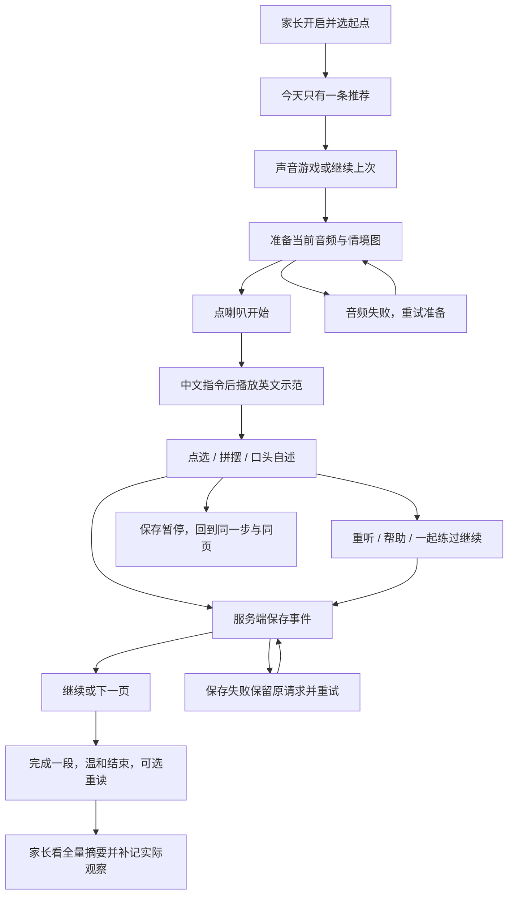

# 自然拼读交互与验收稿

2026-10-19。沿用暖纸、贴纸和现有导航。课堂主触点 56–68 CSS px，字母 64 px 起；无必须拖动操作；英文标注 en-GB，中文指令独立录音，应用不使用 Web Speech 自动补音。

## 正常与异常状态

已实现课堂稿（协议测试数据，截图中的字母由真实组件渲染）：[390 手机](screens/classroom-390.png)、[768 平板](screens/classroom-768.png)。

| 状态 | 展示与动作 | 保存/音频约束 |
|---|---|---|
| 首入 | 声音游戏说明，一次一个操作；孩子可点喇叭 | 家长显式开启，无字母入学考试 |
| 准备 | 正在准备声音，允许回到今天 | 素材未准备好不开放作答 |
| 听音 | 大字母或当前词；喇叭位置固定 | 一条音源，中文→英文；新播放停止旧播放 |
| 点选 | 少量大字母按钮 | 请求在途禁用，服务端核对 |
| 拼摆 | 上方已摆字母可逐个撤回；下方可选字母 | 听完整词后点选，不预显示正确拼写 |
| 错误 | “再听一遍，换个摆法试试” | 保留首次错误；重试有新的题目实例号 |
| 提示 | “帮我一下”→“听示范，一起练” | 按阶段开放已审定提示；仍是有帮助的练习 |
| 口头 | 我试着读过了 / 想一起读 | 不显示“发音正确”；自述 correct=null |
| 阅读 | 当前一页、独立页号、自述后下一页 | 每页独立实例；服务端保存页号 |
| 保存失败 | 明确“还没有确认”，重新保存 | 保留事件编号和原 payload；不凭客户端加进度 |
| 陈旧进度 | 读取最新服务端状态 | 被拒请求不伪造成功，不重放到新题 |
| 暂停 | 进度仍在，接着玩 | 同一步/同页/提示与尝试次数均保留 |
| 素材撤回 | 休息一下，请家长查看 | 无新学习/媒体授权；可安全暂停和关闭 |
| 结束 | 今天试过了，也练过了 | 不自动跳下一课，不用奖励强迫继续 |
| 家长区 | 版本、声音游戏/字母音起点、暂停、摘要、补记更正 | 角色由服务端验证；改起点需明确处理原活动 |

正式交互在 `PhonicsPage.tsx` 实现。390 与 768 宽度实际截图由独立 `e2e/phonics.config.ts` 的验收保存到 output/phonics-v1/20261019/browser；其中合成短测试音和 1px 图仅检验加载、解码、协议与布局，不证明英语教学或正式配图质量。图稿审阅应同时检查正常课堂、帮助、暂停、失败、阅读和结束，不只审首页。

尚需正式素材后的检查：中文语音与屏幕主按钮逐一对应，结束/退出/恢复的中文说明、纯音音块对齐、实物图片适义、真机手势策略与音频中断、儿童是否无需读中文就能理解操作。浏览器模拟通过不能代替这些结果。
